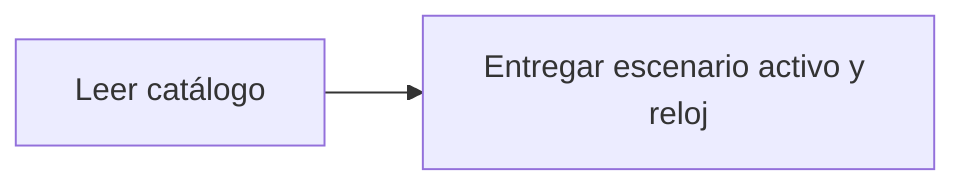

# Feature Specification: SF-06.2 — Listado del catálogo

**Created**: 2026-10-19  
**Status**: draft  
**Flow**: [F-06 Escenarios y reloj de desarrollo](42-f-06-escenarios-y-reloj-de-desarrollo.md) (subflujo)  
**Related Specs**: [F-06 Escenarios y reloj de desarrollo](42-f-06-escenarios-y-reloj-de-desarrollo.md), [SF-06.1 Verificación de los flags de desarrollo](43-sf-06-1-verificacion-de-los-flags-de-desarrollo.md), [SF-06.3 Activación del escenario y reinicio del reloj](45-sf-06-3-activacion-del-escenario-y-reinicio-del-reloj.md)  
**Origen (DEC/H)**: DEC-04, DEC-31  
**Pruebas (TC)**: TC-01, TC-02, TC-03, TC-57, TC-58, TC-59, TC-60  
**Contratos externos**: §1.1 (fila 6)  

## Reglas de este documento

> Este spec es FUNCIONAL, no técnico: describe QUÉ hace el sistema, no CÓMO. Usa lenguaje de negocio; las siete herramientas externas se nombran por su función y se referencian por la sección de `sdd/reports/EXTERNAL_CONTRACTS.md`. Los casos borde se DOCUMENTAN; los valores de configuración se citan por el nombre del parámetro (NFR-012) con su valor por defecto entre paréntesis.

**Alcance**: Devuelve el escenario activo, el reloj vigente y el catálogo con título, descripción, visibilidad en el selector y pruebas relacionadas.

## User Scenarios & Testing *(mandatory)*

### User Story 1 - El selector sabe qué ofrecer (Priority: P1)

Como evaluador, quiero ver los escenarios disponibles con su descripción para elegir el que quiero demostrar.

**Why this priority**: Los siete ejemplos del enunciado son la fuente de verdad.

**Independent Test**: Se prueba comparando el catálogo con los siete ejemplos y las variantes.

**Acceptance Scenarios**:

1. **Scenario**: Catálogo completo
   - **Given** los funciones de desarrollo están habilitados
   - **When** se lista
   - **Then** aparecen los escenarios con `ui` verdadero y las variantes de prueba con `ui` falso

2. **Scenario**: Datos ficticios
   - **Given** cualquier escenario
   - **When** se inspecciona
   - **Then** los datos personales son claramente ficticios

3. **Scenario**: Catálogo con variantes (TC-01, TC-02, TC-03)
   - **Given** el catálogo con BASE_TC01, SOLO_DEGRADADO_TC02 (solo E-1012) y CONFLICTO_TC03
   - **When** se lista
   - **Then** BASE_TC01 y SOLO_DEGRADADO_TC02 son visibles y todos traen datos ficticios de Ana Prueba

---

### Edge Cases

> Solo se documentan; los marcados MUST-IMPLEMENT se vuelven requisito FR-XXX y se implementan con TDD, los DEFERRED quedan para una iteración posterior.

#### Invalid Data
- [MUST-IMPLEMENT] Cuando una variante no es visible → igual puede activarse por identificador (FR-101)

#### Security & Permissions
- [MUST-IMPLEMENT] Cuando se buscan datos personales reales en el catálogo → no existen (FR-101)

## Requirements *(mandatory)*

### Functional Requirements

- **FR-100**: El sistema DEBE definir interfaces para las siete herramientas externas con los contratos del enunciado y simulaciones intercambiables por un adaptador real cuando exista su documentación.
- **FR-101**: La fuente de verdad es el universo del enunciado: los escenarios de prueba reproducen los siete ejemplos (con datos personales claramente ficticios) y las variantes de prueba; los tipos de evento son retraso, cambio de puerta y estado; un test verifica que los datos ficticios no aparecen en registros ni en el historial.
- **FR-102**: Las enumeraciones abiertas DEBEN tolerarse: un valor nuevo degrada a caso humano.
- **FR-103**: Las simulaciones DEBEN respetar los metadatos de lectura y los errores de duplicado, indisponibilidad y validación.
- **FR-111**: El front de prueba DEBE tener el aspecto y la sensación del centro de ayuda de una aerolínea (sin logos ni marcas), verificable con la lista de componentes y la lista de verificación de tokens de `sdd/reports/DESIGN_CONTRACT.md`: selector de escenario, contexto, alerta, reglas cumplidas y no cumplidas, opción propuesta, vía de reembolso, avisos de estimación, hora límite y «sujeto a disponibilidad», y botones de acción.

### Key Entities *(include if feature involves data)*

- **Escenario de desarrollo**: Conjunto de datos simulados de las siete herramientas, activable solo en desarrollo. Campos principales:
  - `scenario_id`: texto
  - `booking_id`: texto
  - `title`: texto en español
  - `description`: texto
  - `ui`: booleano (visible en el selector)
  - `tests`: lista de TC-nn

## Architectural Attributes *(mandatory)*

| Attribute | Value |
|-----------|-------|
| **Interaction type** | sync-http |
| **Consistency** | strong |
| **Workflow** | single-step |
| **Read pattern** | simple |
| **Auditability** | full-history |
| **Domain complexity** | medium |
| **Modularity** | bounded-context |
| **Deployment** | monolith |

## Success Criteria *(mandatory)*

### Measurable Outcomes

- **SC-001**: Los siete ejemplos del enunciado figuran en el catálogo.
- **SC-002**: Una búsqueda de datos personales del enunciado original no encuentra ninguno.

## Traceability *(mandatory after implementation)*

> Las columnas de archivo y línea se registran en la verificación de trazabilidad posterior a la implementación; hoy cada criterio queda enlazado a su origen y a las pruebas que lo verifican.

| Criterion | Origen | Prueba (TC) | Source File | Line(s) |
|-----------|--------|-------------|-------------|---------|
| FR-100 | DEC-04 | sin TC en el mapa §6 de REQUERIMIENTOS_V1 | se registra en la verificación posterior a la implementación | se registra en la verificación posterior a la implementación |
| FR-101 | DEC-04 | sin TC en el mapa §6 de REQUERIMIENTOS_V1 | se registra en la verificación posterior a la implementación | se registra en la verificación posterior a la implementación |
| FR-102 | DEC-31 | sin TC en el mapa §6 de REQUERIMIENTOS_V1 | se registra en la verificación posterior a la implementación | se registra en la verificación posterior a la implementación |
| FR-103 | DEC-04 | sin TC en el mapa §6 de REQUERIMIENTOS_V1 | se registra en la verificación posterior a la implementación | se registra en la verificación posterior a la implementación |
| FR-111 | DEC-04 | sin TC en el mapa §6 de REQUERIMIENTOS_V1 | se registra en la verificación posterior a la implementación | se registra en la verificación posterior a la implementación |
| SC-001 | criterio medible de este spec | TC-01, TC-02, TC-03, TC-57, TC-58, TC-59, TC-60 | se registra en la verificación posterior a la implementación | se registra en la verificación posterior a la implementación |
| SC-002 | criterio medible de este spec | TC-01, TC-02, TC-03, TC-57, TC-58, TC-59, TC-60 | se registra en la verificación posterior a la implementación | se registra en la verificación posterior a la implementación |

## Business Process (BPM View)

```
Leer catálogo → Entregar escenario activo y reloj
```



