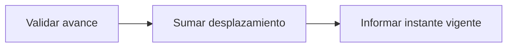

# Feature Specification: SF-06.4 — Avance del reloj de escenario

**Created**: 2026-10-19  
**Status**: draft  
**Flow**: [F-06 Escenarios y reloj de desarrollo](42-f-06-escenarios-y-reloj-de-desarrollo.md) (subflujo)  
**Related Specs**: [F-06 Escenarios y reloj de desarrollo](42-f-06-escenarios-y-reloj-de-desarrollo.md), [SF-06.3 Activación del escenario y reinicio del reloj](45-sf-06-3-activacion-del-escenario-y-reinicio-del-reloj.md)  
**Origen (DEC/H)**: DEC-02, DEC-10, DEC-19  
**Pruebas (TC)**: TC-08, TC-27  
**Contratos externos**: §1.1 (fila 8), §2.4 (`CLOCK_MODE`)  
**Deuda conocida de A1 (no se resuelve aquí)**: DEBT-A1-02  

## Reglas de este documento

> Este spec es FUNCIONAL, no técnico: describe QUÉ hace el sistema, no CÓMO. Usa lenguaje de negocio; las siete herramientas externas se nombran por su función y se referencian por la sección de `sdd/reports/EXTERNAL_CONTRACTS.md`. Los casos borde se DOCUMENTAN; los valores de configuración se citan por el nombre del parámetro (NFR-012) con su valor por defecto entre paréntesis.

**Alcance**: Suma segundos al desplazamiento del reloj de escenario para demostrar vigencias y vencimientos sin esperar.

## User Scenarios & Testing *(mandatory)*

### User Story 1 - Se demuestra el vencimiento en segundos (Priority: P1)

Como evaluador, quiero avanzar el reloj 120 segundos para ver cómo vence la hora límite y cómo se refresca la opción al aceptar.

**Why this priority**: Las opciones duran 120 segundos y la demostración no puede esperar.

**Independent Test**: Se prueba avanzando 119 y 120 segundos.

**Acceptance Scenarios**:

1. **Scenario**: Avance válido
   - **Given** el escenario activo y modo de reloj de escenario
   - **When** se avanzan 120 segundos
   - **Then** devuelve el nuevo instante y el desplazamiento

2. **Scenario**: Avance inválido
   - **Given** el valor es negativo o mayor que 86400
   - **When** se avanza
   - **Then** rechazo por validación

3. **Scenario**: Avance de 120 s (TC-08, TC-27)
   - **Given** el escenario base con reloj 11:02:35Z
   - **When** se avanzan 120 s
   - **Then** el reloj marca 11:04:35Z y las opciones quedan vencidas

---

### Edge Cases

> Solo se documentan; los marcados MUST-IMPLEMENT se vuelven requisito FR-XXX y se implementan con TDD, los DEFERRED quedan para una iteración posterior.

#### Invalid Data
- [MUST-IMPLEMENT] Cuando el modo del reloj no es de escenario → responde como desactivado (FR-017)
- [MUST-IMPLEMENT] Cuando el reloj avanza → los simulados no caducan solos fuera de este avance (FR-071)

## Requirements *(mandatory)*

### Functional Requirements

- **FR-017**: El sistema DEBE usar siempre el dato más reciente y respetar la vigencia: las opciones vencen en el instante de su lectura más su vigencia en segundos (en el instante exacto ya están vencidas; sin vigencia declarada el conjunto se considera vencido). Los eventos no vencen por sí mismos (`EVENT_MAX_AGE_SECONDS`, por defecto sin límite). Al vencer se re-consulta una sola vez por acción, sin bucles.
- **FR-071**: La vista DEBE mostrar la hora límite (el mínimo de los vencimientos de las opciones mostradas) en UTC y como cuenta regresiva; pasada esa hora, «sujeto a disponibilidad».

### Non-Functional and Documentation Requirements

- **NFR-001**: Determinismo: con el mismo reloj inyectado y las mismas lecturas el sistema DEBE producir la misma huella de decisión y los mismos mensajes, sin inteligencia artificial ni modelos en ejecución y con costo por interacción en modelos igual a cero.

### Key Entities *(include if feature involves data)*

- **Reloj de escenario**: Reloj controlado de desarrollo: instante base del escenario más un desplazamiento que solo avanza a pedido. Campos principales:
  - `mode`: scenario | system
  - `now`: marca de tiempo UTC
  - `offset_seconds`: entero ≥ 0
  - `advance_seconds`: entero entre 0 y 86400 (entrada)

## Architectural Attributes *(mandatory)*

| Attribute | Value |
|-----------|-------|
| **Interaction type** | sync-http |
| **Consistency** | strong |
| **Workflow** | single-step |
| **Read pattern** | simple |
| **Auditability** | full-history |
| **Domain complexity** | medium |
| **Modularity** | bounded-context |
| **Deployment** | monolith |

## Success Criteria *(mandatory)*

### Measurable Outcomes

- **SC-001**: El desplazamiento solo cambia con la orden explícita de avance.

## Traceability *(mandatory after implementation)*

> Las columnas de archivo y línea se registran en la verificación de trazabilidad posterior a la implementación; hoy cada criterio queda enlazado a su origen y a las pruebas que lo verifican.

| Criterion | Origen | Prueba (TC) | Source File | Line(s) |
|-----------|--------|-------------|-------------|---------|
| FR-017 | DEC-10 | TC-27 | se registra en la verificación posterior a la implementación | se registra en la verificación posterior a la implementación |
| FR-071 | DEC-19 | sin TC en el mapa §6 de REQUERIMIENTOS_V1 | se registra en la verificación posterior a la implementación | se registra en la verificación posterior a la implementación |
| NFR-001 | DEC-02 | sin TC en el mapa §6 de REQUERIMIENTOS_V1 | se registra en la verificación posterior a la implementación | se registra en la verificación posterior a la implementación |
| SC-001 | criterio medible de este spec | TC-08, TC-27 | se registra en la verificación posterior a la implementación | se registra en la verificación posterior a la implementación |

## Business Process (BPM View)

```
Validar avance → Sumar desplazamiento → Informar instante vigente
```



