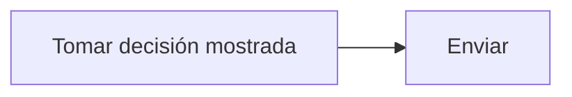

# Feature Specification: FE-04.3 — Envío con la decisión

**Created**: 2026-10-19  
**Status**: draft  
**Flow**: [FE-04 Hablar con una persona (front)](97-fe-04-hablar-con-una-persona-front.md) (subflujo)  
**Related Specs**: [FE-04 Hablar con una persona (front)](97-fe-04-hablar-con-una-persona-front.md), [FE-04.2 Clic único con motivo conocido](99-fe-04-2-clic-unico-con-motivo-conocido.md), [FE-04.4 Resultado y errores](101-fe-04-4-resultado-y-errores.md)  
**Origen (DEC/H)**: DEC-02, DEC-15, DEC-23, DEC-29  
**Pruebas (TC)**: TC-17  
**Contratos externos**: §1.1 (fila 4: cuerpo)  

## Reglas de este documento

> Este spec es FUNCIONAL, no técnico: describe QUÉ hace el sistema, no CÓMO. Usa lenguaje de negocio; las siete herramientas externas se nombran por su función y se referencian por la sección de `sdd/reports/EXTERNAL_CONTRACTS.md`. Los casos borde se DOCUMENTAN; los valores de configuración se citan por el nombre del parámetro (NFR-012) con su valor por defecto entre paréntesis.

**Alcance**: Envía el motivo con la decisión que el pasajero vio para que la evidencia salga de la decisión guardada.

## User Scenarios & Testing *(mandatory)*

### User Story 1 - El caso refleja lo que se vio (Priority: P1)

Como pasajero, quiero que la persona vea lo mismo que yo.

**Why this priority**: Evita diferencias entre pantalla y caso.

**Independent Test**: Se prueba comparando la decisión enviada y la mostrada.

**Acceptance Scenarios**:

1. **Scenario**: Con decisión
   - **Given** la vista tiene una decisión
   - **When** se envía
   - **Then** la petición lleva la decisión mostrada

2. **Scenario**: Decisión enviada (TC-17)
   - **Given** BASE_TC01 con compensación elegible (R4) y la decisión mostrada de ABC123
   - **When** se elige «Tengo una consulta sobre compensaciones»
   - **Then** la petición lleva esa decisión y fija la solicitud de compensación, sin montos

---

### Edge Cases

> Solo se documentan; los marcados MUST-IMPLEMENT se vuelven requisito FR-XXX y se implementan con TDD, los DEFERRED quedan para una iteración posterior.

#### Security & Permissions
- [MUST-IMPLEMENT] Cuando se envía → sin texto libre ni campos adicionales (FR-059)

## Requirements *(mandatory)*

### Functional Requirements

- **FR-VIS-001**: La interfaz DEBE aplicar estilos coherentes con la identidad visual definida: CSS propio alineado con `sdd/reports/DESIGN_CONTRACT.md` (tokens de color, tipografía, espaciado y radios), sin logos ni marcas de terceros.
- **FR-VIS-002**: Está PROHIBIDO entregar HTML sin estilos: cada pantalla y cada estado de este flujo DEBE renderizarse con los estilos de la identidad, nunca con el aspecto por defecto del navegador.
- **FR-VIS-003**: La interfaz DEBE ser consistente con `sdd/reports/DESIGN_CONTRACT.md`: usa solo los componentes de su inventario y solo sus tokens; toda diferencia respecto del contrato es un defecto de la implementación, no del contrato.
- **FR-059**: Al crear un caso humano el sistema DEBE enviar el motivo de mayor prioridad y conservar todos los motivos simultáneos, con evidencia solo de identificadores, enumeraciones y hechos validados (sin información personal), tomada de la decisión guardada si el pasajero indica la decisión que vio y, si no, de una evaluación fresca. La deduplicación local se calcula con reserva, motivos ordenados y huella de decisión, no bloquea el reintento explícito tras un intento fallido o indeterminado, y cada intento y su resultado (creado, fallido, indeterminado) queda registrado. No requiere revalidación.
- **FR-060**: El botón neutro «Hablar con una persona» DEBE mostrarse solo cuando hay una acción posible, con un motivo de enumeración cerrada (otra ayuda, datos personales y, solo si hay compensación elegible, compensación), con rótulos neutros sin resaltar ni preseleccionar y sin texto libre. La compensación nunca es proactiva ni lleva montos y, al elegirla, fija la solicitud de compensación y abre el caso con el clic.

### Key Entities *(include if feature involves data)*

- **Pantalla del front de prueba**: Estado visible del front según la vista recibida. Campos principales:
  - `screen_state`: carga | sin anomalía | informativa | solo puerta | retraso con opción | conflicto | sin opción viable | solicitud registrada | lectura fallida | error de carga
  - `components`: lista de componentes del inventario del DESIGN_CONTRACT presentes
  - `texts`: claves del catálogo de textos usadas
  - `focus_target`: elemento que recibe el foco tras una acción
  - `aria_busy`: booleano (verdadero durante la carga)

## Architectural Attributes *(mandatory)*

| Attribute | Value |
|-----------|-------|
| **Interaction type** | sync-http |
| **Consistency** | strong |
| **Workflow** | single-step |
| **Read pattern** | simple |
| **Auditability** | none |
| **Domain complexity** | low |
| **Modularity** | feature-slice |
| **Deployment** | monolith |

## Success Criteria *(mandatory)*

### Measurable Outcomes

- **SC-001**: El 100 % de los envíos lleva la decisión mostrada.

## UI Constraints *(include for frontend/web projects)*

### Visual Requirements
- **Design system**: propio, definido en `sdd/reports/DESIGN_CONTRACT.md` (CSS propio con tokens de color, tipografía, espaciado y radios; sin librería de componentes ni logos de terceros).
- **Responsive**: sí; una columna con margen lateral de 16 px y ancho máximo de 720 px, sin desplazamiento horizontal desde 320 px; botones a ancho completo en móvil con área táctil mínima de 44 × 44 px.
- **Accessibility**: WCAG 2.1 nivel AA (NFR-011): roles semánticos, foco visible, navegación por teclado, contraste de al menos 4,5:1 en texto y 3:1 en contornos de controles; el color nunca es el único portador de significado.

### Interaction Patterns
- **Loading states**: ver FE-04.2.
- **Error states**: ver FE-04.4.
- **Empty states**: no aplica.

### Style Constraints
- **Color palette**: tokens de color del DESIGN_CONTRACT (marca índigo para acciones primarias y foco, rojo solo decorativo, tintes para banners y chips); el color nunca es el único portador de significado: siempre va acompañado de texto e ícono.
- **Typography**: tipografía del sistema con escala de 14, 16, 20 y 24 px, interlineado 1,5; códigos de reglas en monoespaciada.
- **Spacing**: escala de espaciado de 4 a 32 px del DESIGN_CONTRACT; radio único de 8 px.

### Visual Spec *(mandatory for web/mobile)*

| Screen | Image | Source | Description |
|--------|-------|--------|-------------|
| Pantalla 2: retraso con opción propuesta y caso humano | Wireframe ASCII de `sdd/reports/DESIGN_CONTRACT.md` (§Evidencia Visual); captura de imagen diferida hasta que exista el front | Wireframe de texto (alternativa autorizada cuando no hay imagen) | alertas, reglas plegadas, opción propuesta, vía de reembolso, acciones con cuenta regresiva y diálogo |

## Traceability *(mandatory after implementation)*

> Las columnas de archivo y línea se registran en la verificación de trazabilidad posterior a la implementación; hoy cada criterio queda enlazado a su origen y a las pruebas que lo verifican.

| Criterion | Origen | Prueba (TC) | Source File | Line(s) |
|-----------|--------|-------------|-------------|---------|
| FR-VIS-001 | Usuario (2026-10-19) | sin TC en el mapa §6 de REQUERIMIENTOS_V1 | se registra en la verificación posterior a la implementación | se registra en la verificación posterior a la implementación |
| FR-VIS-002 | Usuario (2026-10-19) | sin TC en el mapa §6 de REQUERIMIENTOS_V1 | se registra en la verificación posterior a la implementación | se registra en la verificación posterior a la implementación |
| FR-VIS-003 | Usuario (2026-10-19) | sin TC en el mapa §6 de REQUERIMIENTOS_V1 | se registra en la verificación posterior a la implementación | se registra en la verificación posterior a la implementación |
| FR-059 | DEC-15, DEC-23 | sin TC en el mapa §6 de REQUERIMIENTOS_V1 | se registra en la verificación posterior a la implementación | se registra en la verificación posterior a la implementación |
| FR-060 | DEC-02, DEC-29 | TC-17 | se registra en la verificación posterior a la implementación | se registra en la verificación posterior a la implementación |
| SC-001 | criterio medible de este spec | TC-17 | se registra en la verificación posterior a la implementación | se registra en la verificación posterior a la implementación |

## Business Process (BPM View)

```
Tomar decisión mostrada → Enviar
```



