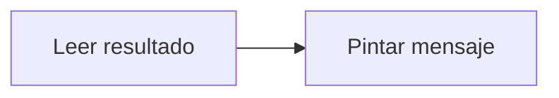

# Feature Specification: FE-04.4 — Resultado y errores

**Created**: 2026-10-19  
**Status**: draft  
**Flow**: [FE-04 Hablar con una persona (front)](97-fe-04-hablar-con-una-persona-front.md) (subflujo)  
**Related Specs**: [FE-04 Hablar con una persona (front)](97-fe-04-hablar-con-una-persona-front.md), [FE-04.3 Envío con la decisión](100-fe-04-3-envio-con-la-decision.md), [FE-04.5 Advertencia de duplicado y segundo clic](102-fe-04-5-advertencia-de-duplicado-y-segundo-clic.md)  
**Origen (DEC/H)**: DEC-15, DEC-18, DEC-22, DEC-23  
**Pruebas (TC)**: TC-20, TC-33  
**Contratos externos**: §1.1 (fila 4: resultado de caso humano)  

## Reglas de este documento

> Este spec es FUNCIONAL, no técnico: describe QUÉ hace el sistema, no CÓMO. Usa lenguaje de negocio; las siete herramientas externas se nombran por su función y se referencian por la sección de `sdd/reports/EXTERNAL_CONTRACTS.md`. Los casos borde se DOCUMENTAN; los valores de configuración se citan por el nombre del parámetro (NFR-012) con su valor por defecto entre paréntesis.

**Alcance**: Muestra el caso creado, el existente o el error «puedes reintentar», con tono y rol adecuados.

## User Scenarios & Testing *(mandatory)*

### User Story 1 - El pasajero sabe si su solicitud quedó registrada (Priority: P1)

Como pasajero, quiero un mensaje claro del resultado.

**Why this priority**: Un mensaje ambiguo deja sin atención.

**Independent Test**: Se prueba con creado, existente y fallido.

**Acceptance Scenarios**:

1. **Scenario**: Creado
   - **Given** el caso se creó
   - **When** se pinta
   - **Then** aviso de éxito con rol de estado, que recibe el foco: «Registramos tu solicitud. Una persona te atenderá; el tiempo objetivo de atención es de 45 minutos. Código de seguimiento: HC-4471.»

2. **Scenario**: Error
   - **Given** error explícito del proveedor de casos
   - **When** se pinta
   - **Then** aviso de error con rol de alerta, «No pudimos registrar tu solicitud, puedes reintentar.», y los botones «Cerrar» y «Reintentar» (texto de la variante de error del diálogo en el DESIGN_CONTRACT v1.5)

3. **Scenario**: Caso HC-4471 tras pedir datos o documentos (TC-20)
   - **Given** el pasajero eligió «Necesito ayuda con mis datos o documentos» y el caso HC-4471 quedó creado con 45 minutos
   - **When** se pinta
   - **Then** dice el tiempo objetivo de 45 minutos y el código HC-4471, sin mostrar ningún dato personal

---

### Edge Cases

> Solo se documentan; los marcados MUST-IMPLEMENT se vuelven requisito FR-XXX y se implementan con TDD, los DEFERRED quedan para una iteración posterior.

#### System Errors
- [MUST-IMPLEMENT] Cuando el resultado es indeterminado → no se dice éxito (FR-105)
- [MUST-IMPLEMENT] Cuando el proveedor de casos responde con un error explícito → el diálogo muestra «No pudimos registrar tu solicitud, puedes reintentar.» con «Cerrar» y «Reintentar» (FR-105)

#### Security & Permissions
- [MUST-IMPLEMENT] Cuando el motivo fue de datos personales → no aparece ningún dato personal (FR-061)

## Requirements *(mandatory)*

### Functional Requirements

- **FR-VIS-001**: La interfaz DEBE aplicar estilos coherentes con la identidad visual definida: CSS propio alineado con `sdd/reports/DESIGN_CONTRACT.md` (tokens de color, tipografía, espaciado y radios), sin logos ni marcas de terceros.
- **FR-VIS-002**: Está PROHIBIDO entregar HTML sin estilos: cada pantalla y cada estado de este flujo DEBE renderizarse con los estilos de la identidad, nunca con el aspecto por defecto del navegador.
- **FR-VIS-003**: La interfaz DEBE ser consistente con `sdd/reports/DESIGN_CONTRACT.md`: usa solo los componentes de su inventario y solo sus tokens; toda diferencia respecto del contrato es un defecto de la implementación, no del contrato.
- **FR-059**: Al crear un caso humano el sistema DEBE enviar el motivo de mayor prioridad y conservar todos los motivos simultáneos, con evidencia solo de identificadores, enumeraciones y hechos validados (sin información personal), tomada de la decisión guardada si el pasajero indica la decisión que vio y, si no, de una evaluación fresca. La deduplicación local se calcula con reserva, motivos ordenados y huella de decisión, no bloquea el reintento explícito tras un intento fallido o indeterminado, y cada intento y su resultado (creado, fallido, indeterminado) queda registrado. No requiere revalidación.
- **FR-061**: El motivo de petición de datos personales NUNCA DEBE devolver información personal: abre un caso humano y la respuesta no contiene ningún campo prohibido.
- **FR-105**: Matriz de errores por herramienta: las lecturas con fallo se reconsultan una vez sin bucles; sin contexto del viaje hay pantalla de «no pudimos cargar tu viaje» con reintento; solo sin eventos se muestra el contexto sin estado ni alerta y con aviso; sin política u opciones queda BLOQUEADA con caso humano ofrecido. Una solicitud de cambio con error no reintentable no se reintenta, muestra un fallo genérico y ofrece caso humano. En el caso humano, un error explícito dice «no pudimos registrar tu solicitud, puedes reintentar»; un tiempo agotado o respuesta perdida es indeterminado («no pudimos confirmar si tu solicitud quedó registrada; puede que ya lo esté»), no se reenvía automáticamente y el reintento exige un segundo clic explícito tras advertir del posible duplicado. Nunca se afirma éxito.

### Key Entities *(include if feature involves data)*

- **Pantalla del front de prueba**: Estado visible del front según la vista recibida. Campos principales:
  - `screen_state`: carga | sin anomalía | informativa | solo puerta | retraso con opción | conflicto | sin opción viable | solicitud registrada | lectura fallida | error de carga
  - `components`: lista de componentes del inventario del DESIGN_CONTRACT presentes
  - `texts`: claves del catálogo de textos usadas
  - `focus_target`: elemento que recibe el foco tras una acción
  - `aria_busy`: booleano (verdadero durante la carga)
- **Resultado de caso humano**: Respuesta a un clic de «Hablar con una persona». Campos principales:
  - `outcome`: HUMAN_CASE_CREATED | EXISTING_CASE | NEEDS_CONFIRMATION | INDETERMINATE | FAILED
  - `message`: mensaje validado
  - `human_case`: caso humano | nulo
  - `decision_id`: identificador de la decisión de la que salió la evidencia

## Architectural Attributes *(mandatory)*

| Attribute | Value |
|-----------|-------|
| **Interaction type** | sync-http |
| **Consistency** | strong |
| **Workflow** | single-step |
| **Read pattern** | simple |
| **Auditability** | none |
| **Domain complexity** | low |
| **Modularity** | feature-slice |
| **Deployment** | monolith |

## Success Criteria *(mandatory)*

### Measurable Outcomes

- **SC-001**: Todos los resultados usan un texto del catálogo.

## UI Constraints *(include for frontend/web projects)*

### Visual Requirements
- **Design system**: propio, definido en `sdd/reports/DESIGN_CONTRACT.md` (CSS propio con tokens de color, tipografía, espaciado y radios; sin librería de componentes ni logos de terceros).
- **Responsive**: sí; una columna con margen lateral de 16 px y ancho máximo de 720 px, sin desplazamiento horizontal desde 320 px; botones a ancho completo en móvil con área táctil mínima de 44 × 44 px.
- **Accessibility**: WCAG 2.1 nivel AA (NFR-011): roles semánticos, foco visible, navegación por teclado, contraste de al menos 4,5:1 en texto y 3:1 en contornos de controles; el color nunca es el único portador de significado.

### Interaction Patterns
- **Loading states**: ver FE-04.2.
- **Error states**: tono de error y rol de alerta.
- **Empty states**: no aplica.

### Style Constraints
- **Color palette**: tokens de color del DESIGN_CONTRACT (marca índigo para acciones primarias y foco, rojo solo decorativo, tintes para banners y chips); el color nunca es el único portador de significado: siempre va acompañado de texto e ícono.
- **Typography**: tipografía del sistema con escala de 14, 16, 20 y 24 px, interlineado 1,5; códigos de reglas en monoespaciada.
- **Spacing**: escala de espaciado de 4 a 32 px del DESIGN_CONTRACT; radio único de 8 px.

### Visual Spec *(mandatory for web/mobile)*

| Screen | Image | Source | Description |
|--------|-------|--------|-------------|
| Pantalla 2: retraso con opción propuesta y caso humano | Wireframe ASCII de `sdd/reports/DESIGN_CONTRACT.md` (§Evidencia Visual); captura de imagen diferida hasta que exista el front | Wireframe de texto (alternativa autorizada cuando no hay imagen) | alertas, reglas plegadas, opción propuesta, vía de reembolso, acciones con cuenta regresiva y diálogo |

## Traceability *(mandatory after implementation)*

> Las columnas de archivo y línea se registran en la verificación de trazabilidad posterior a la implementación; hoy cada criterio queda enlazado a su origen y a las pruebas que lo verifican.

| Criterion | Origen | Prueba (TC) | Source File | Line(s) |
|-----------|--------|-------------|-------------|---------|
| FR-VIS-001 | Usuario (2026-10-19) | sin TC en el mapa §6 de REQUERIMIENTOS_V1 | se registra en la verificación posterior a la implementación | se registra en la verificación posterior a la implementación |
| FR-VIS-002 | Usuario (2026-10-19) | sin TC en el mapa §6 de REQUERIMIENTOS_V1 | se registra en la verificación posterior a la implementación | se registra en la verificación posterior a la implementación |
| FR-VIS-003 | Usuario (2026-10-19) | sin TC en el mapa §6 de REQUERIMIENTOS_V1 | se registra en la verificación posterior a la implementación | se registra en la verificación posterior a la implementación |
| FR-059 | DEC-15, DEC-23 | sin TC en el mapa §6 de REQUERIMIENTOS_V1 | se registra en la verificación posterior a la implementación | se registra en la verificación posterior a la implementación |
| FR-061 | DEC-15, DEC-22 | TC-20 | se registra en la verificación posterior a la implementación | se registra en la verificación posterior a la implementación |
| FR-105 | DEC-15, DEC-18 | TC-33 | se registra en la verificación posterior a la implementación | se registra en la verificación posterior a la implementación |
| SC-001 | criterio medible de este spec | TC-20, TC-33 | se registra en la verificación posterior a la implementación | se registra en la verificación posterior a la implementación |

## Business Process (BPM View)

```
Leer resultado → Pintar mensaje
```



