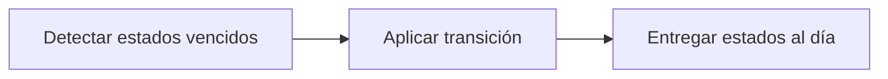

# Feature Specification: SF-01.12 — Barrido perezoso del ciclo de vida

**Created**: 2026-10-19  
**Status**: draft  
**Flow**: [F-01 Evaluar viaje como pasajero](01-f-01-evaluar-viaje-como-pasajero.md) (subflujo)  
**Related Specs**: [F-01 Evaluar viaje como pasajero](01-f-01-evaluar-viaje-como-pasajero.md), [SF-01.11 Construcción y validación de mensajes](12-sf-01-11-construccion-y-validacion-de-mensajes.md), [SF-01.13 Huella por opción y registro de decisión](14-sf-01-13-huella-por-opcion-y-registro-de-decision.md)  
**Origen (DEC/H)**: DEC-18  
**Pruebas (TC)**: TC-38, TC-57  
**Contratos externos**: §2.3 (registro de operaciones y casos), FR-064 en REQUERIMIENTOS_V1  

## Reglas de este documento

> Este spec es FUNCIONAL, no técnico: describe QUÉ hace el sistema, no CÓMO. Usa lenguaje de negocio; las siete herramientas externas se nombran por su función y se referencian por la sección de `sdd/reports/EXTERNAL_CONTRACTS.md`. Los casos borde se DOCUMENTAN; los valores de configuración se citan por el nombre del parámetro (NFR-012) con su valor por defecto entre paréntesis.

**Alcance**: Antes de mostrar operaciones y casos, actualiza los estados que cambiaron con el paso del tiempo para que la vista muestre lo vigente.

## User Scenarios & Testing *(mandatory)*

### User Story 1 - El pasajero ve el estado real de su solicitud (Priority: P1)

Como pasajero, quiero que una solicitud que expiró o quedó sin respuesta se muestre como tal, para saber si puedo volver a intentar.

**Why this priority**: Un estado viejo mostraría bloqueos o promesas que ya no existen.

**Independent Test**: Se prueba avanzando el reloj sobre operaciones en curso y creadas.

**Acceptance Scenarios**:

1. **Scenario**: Operación colgada
   - **Given** una operación está en curso y superó `OPERATION_STALE_SECONDS` (120) sin respuesta
   - **When** se arma la vista
   - **Then** se muestra como indeterminada

2. **Scenario**: Indeterminada vencida
   - **Given** una operación indeterminada superó `OPERATION_INDETERMINATE_EXPIRY_SECONDS` (900) sin resolverse
   - **When** se arma la vista
   - **Then** se muestra como expirada y deja de bloquear una operación nueva

3. **Scenario**: Solicitud vencida
   - **Given** una solicitud creada llegó a su vencimiento
   - **When** se arma la vista
   - **Then** se muestra como expirada y permite una nueva operación con la generación siguiente

4. **Scenario**: Operación colgada y solicitud vencida (TC-38, TC-57)
   - **Given** una operación de ABC123 en curso hace 121 s, otra creada con vencimiento 11:12:00Z y una indeterminada de 900 s
   - **When** se lee el registro a las 11:12:01Z
   - **Then** pasan a indeterminada, expirada y expirada respectivamente

---

### Edge Cases

> Solo se documentan; los marcados MUST-IMPLEMENT se vuelven requisito FR-XXX y se implementan con TDD, los DEFERRED quedan para una iteración posterior.

#### System Errors
- [MUST-IMPLEMENT] Cuando el proceso se cayó con una operación en curso → pasa a indeterminada tras el tiempo configurado (FR-064)
- [MUST-IMPLEMENT] Cuando una operación indeterminada supera `OPERATION_INDETERMINATE_EXPIRY_SECONDS` (900) sin resolverse → pasa a expirada y permite la generación siguiente (FR-064)

#### Invalid Data
- [DEFERRED] Resolución de una operación indeterminada por un agente: Fase 2; riesgo S-20: si la solicitud indeterminada sí se creó y su vigencia fuera mayor que el plazo de expiración, un intento nuevo podría duplicarla (FR-064)

#### Race Conditions
- [MUST-IMPLEMENT] Cuando el barrido y una aceptación coinciden → el estado se actualiza solo desde el estado esperado y una respuesta fuera de orden no pisa un estado final (FR-064)

## Requirements *(mandatory)*

### Functional Requirements

- **FR-064**: La operación de cambio DEBE seguir un ciclo de vida: en curso, creada, indeterminada, fallida y expirada. En curso pasa a indeterminada tras `OPERATION_STALE_SECONDS` (120) sin respuesta; creada pasa a expirada en su vencimiento; indeterminada pasa a expirada tras `OPERATION_INDETERMINATE_EXPIRY_SECONDS` (900, mayor que la vigencia de una solicitud) si nada la resuelve. Si la llave no pudo persistirse no se escribe. Expirada o fallida permiten una operación nueva con la generación siguiente; creada, en curso e indeterminada la bloquean y la vista muestra su estado. Un rechazo por duplicado sin operación local se muestra «ya existe una solicitud para esta opción».

### Key Entities *(include if feature involves data)*

- **Operación de reprogramación**: Intento de crear una solicitud de cambio, con su llave de idempotencia y su ciclo de vida. Campos principales:
  - `itinerary_key`: texto
  - `idempotency_key`: texto no adivinable
  - `generation`: entero ≥ 1
  - `state`: EN_CURSO | CREADA | INDETERMINADA | FALLIDA | EXPIRADA (INDETERMINADA pasa a EXPIRADA tras `OPERATION_INDETERMINATE_EXPIRY_SECONDS`)
  - `request_id`: texto | nulo
  - `request_status`: enumeración abierta (p. ej. PENDING_CONFIRMATION) | nulo
  - `expires_at`: marca de tiempo UTC | nulo
  - `passenger_ids`: lista de texto con TODO el grupo
  - `minimized`: booleano: verdadero cuando la purga conservó solo la identidad, el estado y la vigencia de la operación (sin itinerario ni pasajeros) para no perder su bloqueo
- **Caso humano**: Escalamiento a una persona; cada intento queda registrado con su resultado. Campos principales:
  - `dedup_key`: texto
  - `attempt`: entero ≥ 1
  - `state`: EN_CURSO | CREADO | FALLIDO | INDETERMINADO
  - `reason`: uno de los 13 motivos cerrados
  - `reasons`: lista ordenada por prioridad
  - `case_id`: texto | nulo
  - `queue`: texto | nulo
  - `sla_minutes`: entero | nulo
  - `option`: {option_id: texto, itinerario y diferencia de tarifa} | nulo
  - `confirm_possible_duplicate`: booleano

## Architectural Attributes *(mandatory)*

| Attribute | Value |
|-----------|-------|
| **Interaction type** | sync-http |
| **Consistency** | strong |
| **Workflow** | single-step |
| **Read pattern** | simple |
| **Auditability** | full-history |
| **Domain complexity** | medium |
| **Modularity** | bounded-context |
| **Deployment** | monolith |

## Success Criteria *(mandatory)*

### Measurable Outcomes

- **SC-001**: El 100 % de las operaciones en curso sin respuesta pasa a indeterminada al superar el tiempo configurado.
- **SC-002**: El 100 % de las solicitudes creadas pasa a expirada en su vencimiento y el 100 % de las indeterminadas, tras `OPERATION_INDETERMINATE_EXPIRY_SECONDS`.

## Traceability *(mandatory after implementation)*

> Las columnas de archivo y línea se registran en la verificación de trazabilidad posterior a la implementación; hoy cada criterio queda enlazado a su origen y a las pruebas que lo verifican.

| Criterion | Origen | Prueba (TC) | Source File | Line(s) |
|-----------|--------|-------------|-------------|---------|
| FR-064 | DEC-18 | TC-38, TC-57 | se registra en la verificación posterior a la implementación | se registra en la verificación posterior a la implementación |
| SC-001 | criterio medible de este spec | TC-38, TC-57 | se registra en la verificación posterior a la implementación | se registra en la verificación posterior a la implementación |
| SC-002 | criterio medible de este spec | TC-38, TC-57 | se registra en la verificación posterior a la implementación | se registra en la verificación posterior a la implementación |

## Business Process (BPM View)

```
Detectar estados vencidos → Aplicar transición → Entregar estados al día
```



