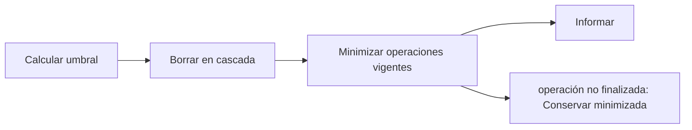

# Feature Specification: F-07 — Purga de retención

**Created**: 2026-10-19  
**Status**: draft  
**Flow**: F-07 Purga de retención  
**Related Specs**: [SF-07.1 Cálculo del umbral con el reloj inyectado](48-sf-07-1-calculo-del-umbral-con-el-reloj-inyectado.md), [SF-07.2 Borrado en cascada](49-sf-07-2-borrado-en-cascada.md), [SF-07.3 Informe de filas eliminadas](50-sf-07-3-informe-de-filas-eliminadas.md), [F-09 Ciclo de vida de operaciones, intentos de caso y notificaciones (barrido perezoso)](56-f-09-ciclo-de-vida-de-operaciones-intentos-de-caso-y.md)  
**Origen (DEC/H)**: DEC-18, DEC-23, DEC-24  
**Pruebas (TC)**: TC-32, TC-56, TC-57  
**Contratos externos**: §2.3 (registros), §2.4 (`AUDIT_RETENTION_DAYS`)  

## Reglas de este documento

> Este spec es FUNCIONAL, no técnico: describe QUÉ hace el sistema, no CÓMO. Usa lenguaje de negocio; las siete herramientas externas se nombran por su función y se referencian por la sección de `sdd/reports/EXTERNAL_CONTRACTS.md`. Los casos borde se DOCUMENTAN; los valores de configuración se citan por el nombre del parámetro (NFR-012) con su valor por defecto entre paréntesis.

**Alcance**: Elimina, por comando y una vez al arrancar, los registros de decisión, operaciones, casos y notificaciones más antiguos que `AUDIT_RETENTION_DAYS` (30, provisional), conservando el registro mínimo de las operaciones no finalizadas.

## User Scenarios & Testing *(mandatory)*

### User Story 1 - Los registros no se acumulan, pero ningún bloqueo vigente se pierde (Priority: P1)

Como responsable de privacidad, quiero que los registros se eliminen pasada la retención, sin perder la protección contra duplicados de los cambios aún vigentes.

**Why this priority**: La retención limita la exposición de datos seudónimos y es verificable.

**Independent Test**: Se prueba con registros de 29 y 31 días y con una operación indeterminada antigua.

**Acceptance Scenarios**:

1. **Scenario**: Purga normal
   - **Given** registros más antiguos que la retención
   - **When** se ejecuta la purga
   - **Then** se eliminan en cascada y se informa cuántas filas se borraron

2. **Scenario**: Conservación de un bloqueo aún vigente (TC-56)
   - **Given** una operación CREADA de 31 días de antigüedad cuyo vencimiento todavía no llega (a +10 min)
   - **When** se ejecuta la purga
   - **Then** se conserva minimizada (solo identidad, estado y vigencia) y su bloqueo sigue impidiendo una operación nueva

3. **Scenario**: Purga que aplica vencimientos primero (TC-32, TC-56)
   - **Given** FixedClock 2026-10-19T00:00:00Z y retención de 30 días (corte 2026-09-19T00:00:00Z), registros de 29 y 31 días, 3 operaciones jóvenes (EN_CURSO de 10 s, INDETERMINADA de 300 s, CREADA con vencimiento a +10 min) y 3 vencidas (EN_CURSO de 40 días, INDETERMINADA de 40 días, CREADA vencida hace 40 días)
   - **When** se ejecuta la purga
   - **Then** primero se aplican los vencimientos (las 3 vencidas pasan a EXPIRADA) y luego se borra por antigüedad: se eliminan las 3 vencidas y los registros de 31 días; se conservan las 3 operaciones jóvenes y el registro de 29 días

---

### Edge Cases

> Solo se documentan; los marcados MUST-IMPLEMENT se vuelven requisito FR-XXX y se implementan con TDD, los DEFERRED quedan para una iteración posterior.

#### System Errors
- [MUST-IMPLEMENT] Cuando el cálculo del umbral usa el reloj inyectado → es determinista en las pruebas (FR-092)
- [MUST-IMPLEMENT] Cuando una operación indeterminada vence (pasa a expirada tras `OPERATION_INDETERMINATE_EXPIRY_SECONDS`) → deja de conservarse y se purga como operación final (FR-064)
- [MUST-IMPLEMENT] Cuando la purga se ejecuta → primero aplica los vencimientos de las operaciones (FR-064) y después borra por antigüedad; solo conserva minimizadas las operaciones que siguen no finalizadas (FR-092)

#### Invalid Data
- [MUST-IMPLEMENT] Cuando `AUDIT_RETENTION_DAYS` es menor que 1 → el servicio no arranca (NFR-012)
- [DEFERRED] Retención definitiva: valor pendiente de decisión (FR-092)

## Requirements *(mandatory)*

### Functional Requirements

- **FR-092**: El sistema DEBE aplicar una retención provisional (`AUDIT_RETENTION_DAYS`, 30) con una rutina de purga verificable del registro de decisiones, de operaciones, de casos y de notificaciones, que primero aplica los vencimientos de las operaciones (FR-064) y después conserva el registro mínimo solo de las operaciones que siguen no finalizadas (en curso, indeterminada o creada dentro de su vigencia) para no perder su bloqueo; una operación ya vencida se purga por antigüedad como cualquier otra.
- **FR-064**: La operación de cambio DEBE seguir un ciclo de vida: en curso, creada, indeterminada, fallida y expirada. En curso pasa a indeterminada tras `OPERATION_STALE_SECONDS` (120) sin respuesta; creada pasa a expirada en su vencimiento; indeterminada pasa a expirada tras `OPERATION_INDETERMINATE_EXPIRY_SECONDS` (900, mayor que la vigencia de una solicitud) si nada la resuelve. Si la llave no pudo persistirse no se escribe. Expirada o fallida permiten una operación nueva con la generación siguiente; creada, en curso e indeterminada la bloquean y la vista muestra su estado. Un rechazo por duplicado sin operación local se muestra «ya existe una solicitud para esta opción».

### Non-Functional and Documentation Requirements

- **NFR-005**: Operabilidad: el sistema DEBE configurarse por variables de entorno, emitir registros estructurados sin información personal y contar con un runbook de una página; debe poder operarlo un equipo pequeño.
- **NFR-012**: Configuración: todos los parámetros de los supuestos S-09 a S-19 DEBEN ser variables configurables (archivo de configuración con sobrescritura por entorno, validadas al arrancar y con valor por defecto documentado) y ninguno puede estar fijado en la lógica; entre ellos `RELEVANT_DELAY_MIN_MINUTES` (1), `MIN_CONNECTION_MINUTES` (0 por aeropuerto), `MCT_UNCERTAINTY_MINUTES` (45), `CLOCK_SKEW_SECONDS` (60), `EVENT_MAX_AGE_SECONDS` (sin límite), `OPERATION_STALE_SECONDS` (120), `REBOOK_MAX_RETRIES` (2), `AUDIT_RETENTION_DAYS` (30), `PARSER_MAX_CONDITION_CHARS` (200), `PARSER_MAX_DEPTH` (10), `REMEDY_RIGHTS`, `COMPENSATION_RIGHTS`, `NOTIFY_ENABLED`, `NOTIFY_COOLDOWN_SECONDS` (86400), `NOTIFY_MAX_RETRIES` (2), `OPERATION_INDETERMINATE_EXPIRY_SECONDS` (900), `EVALUATE_RATE_LIMIT_PER_MINUTE` (30), `CHANGE_RIGHTS`, `SUPPORTED_EVENT_TYPES`, `NOTIFY_ONLY_EVENT_TYPES`, `POLICY_SCENARIOS`, `REASON_PRIORITY`, la tabla de compatibilidad de afirmaciones y los secretos `SERVICE_API_KEY` e `IDEMPOTENCY_SECRET` (solo por entorno). Una prueba cambia cada parámetro y comprueba que cambia el comportamiento. También son configurables los parámetros operativos de `sdd/reports/EXTERNAL_CONTRACTS.md` §2.4 (tiempos de espera, reintentos de lectura, modo de reloj, origen permitido, ubicación del registro y banderas de desarrollo).

### Key Entities *(include if feature involves data)*

- **Registro de retención**: Resultado de una purga del registro: cuántas filas se eliminaron y cuáles se conservaron minimizadas. Campos principales:
  - `cutoff`: marca de tiempo UTC
  - `deleted_decisions`: entero
  - `deleted_operations`: entero
  - `deleted_cases`: entero
  - `deleted_notifications`: entero
  - `expired_by_sweep`: entero: operaciones vencidas al aplicar FR-064 antes de purgar
  - `minimized_operations`: entero: operaciones aún no finalizadas que superan la retención
- **Operación de reprogramación**: Intento de crear una solicitud de cambio, con su llave de idempotencia y su ciclo de vida. Campos principales:
  - `itinerary_key`: texto
  - `idempotency_key`: texto no adivinable
  - `generation`: entero ≥ 1
  - `state`: EN_CURSO | CREADA | INDETERMINADA | FALLIDA | EXPIRADA (INDETERMINADA pasa a EXPIRADA tras `OPERATION_INDETERMINATE_EXPIRY_SECONDS`)
  - `request_id`: texto | nulo
  - `request_status`: enumeración abierta (p. ej. PENDING_CONFIRMATION) | nulo
  - `expires_at`: marca de tiempo UTC | nulo
  - `passenger_ids`: lista de texto con TODO el grupo
  - `minimized`: booleano: verdadero cuando la purga conservó solo la identidad, el estado y la vigencia de la operación (sin itinerario ni pasajeros) para no perder su bloqueo
- **Registro de decisión**: Instantánea de auditoría de una evaluación, sin información personal. Campos principales:
  - `decision_id`: identificador
  - `booking_id`: texto seudónimo
  - `created_at`: marca de tiempo UTC
  - `caller`: user | system
  - `fingerprint`: texto
  - `decision_state`: estado | nulo
  - `needs_manual_review`: booleano (campo interno, no se entrega a la sesión del pasajero)
  - `policy_version`: texto | nulo
  - `mct_provided`: booleano
  - `passenger_count`: entero
  - `segments`: lista de {segment_id: texto, state: texto | nulo, delay_minutes: entero | nulo}
  - `message_hash`: texto
  - `messages_blocked`: entero
  - `reads`: lista de {tool: texto, retrieved_at: marca de tiempo | nulo, outcome: OK | FAILED | INVALID | NOT_REQUESTED}
  - `events`: lista de {event_id, segment_id, event_type, disposition: CHOSEN | DISCARDED | NOT_INTERPRETED, reason}
  - `rules`: lista de {rule_id, result, requires_human_approval}
  - `options`: lista de opciones con sus razones de descarte (también las no viables)
  - `notifications`: lista de {reason, kind, status, notification_id} (solo modo sistema; campo interno, no se entrega a la sesión del pasajero)
  - `outcomes`: lista de {kind: REBOOKING | HUMAN_CASE, reference_id: texto | nulo, state: texto, at: marca de tiempo}

## Architectural Attributes *(mandatory)*

| Attribute | Value |
|-----------|-------|
| **Interaction type** | batch |
| **Consistency** | strong |
| **Workflow** | single-step |
| **Read pattern** | simple |
| **Auditability** | basic |
| **Domain complexity** | high |
| **Modularity** | bounded-context |
| **Deployment** | monolith |

## Success Criteria *(mandatory)*

### Measurable Outcomes

- **SC-001**: El 100 % de los registros más antiguos que la retención se elimina, salvo las operaciones no finalizadas, que quedan minimizadas.
- **SC-002**: Una purga no borra ningún registro más reciente que el umbral.

## Traceability *(mandatory after implementation)*

> Las columnas de archivo y línea se registran en la verificación de trazabilidad posterior a la implementación; hoy cada criterio queda enlazado a su origen y a las pruebas que lo verifican.

| Criterion | Origen | Prueba (TC) | Source File | Line(s) |
|-----------|--------|-------------|-------------|---------|
| FR-092 | DEC-23 | TC-32, TC-56 | se registra en la verificación posterior a la implementación | se registra en la verificación posterior a la implementación |
| FR-064 | DEC-18 | TC-56, TC-57 | se registra en la verificación posterior a la implementación | se registra en la verificación posterior a la implementación |
| NFR-005 | DEC-24 | sin TC en el mapa §6 de REQUERIMIENTOS_V1 | se registra en la verificación posterior a la implementación | se registra en la verificación posterior a la implementación |
| NFR-012 | Usuario (2026-10-19) | sin TC en el mapa §6 de REQUERIMIENTOS_V1 | se registra en la verificación posterior a la implementación | se registra en la verificación posterior a la implementación |
| SC-001 | criterio medible de este spec | TC-32, TC-56, TC-57 | se registra en la verificación posterior a la implementación | se registra en la verificación posterior a la implementación |
| SC-002 | criterio medible de este spec | TC-32, TC-56, TC-57 | se registra en la verificación posterior a la implementación | se registra en la verificación posterior a la implementación |

## Business Process (BPM View)

```
Calcular umbral → Borrar en cascada → Minimizar operaciones vigentes → Informar
```



### Subprocesses (if applicable)

```
SF-07.1: Cálculo del umbral con el reloj inyectado
SF-07.2: Borrado en cascada
SF-07.3: Informe de filas eliminadas
```
