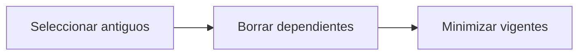

# Feature Specification: SF-07.2 — Borrado en cascada

**Created**: 2026-10-19  
**Status**: draft  
**Flow**: [F-07 Purga de retención](47-f-07-purga-de-retencion.md) (subflujo)  
**Related Specs**: [F-07 Purga de retención](47-f-07-purga-de-retencion.md), [SF-07.1 Cálculo del umbral con el reloj inyectado](48-sf-07-1-calculo-del-umbral-con-el-reloj-inyectado.md), [SF-07.3 Informe de filas eliminadas](50-sf-07-3-informe-de-filas-eliminadas.md)  
**Origen (DEC/H)**: DEC-18, DEC-23  
**Pruebas (TC)**: TC-32, TC-56  
**Contratos externos**: §2.3 (registros)  

## Reglas de este documento

> Este spec es FUNCIONAL, no técnico: describe QUÉ hace el sistema, no CÓMO. Usa lenguaje de negocio; las siete herramientas externas se nombran por su función y se referencian por la sección de `sdd/reports/EXTERNAL_CONTRACTS.md`. Los casos borde se DOCUMENTAN; los valores de configuración se citan por el nombre del parámetro (NFR-012) con su valor por defecto entre paréntesis.

**Alcance**: Elimina los registros de decisión y sus dependientes y los de operaciones, casos y notificaciones más antiguos que el corte, conservando minimizadas las operaciones no finalizadas.

## User Scenarios & Testing *(mandatory)*

### User Story 1 - Se elimina lo viejo y se protege lo vigente (Priority: P1)

Como responsable de privacidad, quiero que el borrado alcance todo lo asociado a una decisión antigua, pero que una operación vigente no pierda su bloqueo.

**Why this priority**: Perder el bloqueo permitiría duplicar un cambio.

**Independent Test**: Se prueba con registros de varias edades y estados.

**Acceptance Scenarios**:

1. **Scenario**: Cascada
   - **Given** una decisión antigua con opciones y reglas
   - **When** se borra
   - **Then** desaparecen todas sus dependientes

2. **Scenario**: Operaciones aún no finalizadas (TC-56)
   - **Given** una operación INDETERMINADA de 300 s, una CREADA con vencimiento a +10 min y una INDETERMINADA de 40 días
   - **When** se borra por antigüedad tras aplicar los vencimientos
   - **Then** la de 40 días ya venció a EXPIRADA y se elimina; las 2 vigentes se conservan y, si superaran la retención, quedarían minimizadas

3. **Scenario**: Operaciones vigentes y vencidas (TC-56)
   - **Given** operaciones en curso de 10 s, indeterminada de 300 s y creada con vencimiento a +10 min, más una EN_CURSO de 40 días, una fallida y una expirada
   - **When** se borra
   - **Then** las 3 vigentes se conservan y las 3 vencidas o finales se eliminan

---

### Edge Cases

> Solo se documentan; los marcados MUST-IMPLEMENT se vuelven requisito FR-XXX y se implementan con TDD, los DEFERRED quedan para una iteración posterior.

#### System Errors
- [MUST-IMPLEMENT] Cuando una operación está en curso, indeterminada (aún no vencida) o creada vigente → se minimiza y no se borra (FR-064)
- [MUST-IMPLEMENT] Cuando la purga se ejecuta dos veces → el segundo resultado es 0 filas borradas (FR-092)
- [MUST-IMPLEMENT] Cuando una operación ya venció (FR-064) → se purga por antigüedad como cualquier otra y no se conserva minimizada (FR-092)

## Requirements *(mandatory)*

### Functional Requirements

- **FR-064**: La operación de cambio DEBE seguir un ciclo de vida: en curso, creada, indeterminada, fallida y expirada. En curso pasa a indeterminada tras `OPERATION_STALE_SECONDS` (120) sin respuesta; creada pasa a expirada en su vencimiento; indeterminada pasa a expirada tras `OPERATION_INDETERMINATE_EXPIRY_SECONDS` (900, mayor que la vigencia de una solicitud) si nada la resuelve. Si la llave no pudo persistirse no se escribe. Expirada o fallida permiten una operación nueva con la generación siguiente; creada, en curso e indeterminada la bloquean y la vista muestra su estado. Un rechazo por duplicado sin operación local se muestra «ya existe una solicitud para esta opción».
- **FR-092**: El sistema DEBE aplicar una retención provisional (`AUDIT_RETENTION_DAYS`, 30) con una rutina de purga verificable del registro de decisiones, de operaciones, de casos y de notificaciones, que primero aplica los vencimientos de las operaciones (FR-064) y después conserva el registro mínimo solo de las operaciones que siguen no finalizadas (en curso, indeterminada o creada dentro de su vigencia) para no perder su bloqueo; una operación ya vencida se purga por antigüedad como cualquier otra.

### Key Entities *(include if feature involves data)*

- **Registro de retención**: Resultado de una purga del registro: cuántas filas se eliminaron y cuáles se conservaron minimizadas. Campos principales:
  - `cutoff`: marca de tiempo UTC
  - `deleted_decisions`: entero
  - `deleted_operations`: entero
  - `deleted_cases`: entero
  - `deleted_notifications`: entero
  - `expired_by_sweep`: entero: operaciones vencidas al aplicar FR-064 antes de purgar
  - `minimized_operations`: entero: operaciones aún no finalizadas que superan la retención
- **Operación de reprogramación**: Intento de crear una solicitud de cambio, con su llave de idempotencia y su ciclo de vida. Campos principales:
  - `itinerary_key`: texto
  - `idempotency_key`: texto no adivinable
  - `generation`: entero ≥ 1
  - `state`: EN_CURSO | CREADA | INDETERMINADA | FALLIDA | EXPIRADA (INDETERMINADA pasa a EXPIRADA tras `OPERATION_INDETERMINATE_EXPIRY_SECONDS`)
  - `request_id`: texto | nulo
  - `request_status`: enumeración abierta (p. ej. PENDING_CONFIRMATION) | nulo
  - `expires_at`: marca de tiempo UTC | nulo
  - `passenger_ids`: lista de texto con TODO el grupo
  - `minimized`: booleano: verdadero cuando la purga conservó solo la identidad, el estado y la vigencia de la operación (sin itinerario ni pasajeros) para no perder su bloqueo

## Architectural Attributes *(mandatory)*

| Attribute | Value |
|-----------|-------|
| **Interaction type** | batch |
| **Consistency** | strong |
| **Workflow** | single-step |
| **Read pattern** | simple |
| **Auditability** | full-history |
| **Domain complexity** | medium |
| **Modularity** | bounded-context |
| **Deployment** | monolith |

## Success Criteria *(mandatory)*

### Measurable Outcomes

- **SC-001**: Ninguna operación no finalizada se pierde por antigüedad.

## Traceability *(mandatory after implementation)*

> Las columnas de archivo y línea se registran en la verificación de trazabilidad posterior a la implementación; hoy cada criterio queda enlazado a su origen y a las pruebas que lo verifican.

| Criterion | Origen | Prueba (TC) | Source File | Line(s) |
|-----------|--------|-------------|-------------|---------|
| FR-064 | DEC-18 | TC-56 | se registra en la verificación posterior a la implementación | se registra en la verificación posterior a la implementación |
| FR-092 | DEC-23 | TC-32, TC-56 | se registra en la verificación posterior a la implementación | se registra en la verificación posterior a la implementación |
| SC-001 | criterio medible de este spec | TC-32, TC-56 | se registra en la verificación posterior a la implementación | se registra en la verificación posterior a la implementación |

## Business Process (BPM View)

```
Seleccionar antiguos → Borrar dependientes → Minimizar vigentes
```



