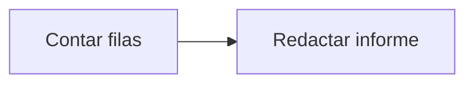

# Feature Specification: SF-07.3 — Informe de filas eliminadas

**Created**: 2026-10-19  
**Status**: draft  
**Flow**: [F-07 Purga de retención](47-f-07-purga-de-retencion.md) (subflujo)  
**Related Specs**: [F-07 Purga de retención](47-f-07-purga-de-retencion.md), [SF-07.2 Borrado en cascada](49-sf-07-2-borrado-en-cascada.md)  
**Origen (DEC/H)**: DEC-23, DEC-24  
**Pruebas (TC)**: TC-32, TC-56  
**Contratos externos**: §2.3 (registros)  

## Reglas de este documento

> Este spec es FUNCIONAL, no técnico: describe QUÉ hace el sistema, no CÓMO. Usa lenguaje de negocio; las siete herramientas externas se nombran por su función y se referencian por la sección de `sdd/reports/EXTERNAL_CONTRACTS.md`. Los casos borde se DOCUMENTAN; los valores de configuración se citan por el nombre del parámetro (NFR-012) con su valor por defecto entre paréntesis.

**Alcance**: Informa cuántas filas se eliminaron y cuántas operaciones se conservaron minimizadas, sin datos personales.

## User Scenarios & Testing *(mandatory)*

### User Story 1 - Operación sabe qué hizo la purga (Priority: P1)

Como operador, quiero ver el resultado de la purga para confirmar que corrió.

**Why this priority**: El runbook se apoya en este informe.

**Independent Test**: Se prueba comparando el informe con las filas realmente borradas.

**Acceptance Scenarios**:

1. **Scenario**: Informe
   - **Given** una purga ejecutada
   - **When** termina
   - **Then** muestra el número de filas eliminadas por tipo y de operaciones minimizadas

2. **Scenario**: Informe de purga (TC-32)
   - **Given** una purga con retención de 30 días que aplicó 3 vencimientos, eliminó 5 filas y minimizó 1 operación aún vigente
   - **When** se informa
   - **Then** dice 3 vencimientos aplicados, 5 filas eliminadas y 1 minimizada, sin datos personales

---

### Edge Cases

> Solo se documentan; los marcados MUST-IMPLEMENT se vuelven requisito FR-XXX y se implementan con TDD, los DEFERRED quedan para una iteración posterior.

#### Invalid Data
- [MUST-IMPLEMENT] Cuando no hay nada que borrar → informa ceros (FR-092)

#### Security & Permissions
- [MUST-IMPLEMENT] Cuando se informa → no incluye datos personales (FR-091)

## Requirements *(mandatory)*

### Functional Requirements

- **FR-092**: El sistema DEBE aplicar una retención provisional (`AUDIT_RETENTION_DAYS`, 30) con una rutina de purga verificable del registro de decisiones, de operaciones, de casos y de notificaciones, que primero aplica los vencimientos de las operaciones (FR-064) y después conserva el registro mínimo solo de las operaciones que siguen no finalizadas (en curso, indeterminada o creada dentro de su vigencia) para no perder su bloqueo; una operación ya vencida se purga por antigüedad como cualquier otra.
- **FR-091**: Solo se persisten campos de una lista cerrada: hechos operacionales no personales, identificadores seudónimos, enumeraciones, números, marcas de tiempo y huellas. NUNCA se guardan cargas completas, nombre, contacto, documento ni edad del menor; los identificadores son seudónimos, no anónimos, y la reserva se trunca en los registros de aplicación.

### Non-Functional and Documentation Requirements

- **NFR-005**: Operabilidad: el sistema DEBE configurarse por variables de entorno, emitir registros estructurados sin información personal y contar con un runbook de una página; debe poder operarlo un equipo pequeño.

### Key Entities *(include if feature involves data)*

- **Registro de retención**: Resultado de una purga del registro: cuántas filas se eliminaron y cuáles se conservaron minimizadas. Campos principales:
  - `cutoff`: marca de tiempo UTC
  - `deleted_decisions`: entero
  - `deleted_operations`: entero
  - `deleted_cases`: entero
  - `deleted_notifications`: entero
  - `expired_by_sweep`: entero: operaciones vencidas al aplicar FR-064 antes de purgar
  - `minimized_operations`: entero: operaciones aún no finalizadas que superan la retención

## Architectural Attributes *(mandatory)*

| Attribute | Value |
|-----------|-------|
| **Interaction type** | batch |
| **Consistency** | strong |
| **Workflow** | single-step |
| **Read pattern** | simple |
| **Auditability** | full-history |
| **Domain complexity** | medium |
| **Modularity** | bounded-context |
| **Deployment** | monolith |

## Success Criteria *(mandatory)*

### Measurable Outcomes

- **SC-001**: El informe coincide en el 100 % con las filas efectivamente afectadas.

## Traceability *(mandatory after implementation)*

> Las columnas de archivo y línea se registran en la verificación de trazabilidad posterior a la implementación; hoy cada criterio queda enlazado a su origen y a las pruebas que lo verifican.

| Criterion | Origen | Prueba (TC) | Source File | Line(s) |
|-----------|--------|-------------|-------------|---------|
| FR-092 | DEC-23 | TC-32, TC-56 | se registra en la verificación posterior a la implementación | se registra en la verificación posterior a la implementación |
| FR-091 | DEC-23 | sin TC en el mapa §6 de REQUERIMIENTOS_V1 | se registra en la verificación posterior a la implementación | se registra en la verificación posterior a la implementación |
| NFR-005 | DEC-24 | sin TC en el mapa §6 de REQUERIMIENTOS_V1 | se registra en la verificación posterior a la implementación | se registra en la verificación posterior a la implementación |
| SC-001 | criterio medible de este spec | TC-32, TC-56 | se registra en la verificación posterior a la implementación | se registra en la verificación posterior a la implementación |

## Business Process (BPM View)

```
Contar filas → Redactar informe
```



