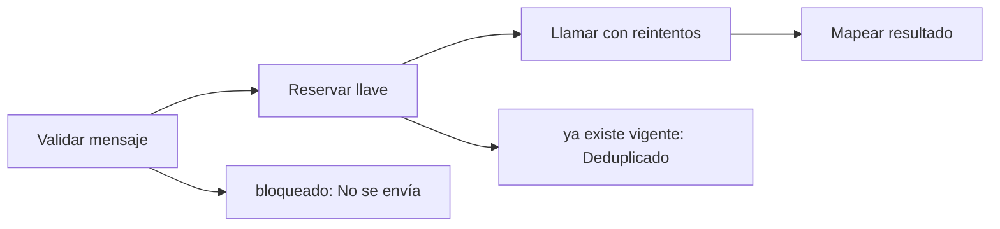

# Feature Specification: F-08 — Notificación al pasajero

**Created**: 2026-10-19  
**Status**: draft  
**Flow**: F-08 Notificación al pasajero  
**Related Specs**: [SF-08.1 Validación del mensaje](52-sf-08-1-validacion-del-mensaje.md), [SF-08.2 Llave idempotente y reserva atómica](53-sf-08-2-llave-idempotente-y-reserva-atomica.md), [SF-08.3 Llamada con reintentos](54-sf-08-3-llamada-con-reintentos.md), [SF-08.4 Mapeo de resultados y registro](55-sf-08-4-mapeo-de-resultados-y-registro.md), [F-11 Evaluar viaje como sistema](64-f-11-evaluar-viaje-como-sistema.md)  
**Origen (DEC/H)**: DEC-04, DEC-14, DEC-18, DEC-20, H-21  
**Pruebas (TC)**: TC-42, TC-44, TC-48, TC-50, TC-55, TC-60  
**Contratos externos**: §2.1 (herramienta 7: notificación al pasajero), §2.4 (`NOTIFY_ENABLED`, `NOTIFY_COOLDOWN_SECONDS`, `NOTIFY_MAX_RETRIES`)  

## Reglas de este documento

> Este spec es FUNCIONAL, no técnico: describe QUÉ hace el sistema, no CÓMO. Usa lenguaje de negocio; las siete herramientas externas se nombran por su función y se referencian por la sección de `sdd/reports/EXTERNAL_CONTRACTS.md`. Los casos borde se DOCUMENTAN; los valores de configuración se citan por el nombre del parámetro (NFR-012) con su valor por defecto entre paréntesis.

**Alcance**: Solo invocado por la evaluación del sistema: envía el aviso con plantilla fija «Hubo un cambio en tu vuelo asociado a {motivo}. Revisa tu reserva en la web o en la aplicación.», una notificación por motivo (retraso con política rota; cambio de puerta validado), dirigida al titular adulto y nunca al menor, sin dirección web, enlace ni contacto, y de forma idempotente (la huella del retraso es la versión de política más las reglas disparadas).

## User Scenarios & Testing *(mandatory)*

### User Story 1 - El pasajero se entera de un cambio sin exponerse a engaños (Priority: P1)

Como pasajero, quiero recibir un aviso corto cuando mi vuelo cambia o una política se rompe, que no contenga enlaces ni teléfonos, para entrar yo mismo por mis canales habituales sin riesgo de suplantación.

**Why this priority**: La notificación es la única acción externa sin clic; su contenido debe ser inatacable.

**Independent Test**: Se prueba con política rota, con cambio de puerta, con repetición dentro del enfriamiento y con una puerta que cambia de 24 a 25.

**Acceptance Scenarios**:

1. **Scenario**: Aviso de política
   - **Given** el sistema evalúa un retraso con política rota y la notificación está activa
   - **When** se notifica
   - **Then** se envía el aviso de tipo política con el motivo «un retraso» y la referencia de política evaluada

2. **Scenario**: Aviso informativo de puerta
   - **Given** hay un cambio de puerta validado
   - **When** se notifica
   - **Then** se envía el aviso informativo con el motivo «un cambio de puerta» y sin referencia de política, sin inventar una

3. **Scenario**: Idempotencia
   - **Given** la misma notificación se pidió hace menos del enfriamiento
   - **When** se pide de nuevo
   - **Then** no se reenvía y se informa que fue deduplicada con el estado del envío previo

4. **Scenario**: Titular adulto
   - **Given** una reserva donde el niño figura antes que el adulto
   - **When** se notifica
   - **Then** el aviso se dirige al titular adulto, nunca al menor

5. **Scenario**: Cambio solo de minutos
   - **Given** ya se avisó un retraso con la política rota y luego el retraso pasa de 160 a 170 minutos con las mismas reglas disparadas
   - **When** se evalúa de nuevo como sistema
   - **Then** no se repite el aviso porque la huella del motivo (versión de política y reglas disparadas) no cambió

6. **Scenario**: Puerta cambia
   - **Given** la puerta cambia de 24 a 25
   - **When** se evalúa de nuevo como sistema
   - **Then** se envía un aviso nuevo porque la huella del motivo incluye la puerta validada

7. **Scenario**: Contenido bloqueado
   - **Given** un texto contiene un enlace, dominio, teléfono o correo
   - **When** pasa por el validador
   - **Then** se bloquea y nunca se envía

8. **Scenario**: Reserva sin titular adulto (TC-60)
   - **Given** una reserva ABC123 con un solo pasajero, el niño P2, sin titular adulto, con un retraso E-1001 de 180 min (R1 concede REBOOK_NO_FEE) que rompe la política POL-DELAY-2026-03 y la notificación activa
   - **When** se notifica en modo sistema
   - **Then** no se envía ningún aviso: el estado es NOT_SENT con la razón NO_ADULT_RECIPIENT («sin destinatario adulto») y la revisión manual queda verdadera

9. **Scenario**: Aviso de política y de puerta (TC-42, TC-48, TC-55)
   - **Given** ABC123 con política rota POL-DELAY-2026-03 y la puerta 24, la notificación activa
   - **When** se notifica en modo sistema
   - **Then** se envían 2 avisos con la plantilla fija, en cola con identificadores distintos (NT-9912 y NT-9913), sin enlaces; con la puerta 25 se envía un aviso nuevo y con la 24 repetida no

---

### Edge Cases

> Solo se documentan; los marcados MUST-IMPLEMENT se vuelven requisito FR-XXX y se implementan con TDD, los DEFERRED quedan para una iteración posterior.

#### System Errors
- [MUST-IMPLEMENT] Cuando el proveedor rechaza por contenido no validado o error explícito → notificación fallida, sin reintento y sin afectar a la otra (FR-123)
- [MUST-IMPLEMENT] Cuando hay tiempo agotado o respuesta perdida → hasta `NOTIFY_MAX_RETRIES` reintentos con la misma llave y luego indeterminada (FR-123)

#### Invalid Data
- [DEFERRED] El proveedor simulado devuelve el mismo identificador en dos avisos (DEBT-A1-09) (FR-103)
- [MUST-IMPLEMENT] Cuando la reserva no tiene titular adulto → el aviso no se envía (NOT_SENT, sin destinatario adulto) y la revisión manual queda verdadera (FR-122)

#### Race Conditions
- [MUST-IMPLEMENT] Cuando dos evaluaciones simultáneas piden el mismo aviso → solo una envía (FR-123)

#### Security & Permissions
- [MUST-IMPLEMENT] Cuando el texto incluye cualquier dato de contacto → se bloquea antes de llamar (FR-122)
- [MUST-IMPLEMENT] Cuando se arma el destinatario → es el titular adulto de la reserva, nunca el menor (FR-122)

## Requirements *(mandatory)*

### Functional Requirements

- **FR-050**: Toda acción externa (solicitud de cambio, caso humano, notificación) DEBE requerir un clic explícito del pasajero; el sistema solo propone y ofrece. La persistencia interna no es una acción externa. Excepción: en modo sistema se puede enviar la notificación de FR-122 sin clic, con plantilla fija; ninguna otra acción externa se ejecuta en modo sistema. Un clic autoriza exactamente una acción y los textos de los botones lo declaran, incluida la derivación posterior a una falla persistente.
- **FR-081**: Un validador propio DEBE revisar todo mensaje dinámico antes de devolverlo y el contrato de notificación: bloquea un hecho sin evidencia vigente o un campo fuera de la lista blanca; exige referencia de política a los mensajes que afirman una opción o un derecho y a toda notificación de política; el aviso informativo de cambio de puerta va sin referencia de política. Los textos estáticos de la interfaz están exentos.
- **FR-085**: La notificación al pasajero DEBE invocarse solo en modo sistema (FR-122) con una plantilla fija; en modo pasajero no se invoca porque el mensaje se ve en la pantalla. Se activa con `NOTIFY_ENABLED`.
- **FR-103**: Las simulaciones DEBEN respetar los metadatos de lectura y los errores de duplicado, indisponibilidad y validación.
- **FR-122**: En modo sistema se DEBE enviar la notificación con la plantilla fija «Hubo un cambio en tu vuelo asociado a {motivo}. Revisa tu reserva en la web o en la aplicación.» en dos casos: (a) política rota, con motivo «un retraso» y la referencia de política evaluada; (b) cambio de puerta validado, con motivo «un cambio de puerta», sin consultar política y sin referencia de política (aviso informativo). El motivo es una enumeración cerrada, se envía una notificación por motivo, el destinatario es la reserva y el aviso se dirige al titular adulto de la reserva, nunca al menor (si la reserva no tiene titular adulto no se envía, se registra «sin destinatario adulto» y se marca la revisión manual), y el mensaje NO contiene dirección web, enlace, teléfono ni dato de contacto (protección contra suplantación); el validador (FR-081) bloquea cualquiera de ellos.
- **FR-123**: La notificación DEBE ser idempotente: no se reenvía la misma (reserva, motivo, huella del motivo y plantilla) dentro de `NOTIFY_COOLDOWN_SECONDS` (86400); aceptada queda en cola, rechazo explícito es fallida, tiempo agotado es indeterminada, con hasta `NOTIFY_MAX_RETRIES` (2) reintentos con la misma llave y sin afirmar éxito. La huella del cambio de puerta incluye la puerta validada de cada segmento, de modo que un cambio posterior genera un aviso nuevo; la del retraso es la versión de política más las reglas disparadas, de modo que un cambio solo de minutos no repite el aviso. Sin política rota y sin cambio de puerta validado no se notifica y se registra la revisión manual; con política rota se notifica aunque la decisión sea BLOQUEADA o PENDIENTE_APROBACION.

### Non-Functional and Documentation Requirements

- **DOC-013**: DEBEN documentarse las extensiones de contrato propuestas al equipo: reserva y pasajeros en la solicitud de cambio, destinatario y tipo de aviso (informativo sin referencia de política) en la notificación, y contrato reducido en las opciones.

### Key Entities *(include if feature involves data)*

- **Notificación**: Aviso al pasajero enviado solo por el sistema, con plantilla fija, una por motivo. Campos principales:
  - `reason`: DELAY | GATE_CHANGE
  - `kind`: POLICY | INFORMATIONAL
  - `policy_ref`: texto | ausente (ausente si kind es INFORMATIONAL)
  - `booking_id`: destinatario: texto
  - `recipient_passenger_id`: identificador del titular adulto (nunca un menor) | ausente si no hay adulto
  - `motive_fingerprint`: texto: DELAY = versión de política + reglas disparadas; GATE_CHANGE = puerta validada de cada segmento
  - `idempotency_key`: texto no adivinable
  - `attempt`: entero ≥ 1
  - `status`: EN_CURSO | QUEUED | FALLIDA | INDETERMINADA | VENCIDA | NOT_SENT
  - `notification_id`: texto | nulo
  - `not_sent_reason`: NOTIFY_DISABLED | NO_BROKEN_POLICY | NO_ADULT_RECIPIENT | nulo
  - `deduplicated`: booleano
  - `attempts`: entero
- **Mensaje validado**: Texto de plantilla con su evidencia, aprobado por el validador antes de mostrarse o enviarse. Campos principales:
  - `message_id`: texto
  - `template_id`: texto del catálogo
  - `kind`: INFO | ESTIMATE | WARNING | NEXT_STEP | DEADLINE
  - `text`: texto en español neutro
  - `evidence_refs`: lista de identificadores
  - `policy_ref`: texto | nulo
  - `blocked`: booleano

## Architectural Attributes *(mandatory)*

| Attribute | Value |
|-----------|-------|
| **Interaction type** | sync-http |
| **Consistency** | strong |
| **Workflow** | multi-step |
| **Read pattern** | simple |
| **Auditability** | full-history |
| **Domain complexity** | high |
| **Modularity** | bounded-context |
| **Deployment** | monolith |

## Success Criteria *(mandatory)*

### Measurable Outcomes

- **SC-001**: El 0 % de los mensajes enviados contiene dirección web, enlace, teléfono o correo.
- **SC-002**: La misma notificación (reserva, motivo, huella del motivo y plantilla) se envía una sola vez dentro del enfriamiento.
- **SC-003**: El 100 % de las notificaciones aceptadas se informa como «en cola», nunca como entregada.

## Traceability *(mandatory after implementation)*

> Las columnas de archivo y línea se registran en la verificación de trazabilidad posterior a la implementación; hoy cada criterio queda enlazado a su origen y a las pruebas que lo verifican.

| Criterion | Origen | Prueba (TC) | Source File | Line(s) |
|-----------|--------|-------------|-------------|---------|
| FR-050 | DEC-14 | sin TC en el mapa §6 de REQUERIMIENTOS_V1 | se registra en la verificación posterior a la implementación | se registra en la verificación posterior a la implementación |
| FR-081 | DEC-20, H-21 | TC-48 | se registra en la verificación posterior a la implementación | se registra en la verificación posterior a la implementación |
| FR-085 | DEC-20 | sin TC en el mapa §6 de REQUERIMIENTOS_V1 | se registra en la verificación posterior a la implementación | se registra en la verificación posterior a la implementación |
| FR-103 | DEC-04 | sin TC en el mapa §6 de REQUERIMIENTOS_V1 | se registra en la verificación posterior a la implementación | se registra en la verificación posterior a la implementación |
| FR-122 | H-21 | TC-42, TC-48, TC-60 | se registra en la verificación posterior a la implementación | se registra en la verificación posterior a la implementación |
| FR-123 | Usuario (2026-10-19) | TC-44, TC-55, TC-60 | se registra en la verificación posterior a la implementación | se registra en la verificación posterior a la implementación |
| DOC-013 | DEC-18 | sin TC en el mapa §6 de REQUERIMIENTOS_V1 | se registra en la verificación posterior a la implementación | se registra en la verificación posterior a la implementación |
| SC-001 | criterio medible de este spec | TC-42, TC-44, TC-48, TC-50, TC-55, TC-60 | se registra en la verificación posterior a la implementación | se registra en la verificación posterior a la implementación |
| SC-002 | criterio medible de este spec | TC-42, TC-44, TC-48, TC-50, TC-55, TC-60 | se registra en la verificación posterior a la implementación | se registra en la verificación posterior a la implementación |
| SC-003 | criterio medible de este spec | TC-42, TC-44, TC-48, TC-50, TC-55, TC-60 | se registra en la verificación posterior a la implementación | se registra en la verificación posterior a la implementación |

## Business Process (BPM View)

```
Validar mensaje → Reservar llave → Llamar con reintentos → Mapear resultado
```



### Subprocesses (if applicable)

```
SF-08.1: Validación del mensaje
SF-08.2: Llave idempotente y reserva atómica
SF-08.3: Llamada con reintentos
SF-08.4: Mapeo de resultados y registro
```
