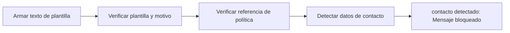

# Feature Specification: SF-08.1 — Validación del mensaje

**Created**: 2026-10-19  
**Status**: draft  
**Flow**: [F-08 Notificación al pasajero](51-f-08-notificacion-al-pasajero.md) (subflujo)  
**Related Specs**: [F-08 Notificación al pasajero](51-f-08-notificacion-al-pasajero.md), [SF-08.2 Llave idempotente y reserva atómica](53-sf-08-2-llave-idempotente-y-reserva-atomica.md)  
**Origen (DEC/H)**: DEC-20, H-21  
**Pruebas (TC)**: TC-16, TC-48, TC-60  
**Contratos externos**: §2.1 (herramienta 7: plantilla fija)  

## Reglas de este documento

> Este spec es FUNCIONAL, no técnico: describe QUÉ hace el sistema, no CÓMO. Usa lenguaje de negocio; las siete herramientas externas se nombran por su función y se referencian por la sección de `sdd/reports/EXTERNAL_CONTRACTS.md`. Los casos borde se DOCUMENTAN; los valores de configuración se citan por el nombre del parámetro (NFR-012) con su valor por defecto entre paréntesis.

**Alcance**: Construye el texto de la plantilla con el motivo cerrado y lo valida: texto idéntico a la plantilla, referencia de política según el tipo, destinatario y ausencia de datos de contacto.

## User Scenarios & Testing *(mandatory)*

### User Story 1 - El validador es la última barrera anti-suplantación (Priority: P1)

Como responsable de seguridad, quiero que ningún aviso salga si no es exactamente la plantilla aprobada.

**Why this priority**: Un aviso adulterado podría usarse para engañar a pasajeros.

**Independent Test**: Se prueba con textos válidos y con variantes que traen enlace, dominio, arroba, secuencias de dígitos o `wa.me`.

**Acceptance Scenarios**:

1. **Scenario**: Texto válido
   - **Given** plantilla fija con «un retraso» y referencia de política
   - **When** se valida
   - **Then** pasa

2. **Scenario**: Informativo sin referencia
   - **Given** tipo informativo y sin referencia de política
   - **When** se valida
   - **Then** pasa; con referencia sería bloqueado

3. **Scenario**: Con contacto
   - **Given** el texto trae un enlace, dominio, correo o teléfono
   - **When** se valida
   - **Then** se bloquea y no se envía

4. **Scenario**: Sin titular adulto para el destinatario (TC-60)
   - **Given** una reserva ABC123 con un solo pasajero, el niño P2, sin titular adulto, con un retraso E-1001 de 180 min (R1 concede REBOOK_NO_FEE) que rompe la política POL-DELAY-2026-03 y la notificación activa
   - **When** se arma el mensaje
   - **Then** no se envía ningún aviso: el estado es NOT_SENT con la razón NO_ADULT_RECIPIENT («sin destinatario adulto») y la revisión manual queda verdadera

5. **Scenario**: Enlace en el texto (TC-48, TC-16)
   - **Given** un texto con «www.ejemplo.test» y otro sin referencia de política con tipo política
   - **When** pasan por el validador
   - **Then** ambos se bloquean antes de llamar

---

### Edge Cases

> Solo se documentan; los marcados MUST-IMPLEMENT se vuelven requisito FR-XXX y se implementan con TDD, los DEFERRED quedan para una iteración posterior.

#### Invalid Data
- [MUST-IMPLEMENT] Cuando el destinatario no es la reserva o es un menor → se bloquea (FR-122)
- [MUST-IMPLEMENT] Cuando la reserva no tiene titular adulto → el aviso no se envía (NOT_SENT, sin destinatario adulto) y la revisión manual queda verdadera (FR-122)

#### Security & Permissions
- [MUST-IMPLEMENT] Cuando el tipo es de política y falta la referencia → se bloquea (FR-081)
- [MUST-IMPLEMENT] Cuando el motivo no pertenece a la enumeración cerrada → se bloquea (FR-122)
- [MUST-IMPLEMENT] Cuando se arma el destinatario → es el titular adulto de la reserva, nunca el menor (FR-122)

## Requirements *(mandatory)*

### Functional Requirements

- **FR-081**: Un validador propio DEBE revisar todo mensaje dinámico antes de devolverlo y el contrato de notificación: bloquea un hecho sin evidencia vigente o un campo fuera de la lista blanca; exige referencia de política a los mensajes que afirman una opción o un derecho y a toda notificación de política; el aviso informativo de cambio de puerta va sin referencia de política. Los textos estáticos de la interfaz están exentos.
- **FR-122**: En modo sistema se DEBE enviar la notificación con la plantilla fija «Hubo un cambio en tu vuelo asociado a {motivo}. Revisa tu reserva en la web o en la aplicación.» en dos casos: (a) política rota, con motivo «un retraso» y la referencia de política evaluada; (b) cambio de puerta validado, con motivo «un cambio de puerta», sin consultar política y sin referencia de política (aviso informativo). El motivo es una enumeración cerrada, se envía una notificación por motivo, el destinatario es la reserva y el aviso se dirige al titular adulto de la reserva, nunca al menor (si la reserva no tiene titular adulto no se envía, se registra «sin destinatario adulto» y se marca la revisión manual), y el mensaje NO contiene dirección web, enlace, teléfono ni dato de contacto (protección contra suplantación); el validador (FR-081) bloquea cualquiera de ellos.

### Key Entities *(include if feature involves data)*

- **Notificación**: Aviso al pasajero enviado solo por el sistema, con plantilla fija, una por motivo. Campos principales:
  - `reason`: DELAY | GATE_CHANGE
  - `kind`: POLICY | INFORMATIONAL
  - `policy_ref`: texto | ausente (ausente si kind es INFORMATIONAL)
  - `booking_id`: destinatario: texto
  - `recipient_passenger_id`: identificador del titular adulto (nunca un menor) | ausente si no hay adulto
  - `motive_fingerprint`: texto: DELAY = versión de política + reglas disparadas; GATE_CHANGE = puerta validada de cada segmento
  - `idempotency_key`: texto no adivinable
  - `attempt`: entero ≥ 1
  - `status`: EN_CURSO | QUEUED | FALLIDA | INDETERMINADA | VENCIDA | NOT_SENT
  - `notification_id`: texto | nulo
  - `not_sent_reason`: NOTIFY_DISABLED | NO_BROKEN_POLICY | NO_ADULT_RECIPIENT | nulo
  - `deduplicated`: booleano
  - `attempts`: entero
- **Mensaje validado**: Texto de plantilla con su evidencia, aprobado por el validador antes de mostrarse o enviarse. Campos principales:
  - `message_id`: texto
  - `template_id`: texto del catálogo
  - `kind`: INFO | ESTIMATE | WARNING | NEXT_STEP | DEADLINE
  - `text`: texto en español neutro
  - `evidence_refs`: lista de identificadores
  - `policy_ref`: texto | nulo
  - `blocked`: booleano

## Architectural Attributes *(mandatory)*

| Attribute | Value |
|-----------|-------|
| **Interaction type** | sync-http |
| **Consistency** | strong |
| **Workflow** | single-step |
| **Read pattern** | simple |
| **Auditability** | full-history |
| **Domain complexity** | medium |
| **Modularity** | bounded-context |
| **Deployment** | monolith |

## Success Criteria *(mandatory)*

### Measurable Outcomes

- **SC-001**: El 100 % de los textos con datos de contacto se bloquea antes de llamar.

## Traceability *(mandatory after implementation)*

> Las columnas de archivo y línea se registran en la verificación de trazabilidad posterior a la implementación; hoy cada criterio queda enlazado a su origen y a las pruebas que lo verifican.

| Criterion | Origen | Prueba (TC) | Source File | Line(s) |
|-----------|--------|-------------|-------------|---------|
| FR-081 | DEC-20, H-21 | TC-16, TC-48 | se registra en la verificación posterior a la implementación | se registra en la verificación posterior a la implementación |
| FR-122 | H-21 | TC-48, TC-60 | se registra en la verificación posterior a la implementación | se registra en la verificación posterior a la implementación |
| SC-001 | criterio medible de este spec | TC-16, TC-48, TC-60 | se registra en la verificación posterior a la implementación | se registra en la verificación posterior a la implementación |

## Business Process (BPM View)

```
Armar texto de plantilla → Verificar plantilla y motivo → Verificar referencia de política → Detectar datos de contacto
```



