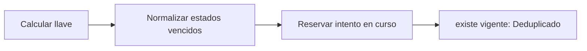

# Feature Specification: SF-08.2 — Llave idempotente y reserva atómica

**Created**: 2026-10-19  
**Status**: draft  
**Flow**: [F-08 Notificación al pasajero](51-f-08-notificacion-al-pasajero.md) (subflujo)  
**Related Specs**: [F-08 Notificación al pasajero](51-f-08-notificacion-al-pasajero.md), [SF-08.1 Validación del mensaje](52-sf-08-1-validacion-del-mensaje.md), [SF-08.3 Llamada con reintentos](54-sf-08-3-llamada-con-reintentos.md)  
**Origen (DEC/H)**: DEC-18  
**Pruebas (TC)**: TC-44, TC-55, TC-60  
**Contratos externos**: §2.1 (herramienta 7: idempotencia y enfriamiento), §2.4 (`NOTIFY_COOLDOWN_SECONDS`)  

## Reglas de este documento

> Este spec es FUNCIONAL, no técnico: describe QUÉ hace el sistema, no CÓMO. Usa lenguaje de negocio; las siete herramientas externas se nombran por su función y se referencian por la sección de `sdd/reports/EXTERNAL_CONTRACTS.md`. Los casos borde se DOCUMENTAN; los valores de configuración se citan por el nombre del parámetro (NFR-012) con su valor por defecto entre paréntesis.

**Alcance**: Calcula la llave por reserva, motivo, huella del motivo y plantilla y reserva el intento en curso antes de llamar, gestionando las transiciones por enfriamiento.

## User Scenarios & Testing *(mandatory)*

### User Story 1 - Cada cambio se avisa una vez (Priority: P1)

Como pasajero, quiero recibir un aviso por cada cambio real y no repetidos por el mismo.

**Why this priority**: El enfriamiento evita el correo basura.

**Independent Test**: Se prueba con repeticiones, con una puerta que cambia y con un intento fallido previo.

**Acceptance Scenarios**:

1. **Scenario**: Misma situación
   - **Given** ya hay un aviso vigente dentro del enfriamiento
   - **When** se pide de nuevo
   - **Then** no se reenvía, con indicación de deduplicado

2. **Scenario**: Solo cambian los minutos
   - **Given** el retraso pasa de 160 a 170 minutos con la misma versión de política y las mismas reglas cumplidas
   - **When** se pide de nuevo
   - **Then** la llave no cambia y el aviso no se repite

3. **Scenario**: Cambio de puerta
   - **Given** la puerta pasa de 24 a 25
   - **When** se pide
   - **Then** la llave cambia y se envía un aviso nuevo

4. **Scenario**: Tras un fallo
   - **Given** el intento anterior fue fallido o vencido
   - **When** se pide
   - **Then** se permite una reserva nueva de inmediato

5. **Scenario**: Misma situación y puerta 24 a 25 (TC-44, TC-55)
   - **Given** un aviso en cola hace 1 h con `NOTIFY_COOLDOWN_SECONDS` de 86400
   - **When** se pide de nuevo con la misma puerta y luego con la puerta 25
   - **Then** la primera se deduplica y la segunda envía un aviso nuevo

---

### Edge Cases

> Solo se documentan; los marcados MUST-IMPLEMENT se vuelven requisito FR-XXX y se implementan con TDD, los DEFERRED quedan para una iteración posterior.

#### System Errors
- [MUST-IMPLEMENT] Cuando un intento en curso quedó colgado → pasa a indeterminado dentro de la misma transacción de reserva (FR-064)

#### Invalid Data
- [MUST-IMPLEMENT] Cuando el retraso cambia solo de minutos y las reglas disparadas y la versión de política son las mismas → la huella del motivo no cambia y no se repite el aviso (FR-123)

#### Race Conditions
- [MUST-IMPLEMENT] Cuando dos peticiones coinciden → una reserva y la otra se deduplica (estado en curso) (FR-123)

## Requirements *(mandatory)*

### Functional Requirements

- **FR-064**: La operación de cambio DEBE seguir un ciclo de vida: en curso, creada, indeterminada, fallida y expirada. En curso pasa a indeterminada tras `OPERATION_STALE_SECONDS` (120) sin respuesta; creada pasa a expirada en su vencimiento; indeterminada pasa a expirada tras `OPERATION_INDETERMINATE_EXPIRY_SECONDS` (900, mayor que la vigencia de una solicitud) si nada la resuelve. Si la llave no pudo persistirse no se escribe. Expirada o fallida permiten una operación nueva con la generación siguiente; creada, en curso e indeterminada la bloquean y la vista muestra su estado. Un rechazo por duplicado sin operación local se muestra «ya existe una solicitud para esta opción».
- **FR-123**: La notificación DEBE ser idempotente: no se reenvía la misma (reserva, motivo, huella del motivo y plantilla) dentro de `NOTIFY_COOLDOWN_SECONDS` (86400); aceptada queda en cola, rechazo explícito es fallida, tiempo agotado es indeterminada, con hasta `NOTIFY_MAX_RETRIES` (2) reintentos con la misma llave y sin afirmar éxito. La huella del cambio de puerta incluye la puerta validada de cada segmento, de modo que un cambio posterior genera un aviso nuevo; la del retraso es la versión de política más las reglas disparadas, de modo que un cambio solo de minutos no repite el aviso. Sin política rota y sin cambio de puerta validado no se notifica y se registra la revisión manual; con política rota se notifica aunque la decisión sea BLOQUEADA o PENDIENTE_APROBACION.

### Non-Functional and Documentation Requirements

- **NFR-012**: Configuración: todos los parámetros de los supuestos S-09 a S-19 DEBEN ser variables configurables (archivo de configuración con sobrescritura por entorno, validadas al arrancar y con valor por defecto documentado) y ninguno puede estar fijado en la lógica; entre ellos `RELEVANT_DELAY_MIN_MINUTES` (1), `MIN_CONNECTION_MINUTES` (0 por aeropuerto), `MCT_UNCERTAINTY_MINUTES` (45), `CLOCK_SKEW_SECONDS` (60), `EVENT_MAX_AGE_SECONDS` (sin límite), `OPERATION_STALE_SECONDS` (120), `REBOOK_MAX_RETRIES` (2), `AUDIT_RETENTION_DAYS` (30), `PARSER_MAX_CONDITION_CHARS` (200), `PARSER_MAX_DEPTH` (10), `REMEDY_RIGHTS`, `COMPENSATION_RIGHTS`, `NOTIFY_ENABLED`, `NOTIFY_COOLDOWN_SECONDS` (86400), `NOTIFY_MAX_RETRIES` (2), `OPERATION_INDETERMINATE_EXPIRY_SECONDS` (900), `EVALUATE_RATE_LIMIT_PER_MINUTE` (30), `CHANGE_RIGHTS`, `SUPPORTED_EVENT_TYPES`, `NOTIFY_ONLY_EVENT_TYPES`, `POLICY_SCENARIOS`, `REASON_PRIORITY`, la tabla de compatibilidad de afirmaciones y los secretos `SERVICE_API_KEY` e `IDEMPOTENCY_SECRET` (solo por entorno). Una prueba cambia cada parámetro y comprueba que cambia el comportamiento. También son configurables los parámetros operativos de `sdd/reports/EXTERNAL_CONTRACTS.md` §2.4 (tiempos de espera, reintentos de lectura, modo de reloj, origen permitido, ubicación del registro y banderas de desarrollo).

### Key Entities *(include if feature involves data)*

- **Notificación**: Aviso al pasajero enviado solo por el sistema, con plantilla fija, una por motivo. Campos principales:
  - `reason`: DELAY | GATE_CHANGE
  - `kind`: POLICY | INFORMATIONAL
  - `policy_ref`: texto | ausente (ausente si kind es INFORMATIONAL)
  - `booking_id`: destinatario: texto
  - `recipient_passenger_id`: identificador del titular adulto (nunca un menor) | ausente si no hay adulto
  - `motive_fingerprint`: texto: DELAY = versión de política + reglas disparadas; GATE_CHANGE = puerta validada de cada segmento
  - `idempotency_key`: texto no adivinable
  - `attempt`: entero ≥ 1
  - `status`: EN_CURSO | QUEUED | FALLIDA | INDETERMINADA | VENCIDA | NOT_SENT
  - `notification_id`: texto | nulo
  - `not_sent_reason`: NOTIFY_DISABLED | NO_BROKEN_POLICY | NO_ADULT_RECIPIENT | nulo
  - `deduplicated`: booleano
  - `attempts`: entero

## Architectural Attributes *(mandatory)*

| Attribute | Value |
|-----------|-------|
| **Interaction type** | sync-http |
| **Consistency** | strong |
| **Workflow** | single-step |
| **Read pattern** | simple |
| **Auditability** | full-history |
| **Domain complexity** | medium |
| **Modularity** | bounded-context |
| **Deployment** | monolith |

## Success Criteria *(mandatory)*

### Measurable Outcomes

- **SC-001**: Cero avisos duplicados por la misma (reserva, motivo, huella, plantilla) dentro del enfriamiento.

## Traceability *(mandatory after implementation)*

> Las columnas de archivo y línea se registran en la verificación de trazabilidad posterior a la implementación; hoy cada criterio queda enlazado a su origen y a las pruebas que lo verifican.

| Criterion | Origen | Prueba (TC) | Source File | Line(s) |
|-----------|--------|-------------|-------------|---------|
| FR-064 | DEC-18 | sin TC en el mapa §6 de REQUERIMIENTOS_V1 | se registra en la verificación posterior a la implementación | se registra en la verificación posterior a la implementación |
| FR-123 | Usuario (2026-10-19) | TC-44, TC-55, TC-60 | se registra en la verificación posterior a la implementación | se registra en la verificación posterior a la implementación |
| NFR-012 | Usuario (2026-10-19) | sin TC en el mapa §6 de REQUERIMIENTOS_V1 | se registra en la verificación posterior a la implementación | se registra en la verificación posterior a la implementación |
| SC-001 | criterio medible de este spec | TC-44, TC-55, TC-60 | se registra en la verificación posterior a la implementación | se registra en la verificación posterior a la implementación |

## Business Process (BPM View)

```
Calcular llave → Normalizar estados vencidos → Reservar intento en curso
```



