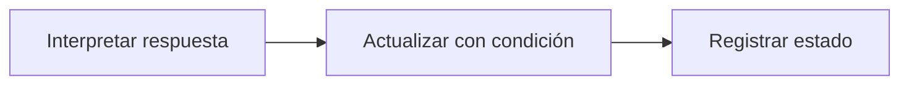

# Feature Specification: SF-08.4 — Mapeo de resultados y registro

**Created**: 2026-10-19  
**Status**: draft  
**Flow**: [F-08 Notificación al pasajero](51-f-08-notificacion-al-pasajero.md) (subflujo)  
**Related Specs**: [F-08 Notificación al pasajero](51-f-08-notificacion-al-pasajero.md), [SF-08.3 Llamada con reintentos](54-sf-08-3-llamada-con-reintentos.md)  
**Origen (DEC/H)**: Usuario (2026-10-19)  
**Pruebas (TC)**: TC-44  
**Contratos externos**: §2.1 (herramienta 7: resultados)  

## Reglas de este documento

> Este spec es FUNCIONAL, no técnico: describe QUÉ hace el sistema, no CÓMO. Usa lenguaje de negocio; las siete herramientas externas se nombran por su función y se referencian por la sección de `sdd/reports/EXTERNAL_CONTRACTS.md`. Los casos borde se DOCUMENTAN; los valores de configuración se citan por el nombre del parámetro (NFR-012) con su valor por defecto entre paréntesis.

**Alcance**: Traduce la respuesta a estados (en cola, fallida, indeterminada) y registra con actualización condicional por intento y estado esperado.

## User Scenarios & Testing *(mandatory)*

### User Story 1 - Un resultado atrasado no pisa uno nuevo (Priority: P1)

Como operador, quiero que una respuesta tardía de un intento viejo no modifique el estado de uno nuevo.

**Why this priority**: Las respuestas pueden llegar fuera de orden.

**Independent Test**: Se prueba con una respuesta tardía de un intento anterior.

**Acceptance Scenarios**:

1. **Scenario**: Aceptada
   - **Given** el proveedor acepta
   - **When** se registra
   - **Then** estado «en cola»; no se afirma entrega

2. **Scenario**: Fuera de orden
   - **Given** llega la respuesta de un intento viejo cuando ya hay uno nuevo
   - **When** se registra
   - **Then** no cambia el nuevo ni sobrescribe un estado final

3. **Scenario**: Respuesta fuera de orden (TC-44)
   - **Given** el intento 1 pasó a vencida y existe el intento 2 en curso
   - **When** llega la respuesta 202 del intento 1
   - **Then** no modifica el intento 2

---

### Edge Cases

> Solo se documentan; los marcados MUST-IMPLEMENT se vuelven requisito FR-XXX y se implementan con TDD, los DEFERRED quedan para una iteración posterior.

#### Invalid Data
- [MUST-IMPLEMENT] Cuando la respuesta es rechazo → fallida y permite una reserva nueva (FR-123)

#### Race Conditions
- [MUST-IMPLEMENT] Cuando la actualización no coincide con el estado esperado → afecta cero filas y se ignora (FR-123)

## Requirements *(mandatory)*

### Functional Requirements

- **FR-123**: La notificación DEBE ser idempotente: no se reenvía la misma (reserva, motivo, huella del motivo y plantilla) dentro de `NOTIFY_COOLDOWN_SECONDS` (86400); aceptada queda en cola, rechazo explícito es fallida, tiempo agotado es indeterminada, con hasta `NOTIFY_MAX_RETRIES` (2) reintentos con la misma llave y sin afirmar éxito. La huella del cambio de puerta incluye la puerta validada de cada segmento, de modo que un cambio posterior genera un aviso nuevo; la del retraso es la versión de política más las reglas disparadas, de modo que un cambio solo de minutos no repite el aviso. Sin política rota y sin cambio de puerta validado no se notifica y se registra la revisión manual; con política rota se notifica aunque la decisión sea BLOQUEADA o PENDIENTE_APROBACION.

### Key Entities *(include if feature involves data)*

- **Notificación**: Aviso al pasajero enviado solo por el sistema, con plantilla fija, una por motivo. Campos principales:
  - `reason`: DELAY | GATE_CHANGE
  - `kind`: POLICY | INFORMATIONAL
  - `policy_ref`: texto | ausente (ausente si kind es INFORMATIONAL)
  - `booking_id`: destinatario: texto
  - `recipient_passenger_id`: identificador del titular adulto (nunca un menor) | ausente si no hay adulto
  - `motive_fingerprint`: texto: DELAY = versión de política + reglas disparadas; GATE_CHANGE = puerta validada de cada segmento
  - `idempotency_key`: texto no adivinable
  - `attempt`: entero ≥ 1
  - `status`: EN_CURSO | QUEUED | FALLIDA | INDETERMINADA | VENCIDA | NOT_SENT
  - `notification_id`: texto | nulo
  - `not_sent_reason`: NOTIFY_DISABLED | NO_BROKEN_POLICY | NO_ADULT_RECIPIENT | nulo
  - `deduplicated`: booleano
  - `attempts`: entero

## Architectural Attributes *(mandatory)*

| Attribute | Value |
|-----------|-------|
| **Interaction type** | sync-http |
| **Consistency** | strong |
| **Workflow** | single-step |
| **Read pattern** | simple |
| **Auditability** | full-history |
| **Domain complexity** | medium |
| **Modularity** | bounded-context |
| **Deployment** | monolith |

## Success Criteria *(mandatory)*

### Measurable Outcomes

- **SC-001**: Una respuesta fuera de orden modifica 0 registros.

## Traceability *(mandatory after implementation)*

> Las columnas de archivo y línea se registran en la verificación de trazabilidad posterior a la implementación; hoy cada criterio queda enlazado a su origen y a las pruebas que lo verifican.

| Criterion | Origen | Prueba (TC) | Source File | Line(s) |
|-----------|--------|-------------|-------------|---------|
| FR-123 | Usuario (2026-10-19) | TC-44 | se registra en la verificación posterior a la implementación | se registra en la verificación posterior a la implementación |
| SC-001 | criterio medible de este spec | TC-44 | se registra en la verificación posterior a la implementación | se registra en la verificación posterior a la implementación |

## Business Process (BPM View)

```
Interpretar respuesta → Actualizar con condición → Registrar estado
```



