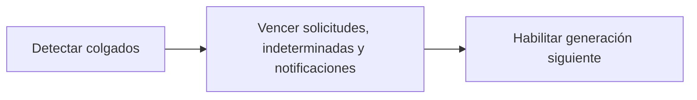

# Feature Specification: F-09 — Ciclo de vida de operaciones, intentos de caso y notificaciones (barrido perezoso)

**Created**: 2026-10-19  
**Status**: draft  
**Flow**: F-09 Ciclo de vida de operaciones, intentos de caso y notificaciones (barrido perezoso)  
**Related Specs**: [SF-09.1 Detección de operaciones, casos y notificaciones colgados](57-sf-09-1-deteccion-de-operaciones-casos-y-notificaciones.md), [SF-09.2 Vencimiento de solicitudes creadas e indeterminadas](58-sf-09-2-vencimiento-de-solicitudes-creadas-e-indetermina.md), [SF-09.3 Generación siguiente de la llave](59-sf-09-3-generacion-siguiente-de-la-llave.md), [F-01 Evaluar viaje como pasajero](01-f-01-evaluar-viaje-como-pasajero.md), [F-02 Aceptar opción](16-f-02-aceptar-opcion.md)  
**Origen (DEC/H)**: DEC-15, DEC-18, DEC-23  
**Pruebas (TC)**: TC-22, TC-38, TC-44, TC-57  
**Contratos externos**: §2.1 (herramienta 5: ciclo de vida de la operación), §2.3, §2.4 (`OPERATION_STALE_SECONDS`)  

## Reglas de este documento

> Este spec es FUNCIONAL, no técnico: describe QUÉ hace el sistema, no CÓMO. Usa lenguaje de negocio; las siete herramientas externas se nombran por su función y se referencian por la sección de `sdd/reports/EXTERNAL_CONTRACTS.md`. Los casos borde se DOCUMENTAN; los valores de configuración se citan por el nombre del parámetro (NFR-012) con su valor por defecto entre paréntesis.

**Alcance**: Al leer los registros aplica las transiciones por el paso del tiempo: operación o intento en curso sin respuesta pasa a indeterminado, solicitud creada pasa a expirada, operación indeterminada pasa a expirada tras `OPERATION_INDETERMINATE_EXPIRY_SECONDS` (900), operación indeterminada pasa a expirada tras `OPERATION_INDETERMINATE_EXPIRY_SECONDS` (900), notificación en cola o indeterminada con enfriamiento terminado pasa a vencida, y una expirada o fallida admite la generación siguiente.

## User Scenarios & Testing *(mandatory)*

### User Story 1 - Los estados reflejan el paso del tiempo sin tareas programadas (Priority: P1)

Como pasajero, quiero que si una solicitud quedó colgada o venció, la vista lo refleje y pueda intentar de nuevo cuando corresponda.

**Why this priority**: Evita bloqueos eternos y estados mentirosos sin necesidad de un proceso periódico.

**Independent Test**: Se prueba avanzando el reloj sobre cada tipo de registro.

**Acceptance Scenarios**:

1. **Scenario**: Colgada
   - **Given** una operación en curso sobrepasó `OPERATION_STALE_SECONDS` (120)
   - **When** se lee el registro
   - **Then** pasa a indeterminada

2. **Scenario**: Vencida
   - **Given** una solicitud creada llegó a su vencimiento
   - **When** se lee el registro
   - **Then** pasa a expirada y permite una operación nueva con la generación siguiente

3. **Scenario**: Indeterminada vencida
   - **Given** una operación indeterminada superó `OPERATION_INDETERMINATE_EXPIRY_SECONDS` (900)
   - **When** se lee el registro
   - **Then** pasa a expirada y permite una operación nueva con la generación siguiente

4. **Scenario**: Notificación
   - **Given** una notificación en cola o indeterminada superó el enfriamiento
   - **When** se lee
   - **Then** pasa a vencida y permite una nueva reserva

5. **Scenario**: Tres transiciones por tiempo (TC-38, TC-57)
   - **Given** operación en curso hace 121 s, solicitud creada con vencimiento 11:12:00Z e indeterminada de 900 s
   - **When** se lee el registro a las 11:12:01Z
   - **Then** pasan a indeterminada, expirada y expirada

---

### Edge Cases

> Solo se documentan; los marcados MUST-IMPLEMENT se vuelven requisito FR-XXX y se implementan con TDD, los DEFERRED quedan para una iteración posterior.

#### System Errors
- [MUST-IMPLEMENT] Cuando la llave no puede persistirse → no se escribe (FR-064)
- [MUST-IMPLEMENT] Cuando una operación indeterminada supera `OPERATION_INDETERMINATE_EXPIRY_SECONDS` sin resolverse → expirada (FR-064)

#### Invalid Data
- [DEFERRED] Resolución de una indeterminada por un agente: Fase 2; riesgo S-20: una solicitud indeterminada que sí se creó y cuya vigencia fuera mayor podría duplicarse con un intento nuevo (FR-064)

#### Race Conditions
- [MUST-IMPLEMENT] Cuando dos lecturas barren a la vez → la transición se aplica una sola vez (FR-062)

## Requirements *(mandatory)*

### Functional Requirements

- **FR-053**: La identidad de una operación de cambio es la reserva más el itinerario de la opción. Al crearla se calcula una llave de idempotencia no adivinable a partir de reserva, vuelo, fecha, salida, versión de política y generación (sin identificador de decisión ni marcas de tiempo), se guarda en el registro de operaciones de forma atómica y única antes de llamar, y toda reevaluación la reutiliza mientras la operación no haya fracasado, aunque cambie la versión de política.
- **FR-059**: Al crear un caso humano el sistema DEBE enviar el motivo de mayor prioridad y conservar todos los motivos simultáneos, con evidencia solo de identificadores, enumeraciones y hechos validados (sin información personal), tomada de la decisión guardada si el pasajero indica la decisión que vio y, si no, de una evaluación fresca. La deduplicación local se calcula con reserva, motivos ordenados y huella de decisión, no bloquea el reintento explícito tras un intento fallido o indeterminado, y cada intento y su resultado (creado, fallido, indeterminado) queda registrado. No requiere revalidación.
- **FR-062**: Dos aceptaciones simultáneas, o una aceptación mientras la operación está en curso, indeterminada o creada, DEBEN resultar en una sola escritura; la segunda devuelve el estado de la primera y el botón se deshabilita mientras hay una solicitud en curso.
- **FR-064**: La operación de cambio DEBE seguir un ciclo de vida: en curso, creada, indeterminada, fallida y expirada. En curso pasa a indeterminada tras `OPERATION_STALE_SECONDS` (120) sin respuesta; creada pasa a expirada en su vencimiento; indeterminada pasa a expirada tras `OPERATION_INDETERMINATE_EXPIRY_SECONDS` (900, mayor que la vigencia de una solicitud) si nada la resuelve. Si la llave no pudo persistirse no se escribe. Expirada o fallida permiten una operación nueva con la generación siguiente; creada, en curso e indeterminada la bloquean y la vista muestra su estado. Un rechazo por duplicado sin operación local se muestra «ya existe una solicitud para esta opción».
- **FR-123**: La notificación DEBE ser idempotente: no se reenvía la misma (reserva, motivo, huella del motivo y plantilla) dentro de `NOTIFY_COOLDOWN_SECONDS` (86400); aceptada queda en cola, rechazo explícito es fallida, tiempo agotado es indeterminada, con hasta `NOTIFY_MAX_RETRIES` (2) reintentos con la misma llave y sin afirmar éxito. La huella del cambio de puerta incluye la puerta validada de cada segmento, de modo que un cambio posterior genera un aviso nuevo; la del retraso es la versión de política más las reglas disparadas, de modo que un cambio solo de minutos no repite el aviso. Sin política rota y sin cambio de puerta validado no se notifica y se registra la revisión manual; con política rota se notifica aunque la decisión sea BLOQUEADA o PENDIENTE_APROBACION.

### Non-Functional and Documentation Requirements

- **NFR-012**: Configuración: todos los parámetros de los supuestos S-09 a S-19 DEBEN ser variables configurables (archivo de configuración con sobrescritura por entorno, validadas al arrancar y con valor por defecto documentado) y ninguno puede estar fijado en la lógica; entre ellos `RELEVANT_DELAY_MIN_MINUTES` (1), `MIN_CONNECTION_MINUTES` (0 por aeropuerto), `MCT_UNCERTAINTY_MINUTES` (45), `CLOCK_SKEW_SECONDS` (60), `EVENT_MAX_AGE_SECONDS` (sin límite), `OPERATION_STALE_SECONDS` (120), `REBOOK_MAX_RETRIES` (2), `AUDIT_RETENTION_DAYS` (30), `PARSER_MAX_CONDITION_CHARS` (200), `PARSER_MAX_DEPTH` (10), `REMEDY_RIGHTS`, `COMPENSATION_RIGHTS`, `NOTIFY_ENABLED`, `NOTIFY_COOLDOWN_SECONDS` (86400), `NOTIFY_MAX_RETRIES` (2), `OPERATION_INDETERMINATE_EXPIRY_SECONDS` (900), `EVALUATE_RATE_LIMIT_PER_MINUTE` (30), `CHANGE_RIGHTS`, `SUPPORTED_EVENT_TYPES`, `NOTIFY_ONLY_EVENT_TYPES`, `POLICY_SCENARIOS`, `REASON_PRIORITY`, la tabla de compatibilidad de afirmaciones y los secretos `SERVICE_API_KEY` e `IDEMPOTENCY_SECRET` (solo por entorno). Una prueba cambia cada parámetro y comprueba que cambia el comportamiento. También son configurables los parámetros operativos de `sdd/reports/EXTERNAL_CONTRACTS.md` §2.4 (tiempos de espera, reintentos de lectura, modo de reloj, origen permitido, ubicación del registro y banderas de desarrollo).

### Key Entities *(include if feature involves data)*

- **Operación de reprogramación**: Intento de crear una solicitud de cambio, con su llave de idempotencia y su ciclo de vida. Campos principales:
  - `itinerary_key`: texto
  - `idempotency_key`: texto no adivinable
  - `generation`: entero ≥ 1
  - `state`: EN_CURSO | CREADA | INDETERMINADA | FALLIDA | EXPIRADA (INDETERMINADA pasa a EXPIRADA tras `OPERATION_INDETERMINATE_EXPIRY_SECONDS`)
  - `request_id`: texto | nulo
  - `request_status`: enumeración abierta (p. ej. PENDING_CONFIRMATION) | nulo
  - `expires_at`: marca de tiempo UTC | nulo
  - `passenger_ids`: lista de texto con TODO el grupo
  - `minimized`: booleano: verdadero cuando la purga conservó solo la identidad, el estado y la vigencia de la operación (sin itinerario ni pasajeros) para no perder su bloqueo
- **Caso humano**: Escalamiento a una persona; cada intento queda registrado con su resultado. Campos principales:
  - `dedup_key`: texto
  - `attempt`: entero ≥ 1
  - `state`: EN_CURSO | CREADO | FALLIDO | INDETERMINADO
  - `reason`: uno de los 13 motivos cerrados
  - `reasons`: lista ordenada por prioridad
  - `case_id`: texto | nulo
  - `queue`: texto | nulo
  - `sla_minutes`: entero | nulo
  - `option`: {option_id: texto, itinerario y diferencia de tarifa} | nulo
  - `confirm_possible_duplicate`: booleano
- **Notificación**: Aviso al pasajero enviado solo por el sistema, con plantilla fija, una por motivo. Campos principales:
  - `reason`: DELAY | GATE_CHANGE
  - `kind`: POLICY | INFORMATIONAL
  - `policy_ref`: texto | ausente (ausente si kind es INFORMATIONAL)
  - `booking_id`: destinatario: texto
  - `recipient_passenger_id`: identificador del titular adulto (nunca un menor) | ausente si no hay adulto
  - `motive_fingerprint`: texto: DELAY = versión de política + reglas disparadas; GATE_CHANGE = puerta validada de cada segmento
  - `idempotency_key`: texto no adivinable
  - `attempt`: entero ≥ 1
  - `status`: EN_CURSO | QUEUED | FALLIDA | INDETERMINADA | VENCIDA | NOT_SENT
  - `notification_id`: texto | nulo
  - `not_sent_reason`: NOTIFY_DISABLED | NO_BROKEN_POLICY | NO_ADULT_RECIPIENT | nulo
  - `deduplicated`: booleano
  - `attempts`: entero

## Architectural Attributes *(mandatory)*

| Attribute | Value |
|-----------|-------|
| **Interaction type** | sync-http |
| **Consistency** | strong |
| **Workflow** | multi-step |
| **Read pattern** | simple |
| **Auditability** | full-history |
| **Domain complexity** | high |
| **Modularity** | bounded-context |
| **Deployment** | monolith |

## Success Criteria *(mandatory)*

### Measurable Outcomes

- **SC-001**: El 100 % de los registros vencidos se muestra con su estado actual en la siguiente lectura.
- **SC-002**: No hay ningún proceso periódico: toda transición ocurre al leer.

## Traceability *(mandatory after implementation)*

> Las columnas de archivo y línea se registran en la verificación de trazabilidad posterior a la implementación; hoy cada criterio queda enlazado a su origen y a las pruebas que lo verifican.

| Criterion | Origen | Prueba (TC) | Source File | Line(s) |
|-----------|--------|-------------|-------------|---------|
| FR-053 | DEC-18 | TC-22 | se registra en la verificación posterior a la implementación | se registra en la verificación posterior a la implementación |
| FR-059 | DEC-15, DEC-23 | sin TC en el mapa §6 de REQUERIMIENTOS_V1 | se registra en la verificación posterior a la implementación | se registra en la verificación posterior a la implementación |
| FR-062 | DEC-18 | TC-22 | se registra en la verificación posterior a la implementación | se registra en la verificación posterior a la implementación |
| FR-064 | DEC-18 | TC-38, TC-57 | se registra en la verificación posterior a la implementación | se registra en la verificación posterior a la implementación |
| FR-123 | Usuario (2026-10-19) | TC-44 | se registra en la verificación posterior a la implementación | se registra en la verificación posterior a la implementación |
| NFR-012 | Usuario (2026-10-19) | sin TC en el mapa §6 de REQUERIMIENTOS_V1 | se registra en la verificación posterior a la implementación | se registra en la verificación posterior a la implementación |
| SC-001 | criterio medible de este spec | TC-22, TC-38, TC-44, TC-57 | se registra en la verificación posterior a la implementación | se registra en la verificación posterior a la implementación |
| SC-002 | criterio medible de este spec | TC-22, TC-38, TC-44, TC-57 | se registra en la verificación posterior a la implementación | se registra en la verificación posterior a la implementación |

## Business Process (BPM View)

```
Detectar colgados → Vencer solicitudes, indeterminadas y notificaciones → Habilitar generación siguiente
```



### Subprocesses (if applicable)

```
SF-09.1: Detección de operaciones, casos y notificaciones colgados
SF-09.2: Vencimiento de solicitudes creadas e indeterminadas
SF-09.3: Generación siguiente de la llave
```
