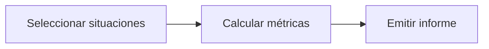

# Feature Specification: F-10 — Reporte de métricas de éxito

**Created**: 2026-10-19  
**Status**: draft  
**Flow**: F-10 Reporte de métricas de éxito  
**Related Specs**: [SF-10.1 Selección de decisiones con anomalía y deduplicación por huella](61-sf-10-1-seleccion-de-decisiones-con-anomalia-y-deduplica.md), [SF-10.2 Cálculo de las tres métricas](62-sf-10-2-calculo-de-las-tres-metricas.md), [SF-10.3 Informe](63-sf-10-3-informe.md)  
**Origen (DEC/H)**: DEC-23, DEC-24  
**Pruebas (TC)**: TC-01, TC-16  
**Contratos externos**: §2.3 (registros), ARCHITECTURE.md §7 (definiciones de métricas)  

## Reglas de este documento

> Este spec es FUNCIONAL, no técnico: describe QUÉ hace el sistema, no CÓMO. Usa lenguaje de negocio; las siete herramientas externas se nombran por su función y se referencian por la sección de `sdd/reports/EXTERNAL_CONTRACTS.md`. Los casos borde se DOCUMENTAN; los valores de configuración se citan por el nombre del parámetro (NFR-012) con su valor por defecto entre paréntesis.

**Alcance**: Por comando y de solo lectura, calcula desde el registro (sin información personal) las tres métricas: resolución sin contacto humano, tasa de casos humanos por motivo y afirmaciones sin evidencia.

## User Scenarios & Testing *(mandatory)*

### User Story 1 - Producto mide si el compañero ayuda de verdad (Priority: P1)

Como responsable de producto, quiero un reporte que me diga cuántas situaciones se resuelven sin una persona, cuántos casos humanos hay por motivo y que no hubo afirmaciones sin evidencia.

**Why this priority**: Son las métricas de éxito propuestas del reto.

**Independent Test**: Se prueba con un registro preparado con situaciones conocidas.

**Acceptance Scenarios**:

1. **Scenario**: Reporte
   - **Given** un registro con situaciones, opciones, operaciones y casos
   - **When** se ejecuta el reporte
   - **Then** informa las tres métricas con sus definiciones y la unidad de análisis

2. **Scenario**: Informativas aparte
   - **Given** hay evaluaciones informativas y del sistema
   - **When** se ejecuta
   - **Then** no cuentan como situaciones accionables y se reportan aparte

3. **Scenario**: Registro de 10 situaciones
   - **Given** 10 situaciones accionables, 4 con opción viable y operación creada sin caso humano, y 2 informativas
   - **When** se ejecuta el reporte
   - **Then** M1 es 4 de 10, las informativas se reportan aparte y M3 informa 0 afirmaciones sin evidencia

---

### Edge Cases

> Solo se documentan; los marcados MUST-IMPLEMENT se vuelven requisito FR-XXX y se implementan con TDD, los DEFERRED quedan para una iteración posterior.

#### System Errors
- [DEFERRED] No existe identificador de sesión: «sesión» se aproxima por la situación; las métricas cubren como máximo la ventana de retención (FR-092)

#### Invalid Data
- [MUST-IMPLEMENT] Cuando no hay situaciones accionables → las razones se informan como 0 sin dividir por cero (NFR-008)
- [MUST-IMPLEMENT] Cuando una misma situación se recarga → cuenta una sola vez por reserva y huella (NFR-008)

## Requirements *(mandatory)*

### Functional Requirements

- **FR-090**: Cada evaluación DEBE generar un registro con identificador de decisión, reserva, lecturas con su instante, eventos elegidos y descartados con razón, versión de política y reglas, variables derivadas con supuestos, opciones viables y descartadas con razón, acción y huella del mensaje.
- **FR-091**: Solo se persisten campos de una lista cerrada: hechos operacionales no personales, identificadores seudónimos, enumeraciones, números, marcas de tiempo y huellas. NUNCA se guardan cargas completas, nombre, contacto, documento ni edad del menor; los identificadores son seudónimos, no anónimos, y la reserva se trunca en los registros de aplicación.

### Non-Functional and Documentation Requirements

- **NFR-008**: Métricas de éxito: el sistema DEBE permitir medir desde el registro de decisiones el porcentaje de sesiones con problema donde el pasajero ve una opción viable y la acepta sin contacto humano, la tasa de casos humanos por motivo y que no haya afirmaciones sin evidencia.

### Key Entities *(include if feature involves data)*

- **Reporte de métricas**: Cálculo de las tres métricas de éxito desde el registro, sin información personal. Campos principales:
  - `situations_actionable`: entero
  - `m1_resolution_without_human`: razón entre 0 y 1
  - `m1_viable_option_shown`: razón entre 0 y 1
  - `m2_human_cases_by_reason`: lista de {reason: texto, rate: razón entre 0 y 1}
  - `m3_messages_blocked`: entero
  - `m3_unsupported_claims`: entero (debe ser 0)
  - `informative_count`: entero (se reporta aparte)
- **Registro de decisión**: Instantánea de auditoría de una evaluación, sin información personal. Campos principales:
  - `decision_id`: identificador
  - `booking_id`: texto seudónimo
  - `created_at`: marca de tiempo UTC
  - `caller`: user | system
  - `fingerprint`: texto
  - `decision_state`: estado | nulo
  - `needs_manual_review`: booleano (campo interno, no se entrega a la sesión del pasajero)
  - `policy_version`: texto | nulo
  - `mct_provided`: booleano
  - `passenger_count`: entero
  - `segments`: lista de {segment_id: texto, state: texto | nulo, delay_minutes: entero | nulo}
  - `message_hash`: texto
  - `messages_blocked`: entero
  - `reads`: lista de {tool: texto, retrieved_at: marca de tiempo | nulo, outcome: OK | FAILED | INVALID | NOT_REQUESTED}
  - `events`: lista de {event_id, segment_id, event_type, disposition: CHOSEN | DISCARDED | NOT_INTERPRETED, reason}
  - `rules`: lista de {rule_id, result, requires_human_approval}
  - `options`: lista de opciones con sus razones de descarte (también las no viables)
  - `notifications`: lista de {reason, kind, status, notification_id} (solo modo sistema; campo interno, no se entrega a la sesión del pasajero)
  - `outcomes`: lista de {kind: REBOOKING | HUMAN_CASE, reference_id: texto | nulo, state: texto, at: marca de tiempo}

## Architectural Attributes *(mandatory)*

| Attribute | Value |
|-----------|-------|
| **Interaction type** | batch |
| **Consistency** | strong |
| **Workflow** | data-pipeline |
| **Read pattern** | analytics |
| **Auditability** | full-history |
| **Domain complexity** | high |
| **Modularity** | bounded-context |
| **Deployment** | monolith |

## Success Criteria *(mandatory)*

### Measurable Outcomes

- **SC-001**: Las tres métricas se calculan solo desde el registro, sin una función de consulta nueva.
- **SC-002**: La métrica de afirmaciones sin evidencia reporta 0.

## Traceability *(mandatory after implementation)*

> Las columnas de archivo y línea se registran en la verificación de trazabilidad posterior a la implementación; hoy cada criterio queda enlazado a su origen y a las pruebas que lo verifican.

| Criterion | Origen | Prueba (TC) | Source File | Line(s) |
|-----------|--------|-------------|-------------|---------|
| FR-090 | DEC-23 | sin TC en el mapa §6 de REQUERIMIENTOS_V1 | se registra en la verificación posterior a la implementación | se registra en la verificación posterior a la implementación |
| FR-091 | DEC-23 | sin TC en el mapa §6 de REQUERIMIENTOS_V1 | se registra en la verificación posterior a la implementación | se registra en la verificación posterior a la implementación |
| NFR-008 | DEC-24 | sin TC en el mapa §6 de REQUERIMIENTOS_V1 | se registra en la verificación posterior a la implementación | se registra en la verificación posterior a la implementación |
| SC-001 | criterio medible de este spec | TC-01, TC-16 | se registra en la verificación posterior a la implementación | se registra en la verificación posterior a la implementación |
| SC-002 | criterio medible de este spec | TC-01, TC-16 | se registra en la verificación posterior a la implementación | se registra en la verificación posterior a la implementación |

## Business Process (BPM View)

```
Seleccionar situaciones → Calcular métricas → Emitir informe
```



### Subprocesses (if applicable)

```
SF-10.1: Selección de decisiones con anomalía y deduplicación por huella
SF-10.2: Cálculo de las tres métricas
SF-10.3: Informe
```
