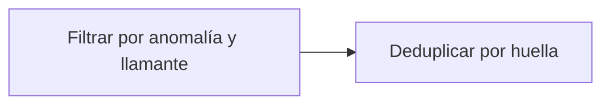

# Feature Specification: SF-10.1 — Selección de decisiones con anomalía y deduplicación por huella

**Created**: 2026-10-19  
**Status**: draft  
**Flow**: [F-10 Reporte de métricas de éxito](60-f-10-reporte-de-metricas-de-exito.md) (subflujo)  
**Related Specs**: [F-10 Reporte de métricas de éxito](60-f-10-reporte-de-metricas-de-exito.md), [SF-10.2 Cálculo de las tres métricas](62-sf-10-2-calculo-de-las-tres-metricas.md)  
**Origen (DEC/H)**: DEC-23, DEC-24  
**Pruebas (TC)**: TC-01  
**Contratos externos**: ARCHITECTURE.md §7  

## Reglas de este documento

> Este spec es FUNCIONAL, no técnico: describe QUÉ hace el sistema, no CÓMO. Usa lenguaje de negocio; las siete herramientas externas se nombran por su función y se referencian por la sección de `sdd/reports/EXTERNAL_CONTRACTS.md`. Los casos borde se DOCUMENTAN; los valores de configuración se citan por el nombre del parámetro (NFR-012) con su valor por defecto entre paréntesis.

**Alcance**: Selecciona las decisiones del pasajero con anomalía y las deduplica por reserva y huella, contando la primera.

## User Scenarios & Testing *(mandatory)*

### User Story 1 - Una situación cuenta una vez (Priority: P1)

Como analista, quiero que recargar la pantalla no infle los números.

**Why this priority**: Las recargas generan decisiones con la misma huella.

**Independent Test**: Se prueba con tres recargas de la misma situación.

**Acceptance Scenarios**:

1. **Scenario**: Recargas
   - **Given** tres decisiones con la misma huella
   - **When** se seleccionan
   - **Then** cuentan como una situación

2. **Scenario**: Sistema excluido
   - **Given** decisiones del modo sistema
   - **When** se seleccionan
   - **Then** no cuentan

3. **Scenario**: Tres recargas
   - **Given** 3 decisiones de ABC123 con la misma huella
   - **When** se seleccionan
   - **Then** cuentan como 1 situación

---

### Edge Cases

> Solo se documentan; los marcados MUST-IMPLEMENT se vuelven requisito FR-XXX y se implementan con TDD, los DEFERRED quedan para una iteración posterior.

#### Invalid Data
- [MUST-IMPLEMENT] Cuando cambia el estado real → cambia la huella y es una situación nueva (NFR-008)

## Requirements *(mandatory)*

### Functional Requirements

- **FR-090**: Cada evaluación DEBE generar un registro con identificador de decisión, reserva, lecturas con su instante, eventos elegidos y descartados con razón, versión de política y reglas, variables derivadas con supuestos, opciones viables y descartadas con razón, acción y huella del mensaje.

### Non-Functional and Documentation Requirements

- **NFR-008**: Métricas de éxito: el sistema DEBE permitir medir desde el registro de decisiones el porcentaje de sesiones con problema donde el pasajero ve una opción viable y la acepta sin contacto humano, la tasa de casos humanos por motivo y que no haya afirmaciones sin evidencia.

### Key Entities *(include if feature involves data)*

- **Reporte de métricas**: Cálculo de las tres métricas de éxito desde el registro, sin información personal. Campos principales:
  - `situations_actionable`: entero
  - `m1_resolution_without_human`: razón entre 0 y 1
  - `m1_viable_option_shown`: razón entre 0 y 1
  - `m2_human_cases_by_reason`: lista de {reason: texto, rate: razón entre 0 y 1}
  - `m3_messages_blocked`: entero
  - `m3_unsupported_claims`: entero (debe ser 0)
  - `informative_count`: entero (se reporta aparte)

## Architectural Attributes *(mandatory)*

| Attribute | Value |
|-----------|-------|
| **Interaction type** | batch |
| **Consistency** | strong |
| **Workflow** | single-step |
| **Read pattern** | analytics |
| **Auditability** | full-history |
| **Domain complexity** | medium |
| **Modularity** | bounded-context |
| **Deployment** | monolith |

## Success Criteria *(mandatory)*

### Measurable Outcomes

- **SC-001**: Las recargas nunca aumentan el denominador.

## Traceability *(mandatory after implementation)*

> Las columnas de archivo y línea se registran en la verificación de trazabilidad posterior a la implementación; hoy cada criterio queda enlazado a su origen y a las pruebas que lo verifican.

| Criterion | Origen | Prueba (TC) | Source File | Line(s) |
|-----------|--------|-------------|-------------|---------|
| FR-090 | DEC-23 | sin TC en el mapa §6 de REQUERIMIENTOS_V1 | se registra en la verificación posterior a la implementación | se registra en la verificación posterior a la implementación |
| NFR-008 | DEC-24 | sin TC en el mapa §6 de REQUERIMIENTOS_V1 | se registra en la verificación posterior a la implementación | se registra en la verificación posterior a la implementación |
| SC-001 | criterio medible de este spec | TC-01 | se registra en la verificación posterior a la implementación | se registra en la verificación posterior a la implementación |

## Business Process (BPM View)

```
Filtrar por anomalía y llamante → Deduplicar por huella
```



