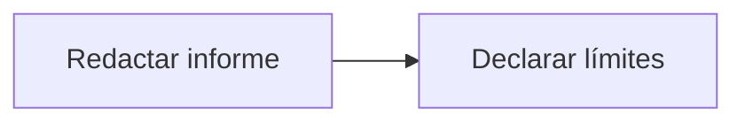

# Feature Specification: SF-10.3 — Informe

**Created**: 2026-10-19  
**Status**: draft  
**Flow**: [F-10 Reporte de métricas de éxito](60-f-10-reporte-de-metricas-de-exito.md) (subflujo)  
**Related Specs**: [F-10 Reporte de métricas de éxito](60-f-10-reporte-de-metricas-de-exito.md), [SF-10.2 Cálculo de las tres métricas](62-sf-10-2-calculo-de-las-tres-metricas.md)  
**Origen (DEC/H)**: DEC-23, DEC-24  
**Pruebas (TC)**: TC-01  
**Contratos externos**: ARCHITECTURE.md §7  

## Reglas de este documento

> Este spec es FUNCIONAL, no técnico: describe QUÉ hace el sistema, no CÓMO. Usa lenguaje de negocio; las siete herramientas externas se nombran por su función y se referencian por la sección de `sdd/reports/EXTERNAL_CONTRACTS.md`. Los casos borde se DOCUMENTAN; los valores de configuración se citan por el nombre del parámetro (NFR-012) con su valor por defecto entre paréntesis.

**Alcance**: Emite el informe de métricas con unidades y límites declarados.

## User Scenarios & Testing *(mandatory)*

### User Story 1 - El informe declara sus límites (Priority: P1)

Como responsable de producto, quiero que el informe explique qué cubre y qué no.

**Why this priority**: Evita sobreinterpretar las cifras.

**Independent Test**: Se revisa el informe de un registro de prueba.

**Acceptance Scenarios**:

1. **Scenario**: Límites
   - **Given** el informe terminado
   - **When** se lee
   - **Then** declara que la sesión se aproxima y que la ventana es la retención

2. **Scenario**: Límites declarados
   - **Given** un informe con 0 mensajes bloqueados
   - **When** se lee
   - **Then** declara que la ventana máxima es de 30 días y que la sesión se aproxima por situación

---

### Edge Cases

> Solo se documentan; los marcados MUST-IMPLEMENT se vuelven requisito FR-XXX y se implementan con TDD, los DEFERRED quedan para una iteración posterior.

#### Security & Permissions
- [MUST-IMPLEMENT] Cuando se emite → no contiene información personal (FR-091)

## Requirements *(mandatory)*

### Functional Requirements

- **FR-091**: Solo se persisten campos de una lista cerrada: hechos operacionales no personales, identificadores seudónimos, enumeraciones, números, marcas de tiempo y huellas. NUNCA se guardan cargas completas, nombre, contacto, documento ni edad del menor; los identificadores son seudónimos, no anónimos, y la reserva se trunca en los registros de aplicación.

### Non-Functional and Documentation Requirements

- **NFR-008**: Métricas de éxito: el sistema DEBE permitir medir desde el registro de decisiones el porcentaje de sesiones con problema donde el pasajero ve una opción viable y la acepta sin contacto humano, la tasa de casos humanos por motivo y que no haya afirmaciones sin evidencia.

### Key Entities *(include if feature involves data)*

- **Reporte de métricas**: Cálculo de las tres métricas de éxito desde el registro, sin información personal. Campos principales:
  - `situations_actionable`: entero
  - `m1_resolution_without_human`: razón entre 0 y 1
  - `m1_viable_option_shown`: razón entre 0 y 1
  - `m2_human_cases_by_reason`: lista de {reason: texto, rate: razón entre 0 y 1}
  - `m3_messages_blocked`: entero
  - `m3_unsupported_claims`: entero (debe ser 0)
  - `informative_count`: entero (se reporta aparte)

## Architectural Attributes *(mandatory)*

| Attribute | Value |
|-----------|-------|
| **Interaction type** | batch |
| **Consistency** | strong |
| **Workflow** | single-step |
| **Read pattern** | analytics |
| **Auditability** | full-history |
| **Domain complexity** | medium |
| **Modularity** | bounded-context |
| **Deployment** | monolith |

## Success Criteria *(mandatory)*

### Measurable Outcomes

- **SC-001**: El informe no contiene ningún campo prohibido.

## Traceability *(mandatory after implementation)*

> Las columnas de archivo y línea se registran en la verificación de trazabilidad posterior a la implementación; hoy cada criterio queda enlazado a su origen y a las pruebas que lo verifican.

| Criterion | Origen | Prueba (TC) | Source File | Line(s) |
|-----------|--------|-------------|-------------|---------|
| FR-091 | DEC-23 | sin TC en el mapa §6 de REQUERIMIENTOS_V1 | se registra en la verificación posterior a la implementación | se registra en la verificación posterior a la implementación |
| NFR-008 | DEC-24 | sin TC en el mapa §6 de REQUERIMIENTOS_V1 | se registra en la verificación posterior a la implementación | se registra en la verificación posterior a la implementación |
| SC-001 | criterio medible de este spec | TC-01 | se registra en la verificación posterior a la implementación | se registra en la verificación posterior a la implementación |

## Business Process (BPM View)

```
Redactar informe → Declarar límites
```



