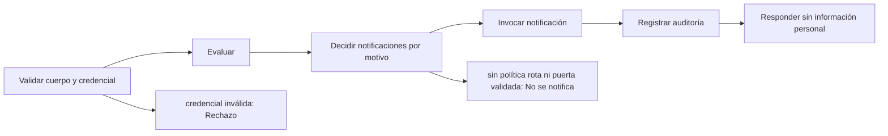

# Feature Specification: F-11 — Evaluar viaje como sistema

**Created**: 2026-10-19  
**Status**: draft  
**Flow**: F-11 Evaluar viaje como sistema  
**Related Specs**: [SF-11.1 Validación del cuerpo y credencial de servicio](65-sf-11-1-validacion-del-cuerpo-y-credencial-de-servicio.md), [SF-11.2 Evaluación](66-sf-11-2-evaluacion.md), [SF-11.3 Decisión de notificar por motivo](67-sf-11-3-decision-de-notificar-por-motivo.md), [SF-11.4 Invocación de la notificación](68-sf-11-4-invocacion-de-la-notificacion.md), [SF-11.5 Registro de auditoría](69-sf-11-5-registro-de-auditoria.md), [SF-11.6 Respuesta sin información personal](70-sf-11-6-respuesta-sin-informacion-personal.md), [F-01 Evaluar viaje como pasajero](01-f-01-evaluar-viaje-como-pasajero.md), [F-08 Notificación al pasajero](51-f-08-notificacion-al-pasajero.md), [F-12 Carga y validación de la configuración](71-f-12-carga-y-validacion-de-la-configuracion.md)  
**Origen (DEC/H)**: DEC-02, DEC-04, DEC-05, DEC-10, DEC-12, DEC-14, DEC-15, DEC-18, DEC-19, DEC-20, DEC-21, DEC-24, DEC-31, H-09, H-21  
**Pruebas (TC)**: TC-42, TC-43, TC-44, TC-45, TC-50, TC-51, TC-52, TC-55, TC-58, TC-59, TC-60  
**Contratos externos**: §1.1 (fila 2: evaluación con llamante sistema y credencial de servicio), §2.1 (herramienta 7: notificación), §2.4 (`SERVICE_API_KEY`, `NOTIFY_ENABLED`)  

## Reglas de este documento

> Este spec es FUNCIONAL, no técnico: describe QUÉ hace el sistema, no CÓMO. Usa lenguaje de negocio; las siete herramientas externas se nombran por su función y se referencian por la sección de `sdd/reports/EXTERNAL_CONTRACTS.md`. Los casos borde se DOCUMENTAN; los valores de configuración se citan por el nombre del parámetro (NFR-012) con su valor por defecto entre paréntesis.

**Alcance**: Otro sistema pide la misma evaluación con una credencial de servicio y recibe un resultado mínimo sin información personal; el servicio notifica por motivo (política rota por retraso, y cambio de puerta validado) y nunca ejecuta cambios ni casos humanos.

## User Scenarios & Testing *(mandatory)*

### User Story 1 - Otro sistema dispara avisos al pasajero sin exponer sus datos (Priority: P1)

Como sistema operacional, quiero pedir la evaluación de una reserva y que, si hay un problema real, el pasajero reciba un aviso, sin que yo reciba su información personal ni pueda ejecutar acciones por él.

**Why this priority**: Habilita la visión proactiva (notificaciones por evento) manteniendo el consentimiento del pasajero para toda acción real.

**Independent Test**: Se prueba con política rota, con cambio de puerta, con ambos, sin ninguno, con la notificación apagada y con credenciales inválidas.

**Acceptance Scenarios**:

1. **Scenario**: Retraso con política rota
   - **Given** la credencial es válida y la notificación está activa
   - **When** otro sistema pide la evaluación
   - **Then** se envía una notificación de política y la respuesta trae solo identificador de decisión, estado, motivo, estado de la notificación y revisión manual

2. **Scenario**: Cambio de puerta
   - **Given** hay un cambio de puerta validado
   - **When** se evalúa como sistema
   - **Then** se envía un aviso informativo sin consultar política

3. **Scenario**: Ambos motivos
   - **Given** hay retraso con política rota y cambio de puerta
   - **When** se evalúa como sistema
   - **Then** se envían dos notificaciones, una por motivo, una tras otra

4. **Scenario**: Sin notificar
   - **Given** retraso sin política rota, o anomalía que impide evaluar la política
   - **When** se evalúa como sistema
   - **Then** no se notifica y la decisión queda marcada para revisión manual cuando corresponde

5. **Scenario**: Bloqueada con política rota
   - **Given** decisión BLOQUEADA por menor desconocido con política rota
   - **When** se evalúa como sistema
   - **Then** sí se notifica y además queda en revisión manual

6. **Scenario**: Reserva sin titular adulto (TC-60)
   - **Given** una reserva ABC123 con un solo pasajero, el niño P2, sin titular adulto, con un retraso E-1001 de 180 min (R1 concede REBOOK_NO_FEE) que rompe la política POL-DELAY-2026-03 y la notificación activa
   - **When** otro sistema pide la evaluación
   - **Then** no se envía ningún aviso: el estado es NOT_SENT con la razón NO_ADULT_RECIPIENT («sin destinatario adulto») y la revisión manual queda verdadera

7. **Scenario**: Retraso y puerta en modo sistema (TC-42, TC-52, TC-51)
   - **Given** ABC123 con retraso de 160 min y puerta 24 en S1, la credencial de servicio válida y un simulador que asigna identificadores distintos a cada aviso aceptado
   - **When** otro sistema pide la evaluación
   - **Then** recibe decision_id, estado PENDIENTE_APROBACION, motivo DELAY, 2 notificaciones en cola con identificadores distintos (NT-9912 para el retraso y NT-9913 para la puerta) y revisión manual falsa, sin datos de Ana

---

### Edge Cases

> Solo se documentan; los marcados MUST-IMPLEMENT se vuelven requisito FR-XXX y se implementan con TDD, los DEFERRED quedan para una iteración posterior.

#### System Errors
- [MUST-IMPLEMENT] Cuando falla la lectura del contexto → error acotado; con lectura fallida de eventos → revisión manual sin notificación (FR-123)
- [DEFERRED] Disparo automático por evento operacional y alerta interna de anomalías: Fase 2 (H-17, H-19) (FR-124)

#### Invalid Data
- [MUST-IMPLEMENT] Cuando `NOTIFY_ENABLED` es falso → no se envía nada y se informa «notificación desactivada» (FR-085)
- [MUST-IMPLEMENT] Cuando la reserva no tiene titular adulto → el aviso no se envía (NOT_SENT, sin destinatario adulto) y la revisión manual queda verdadera (FR-122)

#### Security & Permissions
- [MUST-IMPLEMENT] Cuando falta la credencial, es incorrecta o `SERVICE_API_KEY` no está configurada → rechazo por falta de autenticación (FR-120)
- [MUST-IMPLEMENT] Cuando la sesión del pasajero se envía en modo sistema → no autoriza nada (FR-120)
- [MUST-IMPLEMENT] Cuando la misma reserva y credencial superan `EVALUATE_RATE_LIMIT_PER_MINUTE` solicitudes por minuto → rechazo por límite de tasa (NFR-013)
- [MUST-IMPLEMENT] Cuando la respuesta se arma → nunca incluye información personal ni la vista completa (FR-120)
- [MUST-IMPLEMENT] Cuando se arma el destinatario → es el titular adulto de la reserva, nunca el menor (FR-122)

## Requirements *(mandatory)*

### Functional Requirements

- **FR-002**: En cada entrada del pasajero a la vista, el sistema DEBE consultar de nuevo el contexto del viaje y los eventos operacionales; no existe memoria intermedia de lecturas en la versión 1.
- **FR-003**: El sistema DEBE mostrar siempre el contexto del viaje: segmentos (origen, destino, fecha, hora programada y estado), número de pasajeros y nombre de pila del titular (el primer pasajero adulto de la reserva; sin adulto se omite el saludo). Es la única excepción de información personal autorizada en pantalla.
- **FR-004**: Si no hay anomalía (ningún retraso relevante ni cambio de puerta validado y ninguna evidencia anómala), el sistema DEBE mostrar solo el contexto: sin alertas, reglas, opciones ni botones de acción (puede haber un botón «Actualizar» que solo vuelve a consultar y no es una acción externa), y el pasajero ve que todo está en orden. Con un cambio de puerta validado y sin retraso la decisión es INFORMATIVA con la puerta destacada. La evidencia degradada no genera alerta pero aplica FR-014. El soporte humano solo se ofrece cuando hay una acción posible.
- **FR-005**: El sistema DEBE tratar como evento relevante un retraso validado con minutos de retraso mayores o iguales a `RELEVANT_DELAY_MIN_MINUTES` (1); qué derechos otorga lo decide la política vigente (FR-034).
- **FR-006**: El sistema DEBE informar siempre al pasajero de un cambio de puerta validado: en modo pasajero la vista lo muestra de forma destacada con la hora de la información; en modo sistema se envía la notificación correspondiente (FR-122). El cambio de puerta no consulta reglas de política en la Fase 1, no abre por sí solo el flujo de problema y el estado informado de vuelo se reconoce sin acción.
- **FR-007**: Ante un evento de tipo desconocido o no soportado (por ejemplo una cancelación), el sistema NO DEBE interpretarlo: muestra un aviso neutro («una persona debe revisar tu vuelo») y ofrece el caso humano con el motivo `UNSUPPORTED_EVENT_TYPE`.
- **FR-008**: Con un retraso relevante validado el sistema DEBE consultar la política de retrasos y evaluar todas sus reglas, mostrando las que se cumplen y las que no con los valores usados. Una política vacía, o una regla cumplida cuyo indicador de aprobación humana falta o no es verdadero/falso, deja la decisión BLOQUEADA y con caso humano ofrecido; un fallo de lectura del contexto o de los eventos no produce decisión; un fallo de lectura de la política o de las opciones deja la decisión BLOQUEADA con soporte ofrecido.
- **FR-009**: La consulta de opciones elegibles DEBE ocurrir solo después de evaluar la política; la cadena de lecturas es secuencial (contexto, eventos, política, opciones) y con ella se arma la vista.
- **FR-039**: Hay política rota si al menos una regla cumplida concede un derecho de remedio (`REMEDY_RIGHTS`; por defecto cambio sin costo, vale de comida y compensación en dinero). Un retraso sin política rota deja la decisión INFORMATIVA: se informa el retraso y se muestran las reglas evaluadas, sin consultar opciones, sin rebooking, compensación, soporte ni notificación de política, hasta que exista política rota. Los derechos que no son de remedio (trato prioritario) modifican el trato pero no rompen la política por sí solos.
- **FR-050**: Toda acción externa (solicitud de cambio, caso humano, notificación) DEBE requerir un clic explícito del pasajero; el sistema solo propone y ofrece. La persistencia interna no es una acción externa. Excepción: en modo sistema se puede enviar la notificación de FR-122 sin clic, con plantilla fija; ninguna otra acción externa se ejecuta en modo sistema. Un clic autoriza exactamente una acción y los textos de los botones lo declaran, incluida la derivación posterior a una falla persistente.
- **FR-068**: La evaluación DEBE considerar todos los eventos validados de todos los segmentos en conjunto y la vista los muestra todos. En la Fase 1 solo el retraso consulta la política (`POLICY_SCENARIOS`); el cambio de puerta nunca la consulta y solo se informa o se notifica. Los tipos admitidos son `SUPPORTED_EVENT_TYPES`; uno fuera de la lista no se interpreta (FR-007). Un viaje solo con cambio de puerta queda INFORMATIVO.
- **FR-085**: La notificación al pasajero DEBE invocarse solo en modo sistema (FR-122) con una plantilla fija; en modo pasajero no se invoca porque el mensaje se ve en la pantalla. Se activa con `NOTIFY_ENABLED`.
- **FR-120**: La evaluación DEBE recibir un parámetro `caller` obligatorio (`user` o `system`): el pasajero exige su sesión (FR-001); otro sistema exige una credencial de servicio (`SERVICE_API_KEY`, apagada por defecto) y NUNCA recibe información personal ni la vista completa, solo el identificador de decisión, el estado de la decisión, el motivo del cambio, el estado de la notificación y si requiere revisión manual.
- **FR-121**: En modo sistema NO DEBE ejecutarse ninguna acción del pasajero (ni solicitud de cambio ni caso humano); la única acción externa permitida es la notificación de FR-122.
- **FR-122**: En modo sistema se DEBE enviar la notificación con la plantilla fija «Hubo un cambio en tu vuelo asociado a {motivo}. Revisa tu reserva en la web o en la aplicación.» en dos casos: (a) política rota, con motivo «un retraso» y la referencia de política evaluada; (b) cambio de puerta validado, con motivo «un cambio de puerta», sin consultar política y sin referencia de política (aviso informativo). El motivo es una enumeración cerrada, se envía una notificación por motivo, el destinatario es la reserva y el aviso se dirige al titular adulto de la reserva, nunca al menor (si la reserva no tiene titular adulto no se envía, se registra «sin destinatario adulto» y se marca la revisión manual), y el mensaje NO contiene dirección web, enlace, teléfono ni dato de contacto (protección contra suplantación); el validador (FR-081) bloquea cualquiera de ellos.
- **FR-123**: La notificación DEBE ser idempotente: no se reenvía la misma (reserva, motivo, huella del motivo y plantilla) dentro de `NOTIFY_COOLDOWN_SECONDS` (86400); aceptada queda en cola, rechazo explícito es fallida, tiempo agotado es indeterminada, con hasta `NOTIFY_MAX_RETRIES` (2) reintentos con la misma llave y sin afirmar éxito. La huella del cambio de puerta incluye la puerta validada de cada segmento, de modo que un cambio posterior genera un aviso nuevo; la del retraso es la versión de política más las reglas disparadas, de modo que un cambio solo de minutos no repite el aviso. Sin política rota y sin cambio de puerta validado no se notifica y se registra la revisión manual; con política rota se notifica aunque la decisión sea BLOQUEADA o PENDIENTE_APROBACION.
- **FR-124**: La respuesta del modo sistema NO DEBE guardarse para el front en la versión 1; cuando el pasajero entra, el modo pasajero vuelve a consultar siempre (FR-002).

### Non-Functional and Documentation Requirements

- **DOC-013**: DEBEN documentarse las extensiones de contrato propuestas al equipo: reserva y pasajeros en la solicitud de cambio, destinatario y tipo de aviso (informativo sin referencia de política) en la notificación, y contrato reducido en las opciones.
- **NFR-003**: Seguridad: el analizador de reglas DEBE operar sin ejecución dinámica, las entradas se validan estrictamente, el origen permitido se acota al front y no hay secretos en el repositorio.
- **NFR-004**: Latencia: la vista DEBE responder en menos de 1,5 s (percentil 95) con proveedores simulados de 100 ms fijos; protocolo de aceptación: 50 solicitudes secuenciales del caso base en la máquina de desarrollo, reportando percentiles 50 y 95. La cadena de lecturas es secuencial (contexto, eventos, solo con evento relevante validado la política, y las opciones).
- **NFR-013**: Seguridad de entradas: todo acceso al registro persistente DEBE usar consultas parametrizadas (las consultas viven en archivos propios); la interfaz DEBE mostrar los textos del proveedor (condición, derecho, puerta, mensajes) como texto plano, sin insertar marcado HTML; y la evaluación, la aceptación de una opción, el caso humano y la consulta de una decisión DEBEN tener un límite de tasa por reserva y por origen (`EVALUATE_RATE_LIMIT_PER_MINUTE`, 30 por minuto), con los intentos fallidos de credencial de servicio también limitados por origen.

### Key Entities *(include if feature involves data)*

- **Resultado de evaluación del sistema**: Respuesta mínima y sin información personal para otro sistema. Campos principales:
  - `decision_id`: identificador
  - `decision_state`: INFORMATIVA | AUTOMATICA | PENDIENTE_APROBACION | BLOQUEADA | nulo
  - `reason`: DELAY | GATE_CHANGE | nulo
  - `notifications`: lista de {reason: texto, kind: texto, status: texto, notification_id: texto | nulo, not_sent_reason: texto | nulo, deduplicated: booleano, attempts: entero}
  - `needs_manual_review`: booleano
- **Notificación**: Aviso al pasajero enviado solo por el sistema, con plantilla fija, una por motivo. Campos principales:
  - `reason`: DELAY | GATE_CHANGE
  - `kind`: POLICY | INFORMATIONAL
  - `policy_ref`: texto | ausente (ausente si kind es INFORMATIONAL)
  - `booking_id`: destinatario: texto
  - `recipient_passenger_id`: identificador del titular adulto (nunca un menor) | ausente si no hay adulto
  - `motive_fingerprint`: texto: DELAY = versión de política + reglas disparadas; GATE_CHANGE = puerta validada de cada segmento
  - `idempotency_key`: texto no adivinable
  - `attempt`: entero ≥ 1
  - `status`: EN_CURSO | QUEUED | FALLIDA | INDETERMINADA | VENCIDA | NOT_SENT
  - `notification_id`: texto | nulo
  - `not_sent_reason`: NOTIFY_DISABLED | NO_BROKEN_POLICY | NO_ADULT_RECIPIENT | nulo
  - `deduplicated`: booleano
  - `attempts`: entero
- **Decisión**: Resultado de evaluar la reserva: su estado y las razones que lo explican. Campos principales:
  - `decision_id`: identificador aleatorio no adivinable
  - `decision_state`: INFORMATIVA | AUTOMATICA | PENDIENTE_APROBACION | BLOQUEADA | nulo
  - `anomaly_detected`: booleano
  - `fingerprint`: texto: huella de decisión sin opción
  - `human_case_reasons`: lista ordenada de motivos de caso humano
  - `support_offered`: booleano
  - `compensation_eligible`: booleano
  - `needs_manual_review`: booleano (campo interno: se persiste y no se entrega a la sesión del pasajero, FR-093)
- **Sesión y credencial**: Identidad con la que se pide una evaluación: sesión del pasajero o credencial de servicio. Campos principales:
  - `caller`: user | system
  - `session_booking`: texto | ausente (solo modo user)
  - `service_key`: texto | ausente (solo modo system; comparación en tiempo constante)
  - `requests_last_minute`: entero (límite `EVALUATE_RATE_LIMIT_PER_MINUTE`)
  - `authorized`: booleano

## Architectural Attributes *(mandatory)*

| Attribute | Value |
|-----------|-------|
| **Interaction type** | sync-http |
| **Consistency** | strong |
| **Workflow** | multi-step |
| **Read pattern** | simple |
| **Auditability** | full-history |
| **Domain complexity** | high |
| **Modularity** | bounded-context |
| **Deployment** | monolith |

## Success Criteria *(mandatory)*

### Measurable Outcomes

- **SC-001**: El 100 % de las respuestas del modo sistema carece de información personal y de vista completa.
- **SC-002**: Cero llamadas a la solicitud de cambio o al caso humano en modo sistema.
- **SC-003**: En el peor caso con dos notificaciones la evaluación completa no excede 47,2 s con los valores por defecto.

## Traceability *(mandatory after implementation)*

> Las columnas de archivo y línea se registran en la verificación de trazabilidad posterior a la implementación; hoy cada criterio queda enlazado a su origen y a las pruebas que lo verifican.

| Criterion | Origen | Prueba (TC) | Source File | Line(s) |
|-----------|--------|-------------|-------------|---------|
| FR-002 | DEC-10, DEC-19 | sin TC en el mapa §6 de REQUERIMIENTOS_V1 | se registra en la verificación posterior a la implementación | se registra en la verificación posterior a la implementación |
| FR-003 | DEC-04, DEC-21 | sin TC en el mapa §6 de REQUERIMIENTOS_V1 | se registra en la verificación posterior a la implementación | se registra en la verificación posterior a la implementación |
| FR-004 | DEC-02 | TC-45 | se registra en la verificación posterior a la implementación | se registra en la verificación posterior a la implementación |
| FR-005 | DEC-05, DEC-31, H-09 | sin TC en el mapa §6 de REQUERIMIENTOS_V1 | se registra en la verificación posterior a la implementación | se registra en la verificación posterior a la implementación |
| FR-006 | DEC-05, DEC-31 | TC-51 | se registra en la verificación posterior a la implementación | se registra en la verificación posterior a la implementación |
| FR-007 | DEC-15, DEC-31 | sin TC en el mapa §6 de REQUERIMIENTOS_V1 | se registra en la verificación posterior a la implementación | se registra en la verificación posterior a la implementación |
| FR-008 | DEC-02, DEC-12 | sin TC en el mapa §6 de REQUERIMIENTOS_V1 | se registra en la verificación posterior a la implementación | se registra en la verificación posterior a la implementación |
| FR-009 | DEC-02 | sin TC en el mapa §6 de REQUERIMIENTOS_V1 | se registra en la verificación posterior a la implementación | se registra en la verificación posterior a la implementación |
| FR-039 | DEC-02, DEC-05 | TC-43, TC-45 | se registra en la verificación posterior a la implementación | se registra en la verificación posterior a la implementación |
| FR-050 | DEC-14 | sin TC en el mapa §6 de REQUERIMIENTOS_V1 | se registra en la verificación posterior a la implementación | se registra en la verificación posterior a la implementación |
| FR-068 | Usuario (2026-10-19) | TC-51, TC-52 | se registra en la verificación posterior a la implementación | se registra en la verificación posterior a la implementación |
| FR-085 | DEC-20 | sin TC en el mapa §6 de REQUERIMIENTOS_V1 | se registra en la verificación posterior a la implementación | se registra en la verificación posterior a la implementación |
| FR-120 | Usuario (2026-10-19) | TC-42, TC-50 | se registra en la verificación posterior a la implementación | se registra en la verificación posterior a la implementación |
| FR-121 | Usuario (2026-10-19) | TC-50 | se registra en la verificación posterior a la implementación | se registra en la verificación posterior a la implementación |
| FR-122 | H-21 | TC-42, TC-51, TC-52, TC-60 | se registra en la verificación posterior a la implementación | se registra en la verificación posterior a la implementación |
| FR-123 | Usuario (2026-10-19) | TC-43, TC-44, TC-55, TC-60 | se registra en la verificación posterior a la implementación | se registra en la verificación posterior a la implementación |
| FR-124 | Usuario (2026-10-19) | sin TC en el mapa §6 de REQUERIMIENTOS_V1 | se registra en la verificación posterior a la implementación | se registra en la verificación posterior a la implementación |
| DOC-013 | DEC-18 | sin TC en el mapa §6 de REQUERIMIENTOS_V1 | se registra en la verificación posterior a la implementación | se registra en la verificación posterior a la implementación |
| NFR-003 | DEC-12 | sin TC en el mapa §6 de REQUERIMIENTOS_V1 | se registra en la verificación posterior a la implementación | se registra en la verificación posterior a la implementación |
| NFR-004 | DEC-24 | sin TC en el mapa §6 de REQUERIMIENTOS_V1 | se registra en la verificación posterior a la implementación | se registra en la verificación posterior a la implementación |
| NFR-013 | Usuario (2026-10-19) | TC-58 | se registra en la verificación posterior a la implementación | se registra en la verificación posterior a la implementación |
| SC-001 | criterio medible de este spec | TC-42, TC-43, TC-44, TC-45, TC-50, TC-51, TC-52, TC-55, TC-58, TC-59, TC-60 | se registra en la verificación posterior a la implementación | se registra en la verificación posterior a la implementación |
| SC-002 | criterio medible de este spec | TC-42, TC-43, TC-44, TC-45, TC-50, TC-51, TC-52, TC-55, TC-58, TC-59, TC-60 | se registra en la verificación posterior a la implementación | se registra en la verificación posterior a la implementación |
| SC-003 | criterio medible de este spec | TC-42, TC-43, TC-44, TC-45, TC-50, TC-51, TC-52, TC-55, TC-58, TC-59, TC-60 | se registra en la verificación posterior a la implementación | se registra en la verificación posterior a la implementación |

## Business Process (BPM View)

```
Validar cuerpo y credencial → Evaluar → Decidir notificaciones por motivo → Invocar notificación → Registrar auditoría → Responder sin información personal
```



### Subprocesses (if applicable)

```
SF-11.1: Validación del cuerpo y credencial de servicio
SF-11.2: Evaluación
SF-11.3: Decisión de notificar por motivo
SF-11.4: Invocación de la notificación
SF-11.5: Registro de auditoría
SF-11.6: Respuesta sin información personal
```
