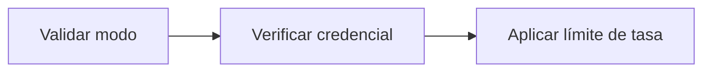

# Feature Specification: SF-11.1 — Validación del cuerpo y credencial de servicio

**Created**: 2026-10-19  
**Status**: draft  
**Flow**: [F-11 Evaluar viaje como sistema](64-f-11-evaluar-viaje-como-sistema.md) (subflujo)  
**Related Specs**: [F-11 Evaluar viaje como sistema](64-f-11-evaluar-viaje-como-sistema.md), [SF-11.2 Evaluación](66-sf-11-2-evaluacion.md)  
**Origen (DEC/H)**: DEC-12  
**Pruebas (TC)**: TC-50, TC-58  
**Contratos externos**: §1.1 (fila 2), §2.4 (`SERVICE_API_KEY`, `EVALUATE_RATE_LIMIT_PER_MINUTE`)  

## Reglas de este documento

> Este spec es FUNCIONAL, no técnico: describe QUÉ hace el sistema, no CÓMO. Usa lenguaje de negocio; las siete herramientas externas se nombran por su función y se referencian por la sección de `sdd/reports/EXTERNAL_CONTRACTS.md`. Los casos borde se DOCUMENTAN; los valores de configuración se citan por el nombre del parámetro (NFR-012) con su valor por defecto entre paréntesis.

**Alcance**: Exige el modo `system` explícito y la credencial de servicio, comparada en tiempo constante.

## User Scenarios & Testing *(mandatory)*

### User Story 1 - Solo sistemas autorizados piden evaluaciones (Priority: P1)

Como responsable de seguridad, quiero que solo quien tenga la credencial de servicio pueda disparar evaluaciones y avisos.

**Why this priority**: La credencial permite evaluar cualquier reserva.

**Independent Test**: Se prueba con credencial correcta, incorrecta, ausente y con el modo apagado.

**Acceptance Scenarios**:

1. **Scenario**: Credencial válida
   - **Given** `SERVICE_API_KEY` configurada y enviada correctamente
   - **When** se pide
   - **Then** se autoriza

2. **Scenario**: Modo apagado
   - **Given** `SERVICE_API_KEY` sin configurar
   - **When** se pide
   - **Then** siempre se rechaza

3. **Scenario**: Clave de servicio incorrecta (TC-50)
   - **Given** `SERVICE_API_KEY` configurada y una petición con una clave distinta de la configurada
   - **When** se pide la evaluación de ABC123
   - **Then** se rechaza por falta de autenticación sin consultar ninguna herramienta ni revelar si la clave existe

4. **Scenario**: Intentos fallidos de credencial por origen (TC-58)
   - **Given** un origen con 30 intentos fallidos de clave de servicio sobre ABC123 en un minuto
   - **When** llega el 31.º intento, ya con la clave correcta
   - **Then** se rechaza por límite de tasa hasta que pase el minuto

---

### Edge Cases

> Solo se documentan; los marcados MUST-IMPLEMENT se vuelven requisito FR-XXX y se implementan con TDD, los DEFERRED quedan para una iteración posterior.

#### Security & Permissions
- [MUST-IMPLEMENT] Cuando el valor del modo falta o es distinto → rechazo por validación (FR-120)
- [MUST-IMPLEMENT] Cuando la clave se compara → en tiempo constante (NFR-003)
- [MUST-IMPLEMENT] Cuando la credencial se usa en otro servicio → no autoriza nada más (FR-120)
- [MUST-IMPLEMENT] Cuando la misma reserva y credencial superan `EVALUATE_RATE_LIMIT_PER_MINUTE` → rechazo por límite de tasa (NFR-013)
- [MUST-IMPLEMENT] Cuando un mismo origen acumula `EVALUATE_RATE_LIMIT_PER_MINUTE` (30) intentos fallidos de credencial de servicio en un minuto → rechazo por límite de tasa aunque la clave sea válida después (NFR-013)

## Requirements *(mandatory)*

### Functional Requirements

- **FR-120**: La evaluación DEBE recibir un parámetro `caller` obligatorio (`user` o `system`): el pasajero exige su sesión (FR-001); otro sistema exige una credencial de servicio (`SERVICE_API_KEY`, apagada por defecto) y NUNCA recibe información personal ni la vista completa, solo el identificador de decisión, el estado de la decisión, el motivo del cambio, el estado de la notificación y si requiere revisión manual.

### Non-Functional and Documentation Requirements

- **NFR-003**: Seguridad: el analizador de reglas DEBE operar sin ejecución dinámica, las entradas se validan estrictamente, el origen permitido se acota al front y no hay secretos en el repositorio.
- **NFR-013**: Seguridad de entradas: todo acceso al registro persistente DEBE usar consultas parametrizadas (las consultas viven en archivos propios); la interfaz DEBE mostrar los textos del proveedor (condición, derecho, puerta, mensajes) como texto plano, sin insertar marcado HTML; y la evaluación, la aceptación de una opción, el caso humano y la consulta de una decisión DEBEN tener un límite de tasa por reserva y por origen (`EVALUATE_RATE_LIMIT_PER_MINUTE`, 30 por minuto), con los intentos fallidos de credencial de servicio también limitados por origen.

### Key Entities *(include if feature involves data)*

- **Sesión y credencial**: Identidad con la que se pide una evaluación: sesión del pasajero o credencial de servicio. Campos principales:
  - `caller`: user | system
  - `session_booking`: texto | ausente (solo modo user)
  - `service_key`: texto | ausente (solo modo system; comparación en tiempo constante)
  - `requests_last_minute`: entero (límite `EVALUATE_RATE_LIMIT_PER_MINUTE`)
  - `authorized`: booleano

## Architectural Attributes *(mandatory)*

| Attribute | Value |
|-----------|-------|
| **Interaction type** | sync-http |
| **Consistency** | strong |
| **Workflow** | single-step |
| **Read pattern** | simple |
| **Auditability** | full-history |
| **Domain complexity** | medium |
| **Modularity** | bounded-context |
| **Deployment** | monolith |

## Success Criteria *(mandatory)*

### Measurable Outcomes

- **SC-001**: El 100 % de las peticiones sin credencial correcta se rechaza.

## Traceability *(mandatory after implementation)*

> Las columnas de archivo y línea se registran en la verificación de trazabilidad posterior a la implementación; hoy cada criterio queda enlazado a su origen y a las pruebas que lo verifican.

| Criterion | Origen | Prueba (TC) | Source File | Line(s) |
|-----------|--------|-------------|-------------|---------|
| FR-120 | Usuario (2026-10-19) | TC-50 | se registra en la verificación posterior a la implementación | se registra en la verificación posterior a la implementación |
| NFR-003 | DEC-12 | sin TC en el mapa §6 de REQUERIMIENTOS_V1 | se registra en la verificación posterior a la implementación | se registra en la verificación posterior a la implementación |
| NFR-013 | Usuario (2026-10-19) | TC-58 | se registra en la verificación posterior a la implementación | se registra en la verificación posterior a la implementación |
| SC-001 | criterio medible de este spec | TC-50, TC-58 | se registra en la verificación posterior a la implementación | se registra en la verificación posterior a la implementación |

## Business Process (BPM View)

```
Validar modo → Verificar credencial → Aplicar límite de tasa
```



