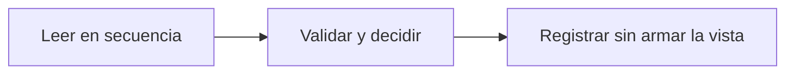

# Feature Specification: SF-11.2 — Evaluación

**Created**: 2026-10-19  
**Status**: draft  
**Flow**: [F-11 Evaluar viaje como sistema](64-f-11-evaluar-viaje-como-sistema.md) (subflujo)  
**Related Specs**: [F-11 Evaluar viaje como sistema](64-f-11-evaluar-viaje-como-sistema.md), [SF-11.1 Validación del cuerpo y credencial de servicio](65-sf-11-1-validacion-del-cuerpo-y-credencial-de-servicio.md), [SF-11.3 Decisión de notificar por motivo](67-sf-11-3-decision-de-notificar-por-motivo.md)  
**Origen (DEC/H)**: DEC-02, DEC-04, DEC-05, DEC-10, DEC-12, DEC-15, DEC-19, DEC-21, DEC-31, H-09  
**Pruebas (TC)**: TC-45, TC-50, TC-51  
**Contratos externos**: §1.1 (fila 2)  

## Reglas de este documento

> Este spec es FUNCIONAL, no técnico: describe QUÉ hace el sistema, no CÓMO. Usa lenguaje de negocio; las siete herramientas externas se nombran por su función y se referencian por la sección de `sdd/reports/EXTERNAL_CONTRACTS.md`. Los casos borde se DOCUMENTAN; los valores de configuración se citan por el nombre del parámetro (NFR-012) con su valor por defecto entre paréntesis.

**Alcance**: Ejecuta la misma cadena de lecturas, validación, variables, reglas y opciones que el pasajero, pero sin armar la vista ni ofrecer acciones.

## User Scenarios & Testing *(mandatory)*

### User Story 1 - La evaluación del sistema es idéntica a la del pasajero (Priority: P1)

Como equipo de producto, quiero que ambos modos decidan igual para no tener dos verdades.

**Why this priority**: Dos criterios distintos producirían avisos incoherentes con la pantalla.

**Independent Test**: Se prueba comparando el estado de la decisión de ambos modos.

**Acceptance Scenarios**:

1. **Scenario**: Misma decisión
   - **Given** las mismas lecturas
   - **When** se evalúa como pasajero y como sistema
   - **Then** el estado de la decisión y su huella coinciden

2. **Scenario**: Sin acciones
   - **Given** modo sistema
   - **When** se evalúa
   - **Then** no se ejecuta solicitud de cambio ni caso humano

3. **Scenario**: Misma decisión en ambos modos (TC-45)
   - **Given** retraso de 5 min en ABC123
   - **When** se evalúa como pasajero y como sistema
   - **Then** ambos dan INFORMATIVA con la misma huella y no se consultan opciones

---

### Edge Cases

> Solo se documentan; los marcados MUST-IMPLEMENT se vuelven requisito FR-XXX y se implementan con TDD, los DEFERRED quedan para una iteración posterior.

#### System Errors
- [MUST-IMPLEMENT] Cuando una lectura falla → igual que en el modo pasajero (FR-105)

#### Invalid Data
- [MUST-IMPLEMENT] Cuando hay anomalía → decisión BLOQUEADA sin política ni opciones (FR-038)

## Requirements *(mandatory)*

### Functional Requirements

- **FR-002**: En cada entrada del pasajero a la vista, el sistema DEBE consultar de nuevo el contexto del viaje y los eventos operacionales; no existe memoria intermedia de lecturas en la versión 1.
- **FR-003**: El sistema DEBE mostrar siempre el contexto del viaje: segmentos (origen, destino, fecha, hora programada y estado), número de pasajeros y nombre de pila del titular (el primer pasajero adulto de la reserva; sin adulto se omite el saludo). Es la única excepción de información personal autorizada en pantalla.
- **FR-004**: Si no hay anomalía (ningún retraso relevante ni cambio de puerta validado y ninguna evidencia anómala), el sistema DEBE mostrar solo el contexto: sin alertas, reglas, opciones ni botones de acción (puede haber un botón «Actualizar» que solo vuelve a consultar y no es una acción externa), y el pasajero ve que todo está en orden. Con un cambio de puerta validado y sin retraso la decisión es INFORMATIVA con la puerta destacada. La evidencia degradada no genera alerta pero aplica FR-014. El soporte humano solo se ofrece cuando hay una acción posible.
- **FR-005**: El sistema DEBE tratar como evento relevante un retraso validado con minutos de retraso mayores o iguales a `RELEVANT_DELAY_MIN_MINUTES` (1); qué derechos otorga lo decide la política vigente (FR-034).
- **FR-006**: El sistema DEBE informar siempre al pasajero de un cambio de puerta validado: en modo pasajero la vista lo muestra de forma destacada con la hora de la información; en modo sistema se envía la notificación correspondiente (FR-122). El cambio de puerta no consulta reglas de política en la Fase 1, no abre por sí solo el flujo de problema y el estado informado de vuelo se reconoce sin acción.
- **FR-007**: Ante un evento de tipo desconocido o no soportado (por ejemplo una cancelación), el sistema NO DEBE interpretarlo: muestra un aviso neutro («una persona debe revisar tu vuelo») y ofrece el caso humano con el motivo `UNSUPPORTED_EVENT_TYPE`.
- **FR-008**: Con un retraso relevante validado el sistema DEBE consultar la política de retrasos y evaluar todas sus reglas, mostrando las que se cumplen y las que no con los valores usados. Una política vacía, o una regla cumplida cuyo indicador de aprobación humana falta o no es verdadero/falso, deja la decisión BLOQUEADA y con caso humano ofrecido; un fallo de lectura del contexto o de los eventos no produce decisión; un fallo de lectura de la política o de las opciones deja la decisión BLOQUEADA con soporte ofrecido.
- **FR-009**: La consulta de opciones elegibles DEBE ocurrir solo después de evaluar la política; la cadena de lecturas es secuencial (contexto, eventos, política, opciones) y con ella se arma la vista.
- **FR-039**: Hay política rota si al menos una regla cumplida concede un derecho de remedio (`REMEDY_RIGHTS`; por defecto cambio sin costo, vale de comida y compensación en dinero). Un retraso sin política rota deja la decisión INFORMATIVA: se informa el retraso y se muestran las reglas evaluadas, sin consultar opciones, sin rebooking, compensación, soporte ni notificación de política, hasta que exista política rota. Los derechos que no son de remedio (trato prioritario) modifican el trato pero no rompen la política por sí solos.
- **FR-068**: La evaluación DEBE considerar todos los eventos validados de todos los segmentos en conjunto y la vista los muestra todos. En la Fase 1 solo el retraso consulta la política (`POLICY_SCENARIOS`); el cambio de puerta nunca la consulta y solo se informa o se notifica. Los tipos admitidos son `SUPPORTED_EVENT_TYPES`; uno fuera de la lista no se interpreta (FR-007). Un viaje solo con cambio de puerta queda INFORMATIVO.
- **FR-121**: En modo sistema NO DEBE ejecutarse ninguna acción del pasajero (ni solicitud de cambio ni caso humano); la única acción externa permitida es la notificación de FR-122.

### Key Entities *(include if feature involves data)*

- **Decisión**: Resultado de evaluar la reserva: su estado y las razones que lo explican. Campos principales:
  - `decision_id`: identificador aleatorio no adivinable
  - `decision_state`: INFORMATIVA | AUTOMATICA | PENDIENTE_APROBACION | BLOQUEADA | nulo
  - `anomaly_detected`: booleano
  - `fingerprint`: texto: huella de decisión sin opción
  - `human_case_reasons`: lista ordenada de motivos de caso humano
  - `support_offered`: booleano
  - `compensation_eligible`: booleano
  - `needs_manual_review`: booleano (campo interno: se persiste y no se entrega a la sesión del pasajero, FR-093)
- **Registro de decisión**: Instantánea de auditoría de una evaluación, sin información personal. Campos principales:
  - `decision_id`: identificador
  - `booking_id`: texto seudónimo
  - `created_at`: marca de tiempo UTC
  - `caller`: user | system
  - `fingerprint`: texto
  - `decision_state`: estado | nulo
  - `needs_manual_review`: booleano (campo interno, no se entrega a la sesión del pasajero)
  - `policy_version`: texto | nulo
  - `mct_provided`: booleano
  - `passenger_count`: entero
  - `segments`: lista de {segment_id: texto, state: texto | nulo, delay_minutes: entero | nulo}
  - `message_hash`: texto
  - `messages_blocked`: entero
  - `reads`: lista de {tool: texto, retrieved_at: marca de tiempo | nulo, outcome: OK | FAILED | INVALID | NOT_REQUESTED}
  - `events`: lista de {event_id, segment_id, event_type, disposition: CHOSEN | DISCARDED | NOT_INTERPRETED, reason}
  - `rules`: lista de {rule_id, result, requires_human_approval}
  - `options`: lista de opciones con sus razones de descarte (también las no viables)
  - `notifications`: lista de {reason, kind, status, notification_id} (solo modo sistema; campo interno, no se entrega a la sesión del pasajero)
  - `outcomes`: lista de {kind: REBOOKING | HUMAN_CASE, reference_id: texto | nulo, state: texto, at: marca de tiempo}

## Architectural Attributes *(mandatory)*

| Attribute | Value |
|-----------|-------|
| **Interaction type** | sync-http |
| **Consistency** | strong |
| **Workflow** | single-step |
| **Read pattern** | simple |
| **Auditability** | full-history |
| **Domain complexity** | medium |
| **Modularity** | bounded-context |
| **Deployment** | monolith |

## Success Criteria *(mandatory)*

### Measurable Outcomes

- **SC-001**: El estado de decisión y la huella son idénticos en ambos modos con las mismas lecturas.

## Traceability *(mandatory after implementation)*

> Las columnas de archivo y línea se registran en la verificación de trazabilidad posterior a la implementación; hoy cada criterio queda enlazado a su origen y a las pruebas que lo verifican.

| Criterion | Origen | Prueba (TC) | Source File | Line(s) |
|-----------|--------|-------------|-------------|---------|
| FR-002 | DEC-10, DEC-19 | sin TC en el mapa §6 de REQUERIMIENTOS_V1 | se registra en la verificación posterior a la implementación | se registra en la verificación posterior a la implementación |
| FR-003 | DEC-04, DEC-21 | sin TC en el mapa §6 de REQUERIMIENTOS_V1 | se registra en la verificación posterior a la implementación | se registra en la verificación posterior a la implementación |
| FR-004 | DEC-02 | TC-45 | se registra en la verificación posterior a la implementación | se registra en la verificación posterior a la implementación |
| FR-005 | DEC-05, DEC-31, H-09 | sin TC en el mapa §6 de REQUERIMIENTOS_V1 | se registra en la verificación posterior a la implementación | se registra en la verificación posterior a la implementación |
| FR-006 | DEC-05, DEC-31 | TC-51 | se registra en la verificación posterior a la implementación | se registra en la verificación posterior a la implementación |
| FR-007 | DEC-15, DEC-31 | sin TC en el mapa §6 de REQUERIMIENTOS_V1 | se registra en la verificación posterior a la implementación | se registra en la verificación posterior a la implementación |
| FR-008 | DEC-02, DEC-12 | sin TC en el mapa §6 de REQUERIMIENTOS_V1 | se registra en la verificación posterior a la implementación | se registra en la verificación posterior a la implementación |
| FR-009 | DEC-02 | sin TC en el mapa §6 de REQUERIMIENTOS_V1 | se registra en la verificación posterior a la implementación | se registra en la verificación posterior a la implementación |
| FR-039 | DEC-02, DEC-05 | TC-45 | se registra en la verificación posterior a la implementación | se registra en la verificación posterior a la implementación |
| FR-068 | Usuario (2026-10-19) | TC-51 | se registra en la verificación posterior a la implementación | se registra en la verificación posterior a la implementación |
| FR-121 | Usuario (2026-10-19) | TC-50 | se registra en la verificación posterior a la implementación | se registra en la verificación posterior a la implementación |
| SC-001 | criterio medible de este spec | TC-45, TC-50, TC-51 | se registra en la verificación posterior a la implementación | se registra en la verificación posterior a la implementación |

## Business Process (BPM View)

```
Leer en secuencia → Validar y decidir → Registrar sin armar la vista
```



