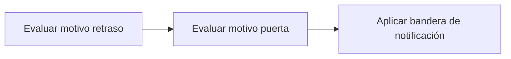

# Feature Specification: SF-11.3 — Decisión de notificar por motivo

**Created**: 2026-10-19  
**Status**: draft  
**Flow**: [F-11 Evaluar viaje como sistema](64-f-11-evaluar-viaje-como-sistema.md) (subflujo)  
**Related Specs**: [F-11 Evaluar viaje como sistema](64-f-11-evaluar-viaje-como-sistema.md), [SF-11.2 Evaluación](66-sf-11-2-evaluacion.md), [SF-11.4 Invocación de la notificación](68-sf-11-4-invocacion-de-la-notificacion.md)  
**Origen (DEC/H)**: DEC-02, DEC-05, H-21  
**Pruebas (TC)**: TC-43, TC-51, TC-52, TC-60  
**Contratos externos**: §2.1 (herramienta 7: cuándo se envía)  

## Reglas de este documento

> Este spec es FUNCIONAL, no técnico: describe QUÉ hace el sistema, no CÓMO. Usa lenguaje de negocio; las siete herramientas externas se nombran por su función y se referencian por la sección de `sdd/reports/EXTERNAL_CONTRACTS.md`. Los casos borde se DOCUMENTAN; los valores de configuración se citan por el nombre del parámetro (NFR-012) con su valor por defecto entre paréntesis.

**Alcance**: Decide, por motivo, si corresponde notificar: retraso con política rota (incluso BLOQUEADA o PENDIENTE_APROBACION) o cambio de puerta validado; sin ellos, no.

## User Scenarios & Testing *(mandatory)*

### User Story 1 - Se avisa solo cuando hay algo real que contar (Priority: P1)

Como pasajero, quiero recibir avisos por problemas reales y no por ruido.

**Why this priority**: Notificar de más desgasta la confianza.

**Independent Test**: Se prueba con cada combinación.

**Acceptance Scenarios**:

1. **Scenario**: Política rota bloqueada
   - **Given** decisión BLOQUEADA con política rota
   - **When** se decide
   - **Then** se notifica el retraso y se marca revisión manual

2. **Scenario**: Solo informativa
   - **Given** retraso sin política rota
   - **When** se decide
   - **Then** no se notifica («sin política rota»)

3. **Scenario**: Apagada
   - **Given** `NOTIFY_ENABLED` falso
   - **When** se decide
   - **Then** no se notifica («notificación desactivada»)

4. **Scenario**: Sin titular adulto no se notifica (TC-60)
   - **Given** una reserva ABC123 con un solo pasajero, el niño P2, sin titular adulto, con un retraso E-1001 de 180 min (R1 concede REBOOK_NO_FEE) que rompe la política POL-DELAY-2026-03 y la notificación activa
   - **When** se decide por motivo
   - **Then** no se envía ningún aviso: el estado es NOT_SENT con la razón NO_ADULT_RECIPIENT («sin destinatario adulto») y la revisión manual queda verdadera

5. **Scenario**: Política rota y bloqueada (TC-43)
   - **Given** un pasajero sin tipo con retraso de 160 min (R3 cumplida, R5 no evaluable)
   - **When** se decide
   - **Then** se notifica el retraso aunque la decisión sea BLOQUEADA y se marca revisión manual

---

### Edge Cases

> Solo se documentan; los marcados MUST-IMPLEMENT se vuelven requisito FR-XXX y se implementan con TDD, los DEFERRED quedan para una iteración posterior.

#### Invalid Data
- [MUST-IMPLEMENT] Cuando el cambio de puerta proviene de fuente degradada → no se notifica (FR-006)
- [MUST-IMPLEMENT] Cuando hay conflicto, tipo desconocido o lectura fallida → no se notifica y queda revisión manual (FR-123)
- [MUST-IMPLEMENT] Cuando la reserva no tiene titular adulto → el aviso no se envía (NOT_SENT, sin destinatario adulto) y la revisión manual queda verdadera (FR-122)

#### Security & Permissions
- [MUST-IMPLEMENT] Cuando se arma el destinatario → es el titular adulto de la reserva, nunca el menor (FR-122)

## Requirements *(mandatory)*

### Functional Requirements

- **FR-039**: Hay política rota si al menos una regla cumplida concede un derecho de remedio (`REMEDY_RIGHTS`; por defecto cambio sin costo, vale de comida y compensación en dinero). Un retraso sin política rota deja la decisión INFORMATIVA: se informa el retraso y se muestran las reglas evaluadas, sin consultar opciones, sin rebooking, compensación, soporte ni notificación de política, hasta que exista política rota. Los derechos que no son de remedio (trato prioritario) modifican el trato pero no rompen la política por sí solos.
- **FR-068**: La evaluación DEBE considerar todos los eventos validados de todos los segmentos en conjunto y la vista los muestra todos. En la Fase 1 solo el retraso consulta la política (`POLICY_SCENARIOS`); el cambio de puerta nunca la consulta y solo se informa o se notifica. Los tipos admitidos son `SUPPORTED_EVENT_TYPES`; uno fuera de la lista no se interpreta (FR-007). Un viaje solo con cambio de puerta queda INFORMATIVO.
- **FR-122**: En modo sistema se DEBE enviar la notificación con la plantilla fija «Hubo un cambio en tu vuelo asociado a {motivo}. Revisa tu reserva en la web o en la aplicación.» en dos casos: (a) política rota, con motivo «un retraso» y la referencia de política evaluada; (b) cambio de puerta validado, con motivo «un cambio de puerta», sin consultar política y sin referencia de política (aviso informativo). El motivo es una enumeración cerrada, se envía una notificación por motivo, el destinatario es la reserva y el aviso se dirige al titular adulto de la reserva, nunca al menor (si la reserva no tiene titular adulto no se envía, se registra «sin destinatario adulto» y se marca la revisión manual), y el mensaje NO contiene dirección web, enlace, teléfono ni dato de contacto (protección contra suplantación); el validador (FR-081) bloquea cualquiera de ellos.
- **FR-123**: La notificación DEBE ser idempotente: no se reenvía la misma (reserva, motivo, huella del motivo y plantilla) dentro de `NOTIFY_COOLDOWN_SECONDS` (86400); aceptada queda en cola, rechazo explícito es fallida, tiempo agotado es indeterminada, con hasta `NOTIFY_MAX_RETRIES` (2) reintentos con la misma llave y sin afirmar éxito. La huella del cambio de puerta incluye la puerta validada de cada segmento, de modo que un cambio posterior genera un aviso nuevo; la del retraso es la versión de política más las reglas disparadas, de modo que un cambio solo de minutos no repite el aviso. Sin política rota y sin cambio de puerta validado no se notifica y se registra la revisión manual; con política rota se notifica aunque la decisión sea BLOQUEADA o PENDIENTE_APROBACION.

### Key Entities *(include if feature involves data)*

- **Notificación**: Aviso al pasajero enviado solo por el sistema, con plantilla fija, una por motivo. Campos principales:
  - `reason`: DELAY | GATE_CHANGE
  - `kind`: POLICY | INFORMATIONAL
  - `policy_ref`: texto | ausente (ausente si kind es INFORMATIONAL)
  - `booking_id`: destinatario: texto
  - `recipient_passenger_id`: identificador del titular adulto (nunca un menor) | ausente si no hay adulto
  - `motive_fingerprint`: texto: DELAY = versión de política + reglas disparadas; GATE_CHANGE = puerta validada de cada segmento
  - `idempotency_key`: texto no adivinable
  - `attempt`: entero ≥ 1
  - `status`: EN_CURSO | QUEUED | FALLIDA | INDETERMINADA | VENCIDA | NOT_SENT
  - `notification_id`: texto | nulo
  - `not_sent_reason`: NOTIFY_DISABLED | NO_BROKEN_POLICY | NO_ADULT_RECIPIENT | nulo
  - `deduplicated`: booleano
  - `attempts`: entero
- **Resultado de evaluación del sistema**: Respuesta mínima y sin información personal para otro sistema. Campos principales:
  - `decision_id`: identificador
  - `decision_state`: INFORMATIVA | AUTOMATICA | PENDIENTE_APROBACION | BLOQUEADA | nulo
  - `reason`: DELAY | GATE_CHANGE | nulo
  - `notifications`: lista de {reason: texto, kind: texto, status: texto, notification_id: texto | nulo, not_sent_reason: texto | nulo, deduplicated: booleano, attempts: entero}
  - `needs_manual_review`: booleano

## Architectural Attributes *(mandatory)*

| Attribute | Value |
|-----------|-------|
| **Interaction type** | sync-http |
| **Consistency** | strong |
| **Workflow** | single-step |
| **Read pattern** | simple |
| **Auditability** | full-history |
| **Domain complexity** | medium |
| **Modularity** | bounded-context |
| **Deployment** | monolith |

## Success Criteria *(mandatory)*

### Measurable Outcomes

- **SC-001**: Cero notificaciones sin política rota ni cambio de puerta validado.

## Traceability *(mandatory after implementation)*

> Las columnas de archivo y línea se registran en la verificación de trazabilidad posterior a la implementación; hoy cada criterio queda enlazado a su origen y a las pruebas que lo verifican.

| Criterion | Origen | Prueba (TC) | Source File | Line(s) |
|-----------|--------|-------------|-------------|---------|
| FR-039 | DEC-02, DEC-05 | TC-43 | se registra en la verificación posterior a la implementación | se registra en la verificación posterior a la implementación |
| FR-068 | Usuario (2026-10-19) | TC-51, TC-52 | se registra en la verificación posterior a la implementación | se registra en la verificación posterior a la implementación |
| FR-122 | H-21 | TC-51, TC-52, TC-60 | se registra en la verificación posterior a la implementación | se registra en la verificación posterior a la implementación |
| FR-123 | Usuario (2026-10-19) | TC-43, TC-60 | se registra en la verificación posterior a la implementación | se registra en la verificación posterior a la implementación |
| SC-001 | criterio medible de este spec | TC-43, TC-51, TC-52, TC-60 | se registra en la verificación posterior a la implementación | se registra en la verificación posterior a la implementación |

## Business Process (BPM View)

```
Evaluar motivo retraso → Evaluar motivo puerta → Aplicar bandera de notificación
```



