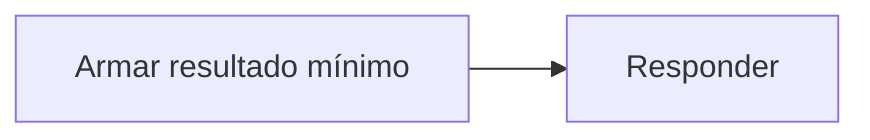

# Feature Specification: SF-11.6 — Respuesta sin información personal

**Created**: 2026-10-19  
**Status**: draft  
**Flow**: [F-11 Evaluar viaje como sistema](64-f-11-evaluar-viaje-como-sistema.md) (subflujo)  
**Related Specs**: [F-11 Evaluar viaje como sistema](64-f-11-evaluar-viaje-como-sistema.md), [SF-11.5 Registro de auditoría](69-sf-11-5-registro-de-auditoria.md)  
**Origen (DEC/H)**: DEC-22  
**Pruebas (TC)**: TC-50  
**Contratos externos**: §1.1 (fila 2: resultado de evaluación del sistema)  

## Reglas de este documento

> Este spec es FUNCIONAL, no técnico: describe QUÉ hace el sistema, no CÓMO. Usa lenguaje de negocio; las siete herramientas externas se nombran por su función y se referencian por la sección de `sdd/reports/EXTERNAL_CONTRACTS.md`. Los casos borde se DOCUMENTAN; los valores de configuración se citan por el nombre del parámetro (NFR-012) con su valor por defecto entre paréntesis.

**Alcance**: Devuelve el resultado mínimo: identificador de decisión, estado, motivo, notificaciones y revisión manual; sin vista ni datos del pasajero, y sin guardarla para el front.

## User Scenarios & Testing *(mandatory)*

### User Story 1 - El sistema solicitante recibe solo lo necesario (Priority: P1)

Como responsable de privacidad, quiero que el sistema solicitante no reciba datos de la persona.

**Why this priority**: Minimización por diseño.

**Independent Test**: Se prueba buscando datos ficticios en la respuesta.

**Acceptance Scenarios**:

1. **Scenario**: Mínimo
   - **Given** evaluación del sistema
   - **When** se responde
   - **Then** sin vista, sin opciones y sin datos personales

2. **Scenario**: No se guarda
   - **Given** el pasajero entra después
   - **When** consulta
   - **Then** el modo pasajero vuelve a evaluar de cero

3. **Scenario**: Resultado mínimo (TC-50)
   - **Given** ABC123 evaluada con la clave de servicio válida
   - **When** se responde
   - **Then** contiene 5 campos y ningún dato de Ana ni del niño

---

### Edge Cases

> Solo se documentan; los marcados MUST-IMPLEMENT se vuelven requisito FR-XXX y se implementan con TDD, los DEFERRED quedan para una iteración posterior.

#### System Errors
- [DEFERRED] Guardar la respuesta para el front: Fase 2 (FR-124)

#### Security & Permissions
- [MUST-IMPLEMENT] Cuando existen campos fuera del resultado mínimo → no se incluyen (FR-120)

## Requirements *(mandatory)*

### Functional Requirements

- **FR-120**: La evaluación DEBE recibir un parámetro `caller` obligatorio (`user` o `system`): el pasajero exige su sesión (FR-001); otro sistema exige una credencial de servicio (`SERVICE_API_KEY`, apagada por defecto) y NUNCA recibe información personal ni la vista completa, solo el identificador de decisión, el estado de la decisión, el motivo del cambio, el estado de la notificación y si requiere revisión manual.
- **FR-124**: La respuesta del modo sistema NO DEBE guardarse para el front en la versión 1; cuando el pasajero entra, el modo pasajero vuelve a consultar siempre (FR-002).

### Non-Functional and Documentation Requirements

- **NFR-002**: Privacidad: el sistema DEBE minimizar la información personal en todas las fronteras propias; ningún dato personal se entrega a un modelo (si en el futuro se usara, se anonimiza antes).

### Key Entities *(include if feature involves data)*

- **Resultado de evaluación del sistema**: Respuesta mínima y sin información personal para otro sistema. Campos principales:
  - `decision_id`: identificador
  - `decision_state`: INFORMATIVA | AUTOMATICA | PENDIENTE_APROBACION | BLOQUEADA | nulo
  - `reason`: DELAY | GATE_CHANGE | nulo
  - `notifications`: lista de {reason: texto, kind: texto, status: texto, notification_id: texto | nulo, not_sent_reason: texto | nulo, deduplicated: booleano, attempts: entero}
  - `needs_manual_review`: booleano

## Architectural Attributes *(mandatory)*

| Attribute | Value |
|-----------|-------|
| **Interaction type** | sync-http |
| **Consistency** | strong |
| **Workflow** | single-step |
| **Read pattern** | simple |
| **Auditability** | full-history |
| **Domain complexity** | medium |
| **Modularity** | bounded-context |
| **Deployment** | monolith |

## Success Criteria *(mandatory)*

### Measurable Outcomes

- **SC-001**: Cero datos personales en el 100 % de las respuestas.

## Traceability *(mandatory after implementation)*

> Las columnas de archivo y línea se registran en la verificación de trazabilidad posterior a la implementación; hoy cada criterio queda enlazado a su origen y a las pruebas que lo verifican.

| Criterion | Origen | Prueba (TC) | Source File | Line(s) |
|-----------|--------|-------------|-------------|---------|
| FR-120 | Usuario (2026-10-19) | TC-50 | se registra en la verificación posterior a la implementación | se registra en la verificación posterior a la implementación |
| FR-124 | Usuario (2026-10-19) | sin TC en el mapa §6 de REQUERIMIENTOS_V1 | se registra en la verificación posterior a la implementación | se registra en la verificación posterior a la implementación |
| NFR-002 | DEC-22 | sin TC en el mapa §6 de REQUERIMIENTOS_V1 | se registra en la verificación posterior a la implementación | se registra en la verificación posterior a la implementación |
| SC-001 | criterio medible de este spec | TC-50 | se registra en la verificación posterior a la implementación | se registra en la verificación posterior a la implementación |

## Business Process (BPM View)

```
Armar resultado mínimo → Responder
```



