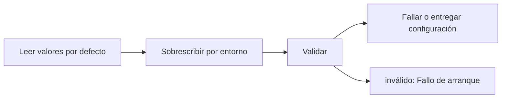

# Feature Specification: F-12 — Carga y validación de la configuración

**Created**: 2026-10-19  
**Status**: draft  
**Flow**: F-12 Carga y validación de la configuración  
**Related Specs**: [SF-12.1 Lectura de los valores por defecto](72-sf-12-1-lectura-de-los-valores-por-defecto.md), [SF-12.2 Sobrescritura por entorno](73-sf-12-2-sobrescritura-por-entorno.md), [SF-12.3 Validación](74-sf-12-3-validacion.md), [SF-12.4 Fallo de arranque](75-sf-12-4-fallo-de-arranque.md), [SF-12.5 Inyección](76-sf-12-5-inyeccion.md), [F-11 Evaluar viaje como sistema](64-f-11-evaluar-viaje-como-sistema.md), [F-07 Purga de retención](47-f-07-purga-de-retencion.md)  
**Origen (DEC/H)**: DEC-02, DEC-03, DEC-05, DEC-07, DEC-08, DEC-09, DEC-10, DEC-12, DEC-18, DEC-20, DEC-23, DEC-24, DEC-29, DEC-31, H-09, H-13  
**Pruebas (TC)**: TC-49, TC-57, TC-58  
**Contratos externos**: §2.4 (configuración central completa)  

## Reglas de este documento

> Este spec es FUNCIONAL, no técnico: describe QUÉ hace el sistema, no CÓMO. Usa lenguaje de negocio; las siete herramientas externas se nombran por su función y se referencian por la sección de `sdd/reports/EXTERNAL_CONTRACTS.md`. Los casos borde se DOCUMENTAN; los valores de configuración se citan por el nombre del parámetro (NFR-012) con su valor por defecto entre paréntesis.

**Alcance**: Al arrancar construye la configuración desde los valores por defecto documentados, la sobrescribe con variables de entorno (los secretos solo por entorno), valida cada parámetro y la entrega por inyección; un valor inválido o un secreto obligatorio ausente impide el arranque.

## User Scenarios & Testing *(mandatory)*

### User Story 1 - Todo parámetro de negocio se cambia sin tocar la lógica (Priority: P1)

Como operador, quiero cambiar umbrales, listas de derechos y banderas por configuración, y que un valor inválido impida arrancar nombrando el parámetro.

**Why this priority**: Los supuestos (S-09 a S-19) deben poder ajustarse sin modificar las reglas.

**Independent Test**: Se prueba cambiando cada parámetro y comprobando que cambia el comportamiento, y con valores inválidos.

**Acceptance Scenarios**:

1. **Scenario**: Valor por defecto
   - **Given** no hay variable de entorno
   - **When** se arranca
   - **Then** rigen los valores por defecto documentados

2. **Scenario**: Sobrescritura
   - **Given** `RELEVANT_DELAY_MIN_MINUTES` = 20 por entorno
   - **When** se evalúa un retraso de 10 minutos
   - **Then** no hay alerta

3. **Scenario**: Valor inválido
   - **Given** un parámetro tiene un valor fuera de rango
   - **When** se arranca
   - **Then** el servicio no arranca y el error nombra el parámetro, nunca el valor de un secreto

4. **Scenario**: Sin secreto de idempotencia
   - **Given** falta `IDEMPOTENCY_SECRET`
   - **When** se arranca
   - **Then** el servicio no arranca

5. **Scenario**: Sin credencial de servicio
   - **Given** falta `SERVICE_API_KEY`
   - **When** se arranca
   - **Then** arranca con el modo sistema apagado

6. **Scenario**: Parámetros nuevos
   - **Given** `OPERATION_INDETERMINATE_EXPIRY_SECONDS` y `EVALUATE_RATE_LIMIT_PER_MINUTE` con sus valores por defecto (900 y 30)
   - **When** se cambia cada uno
   - **Then** cambian el vencimiento de una operación indeterminada y el límite de tasa de la evaluación

7. **Scenario**: Parámetros operativos
   - **Given** los parámetros operativos de `EXTERNAL_CONTRACTS.md` §2.4 (tiempos de espera, reintentos de lectura, modo de reloj, origen permitido, ubicación del registro, banderas de desarrollo)
   - **When** se cambian
   - **Then** cada uno tiene valor por defecto, sobrescritura por entorno y validación al arrancar, igual que los de los supuestos S-09 a S-19

8. **Scenario**: Umbral de 20 minutos (TC-49)
   - **Given** `RELEVANT_DELAY_MIN_MINUTES` en 20 por entorno
   - **When** se evalúa un retraso de 10 min
   - **Then** no hay alerta; con el valor por defecto 1 sí

9. **Scenario**: Parámetros de desarrollo y entrada (TC-49)
   - **Given** `DEV_SESSION_HEADER_ENABLED` y `DEV_ENDPOINTS_ENABLED` en falso por defecto, `CLOCK_MODE` en system, `CORS_ALLOWED_ORIGINS` con el origen del front de prueba y `DB_PATH` con un archivo escribible
   - **When** se cambia cada uno por entorno
   - **Then** las funciones de desarrollo se habilitan, el reloj pasa a modo escenario, un origen distinto queda rechazado y el registro se escribe en la ruta nueva; un `CLOCK_MODE` inválido o un `DB_PATH` no escribible impide arrancar

10. **Scenario**: Parámetros de lectura y reintento (TC-49)
   - **Given** `UPSTREAM_READ_TIMEOUT_MS` de 2000, `UPSTREAM_WRITE_TIMEOUT_MS` de 5000, `READ_MAX_REQUERIES` de 1 y `WRITE_RETRY_BACKOFF_MS` de 200
   - **When** se cambian por entorno
   - **Then** cambian el tiempo de espera de cada lectura y escritura, las re-consultas de una lectura fallida y la pausa de 200 ms entre reintentos (400 ms el segundo); un valor por debajo de 100 ms impide arrancar

11. **Scenario**: Compatibilidad de afirmaciones (TC-49)
   - **Given** `ASSERTION_COMPATIBILITY` con «retrasado», «a tiempo» y «horario programado» incompatibles entre sí
   - **When** se quita «a tiempo» de la tabla
   - **Then** un empate entre E-1001 (160 min) y un estado «a tiempo» deja de ser conflicto; una entrada con una afirmación fuera del conjunto cerrado impide arrancar

---

### Edge Cases

> Solo se documentan; los marcados MUST-IMPLEMENT se vuelven requisito FR-XXX y se implementan con TDD, los DEFERRED quedan para una iteración posterior.

#### System Errors
- [MUST-IMPLEMENT] Cuando un secreto tiene menos de 16 caracteres → no arranca (NFR-012)

#### Invalid Data
- [MUST-IMPLEMENT] Cuando `NOTIFY_ONLY_EVENT_TYPES` no es subconjunto de `SUPPORTED_EVENT_TYPES` → no arranca (NFR-012)
- [MUST-IMPLEMENT] Cuando `OPERATION_INDETERMINATE_EXPIRY_SECONDS` no es mayor que `OPERATION_STALE_SECONDS` o `EVALUATE_RATE_LIMIT_PER_MINUTE` es menor que 1 → no arranca (NFR-012)
- [MUST-IMPLEMENT] Cuando una lógica de dominio intenta leer el entorno directamente → falla la prueba de calidad (NFR-007)

#### Security & Permissions
- [MUST-IMPLEMENT] Cuando se reporta un error de configuración → nunca se muestra el valor de un secreto (NFR-003)

## Requirements *(mandatory)*

### Functional Requirements

- **FR-005**: El sistema DEBE tratar como evento relevante un retraso validado con minutos de retraso mayores o iguales a `RELEVANT_DELAY_MIN_MINUTES` (1); qué derechos otorga lo decide la política vigente (FR-034).
- **FR-016**: El sistema DEBE descartar los eventos de un segmento que no fue solicitado (`UNKNOWN_SEGMENT`) y los eventos con instante de registro posterior al de la lectura más la tolerancia `CLOCK_SKEW_SECONDS` (60) (`FUTURE_TIMESTAMP`).
- **FR-017**: El sistema DEBE usar siempre el dato más reciente y respetar la vigencia: las opciones vencen en el instante de su lectura más su vigencia en segundos (en el instante exacto ya están vencidas; sin vigencia declarada el conjunto se considera vencido). Los eventos no vencen por sí mismos (`EVENT_MAX_AGE_SECONDS`, por defecto sin límite). Al vencer se re-consulta una sola vez por acción, sin bucles.
- **FR-022**: El margen de conexión es la salida programada del segmento siguiente menos la nueva llegada del segmento afectado (horas locales del mismo aeropuerto, con fecha). Si el afectado es el último segmento no hay conexión y la conexión perdida es falsa. La conexión perdida es verdadera si el margen es menor que el tiempo mínimo de conexión; desconocida si ese tiempo no fue provisto y el margen está entre cero y `MCT_UNCERTAINTY_MINUTES` (45); falsa en el resto. Siempre es una estimación.
- **FR-030**: El sistema DEBE evaluar las condiciones de política con un analizador acotado de lista blanca: variables permitidas (retraso, carácter internacional, conexión perdida, compensación solicitada, grupo con menor), comparadores de igualdad, desigualdad y orden, conectores Y/O (Y precede a O), literales enteros y verdadero/falso, y paréntesis; `EQ` equivale a igualdad y `NE` a desigualdad. Comparar un booleano con un entero, o usar orden sobre un booleano, es error de regla. Las condiciones miden como máximo `PARSER_MAX_CONDITION_CHARS` (200) caracteres y `PARSER_MAX_DEPTH` (10) niveles; todo lo demás es error.
- **FR-039**: Hay política rota si al menos una regla cumplida concede un derecho de remedio (`REMEDY_RIGHTS`; por defecto cambio sin costo, vale de comida y compensación en dinero). Un retraso sin política rota deja la decisión INFORMATIVA: se informa el retraso y se muestran las reglas evaluadas, sin consultar opciones, sin rebooking, compensación, soporte ni notificación de política, hasta que exista política rota. Los derechos que no son de remedio (trato prioritario) modifican el trato pero no rompen la política por sí solos.
- **FR-054**: Un resultado indeterminado (falla temporal del proveedor, tiempo agotado o respuesta perdida) DEBE reintentarse hasta `REBOOK_MAX_RETRIES` (2) veces con la misma llave; luego se deriva a caso humano (cubierto por el clic de FR-050). Nunca se informa éxito ni fracaso.
- **FR-064**: La operación de cambio DEBE seguir un ciclo de vida: en curso, creada, indeterminada, fallida y expirada. En curso pasa a indeterminada tras `OPERATION_STALE_SECONDS` (120) sin respuesta; creada pasa a expirada en su vencimiento; indeterminada pasa a expirada tras `OPERATION_INDETERMINATE_EXPIRY_SECONDS` (900, mayor que la vigencia de una solicitud) si nada la resuelve. Si la llave no pudo persistirse no se escribe. Expirada o fallida permiten una operación nueva con la generación siguiente; creada, en curso e indeterminada la bloquean y la vista muestra su estado. Un rechazo por duplicado sin operación local se muestra «ya existe una solicitud para esta opción».
- **FR-067**: El motivo de compensación del menú de soporte solo DEBE mostrarse si la política tiene una regla que concede un derecho de compensación (`COMPENSATION_RIGHTS`) que, evaluada con la solicitud de compensación verdadera y las demás variables, resulta verdadera, y la decisión no es INFORMATIVA.
- **FR-068**: La evaluación DEBE considerar todos los eventos validados de todos los segmentos en conjunto y la vista los muestra todos. En la Fase 1 solo el retraso consulta la política (`POLICY_SCENARIOS`); el cambio de puerta nunca la consulta y solo se informa o se notifica. Los tipos admitidos son `SUPPORTED_EVENT_TYPES`; uno fuera de la lista no se interpreta (FR-007). Un viaje solo con cambio de puerta queda INFORMATIVO.
- **FR-085**: La notificación al pasajero DEBE invocarse solo en modo sistema (FR-122) con una plantilla fija; en modo pasajero no se invoca porque el mensaje se ve en la pantalla. Se activa con `NOTIFY_ENABLED`.
- **FR-092**: El sistema DEBE aplicar una retención provisional (`AUDIT_RETENTION_DAYS`, 30) con una rutina de purga verificable del registro de decisiones, de operaciones, de casos y de notificaciones, que primero aplica los vencimientos de las operaciones (FR-064) y después conserva el registro mínimo solo de las operaciones que siguen no finalizadas (en curso, indeterminada o creada dentro de su vigencia) para no perder su bloqueo; una operación ya vencida se purga por antigüedad como cualquier otra.
- **FR-120**: La evaluación DEBE recibir un parámetro `caller` obligatorio (`user` o `system`): el pasajero exige su sesión (FR-001); otro sistema exige una credencial de servicio (`SERVICE_API_KEY`, apagada por defecto) y NUNCA recibe información personal ni la vista completa, solo el identificador de decisión, el estado de la decisión, el motivo del cambio, el estado de la notificación y si requiere revisión manual.
- **FR-123**: La notificación DEBE ser idempotente: no se reenvía la misma (reserva, motivo, huella del motivo y plantilla) dentro de `NOTIFY_COOLDOWN_SECONDS` (86400); aceptada queda en cola, rechazo explícito es fallida, tiempo agotado es indeterminada, con hasta `NOTIFY_MAX_RETRIES` (2) reintentos con la misma llave y sin afirmar éxito. La huella del cambio de puerta incluye la puerta validada de cada segmento, de modo que un cambio posterior genera un aviso nuevo; la del retraso es la versión de política más las reglas disparadas, de modo que un cambio solo de minutos no repite el aviso. Sin política rota y sin cambio de puerta validado no se notifica y se registra la revisión manual; con política rota se notifica aunque la decisión sea BLOQUEADA o PENDIENTE_APROBACION.

### Non-Functional and Documentation Requirements

- **NFR-012**: Configuración: todos los parámetros de los supuestos S-09 a S-19 DEBEN ser variables configurables (archivo de configuración con sobrescritura por entorno, validadas al arrancar y con valor por defecto documentado) y ninguno puede estar fijado en la lógica; entre ellos `RELEVANT_DELAY_MIN_MINUTES` (1), `MIN_CONNECTION_MINUTES` (0 por aeropuerto), `MCT_UNCERTAINTY_MINUTES` (45), `CLOCK_SKEW_SECONDS` (60), `EVENT_MAX_AGE_SECONDS` (sin límite), `OPERATION_STALE_SECONDS` (120), `REBOOK_MAX_RETRIES` (2), `AUDIT_RETENTION_DAYS` (30), `PARSER_MAX_CONDITION_CHARS` (200), `PARSER_MAX_DEPTH` (10), `REMEDY_RIGHTS`, `COMPENSATION_RIGHTS`, `NOTIFY_ENABLED`, `NOTIFY_COOLDOWN_SECONDS` (86400), `NOTIFY_MAX_RETRIES` (2), `OPERATION_INDETERMINATE_EXPIRY_SECONDS` (900), `EVALUATE_RATE_LIMIT_PER_MINUTE` (30), `CHANGE_RIGHTS`, `SUPPORTED_EVENT_TYPES`, `NOTIFY_ONLY_EVENT_TYPES`, `POLICY_SCENARIOS`, `REASON_PRIORITY`, la tabla de compatibilidad de afirmaciones y los secretos `SERVICE_API_KEY` e `IDEMPOTENCY_SECRET` (solo por entorno). Una prueba cambia cada parámetro y comprueba que cambia el comportamiento. También son configurables los parámetros operativos de `sdd/reports/EXTERNAL_CONTRACTS.md` §2.4 (tiempos de espera, reintentos de lectura, modo de reloj, origen permitido, ubicación del registro y banderas de desarrollo).
- **NFR-005**: Operabilidad: el sistema DEBE configurarse por variables de entorno, emitir registros estructurados sin información personal y contar con un runbook de una página; debe poder operarlo un equipo pequeño.
- **NFR-003**: Seguridad: el analizador de reglas DEBE operar sin ejecución dinámica, las entradas se validan estrictamente, el origen permitido se acota al front y no hay secretos en el repositorio.
- **NFR-007**: Estilo SDD: el desarrollo DEBE seguir TDD con revisión WTF, funciones de a lo sumo 10 líneas y 3 parámetros (verificado por una prueba que mide el código) y lógica de negocio independiente de la tecnología mediante puertos y adaptadores.
- **NFR-013**: Seguridad de entradas: todo acceso al registro persistente DEBE usar consultas parametrizadas (las consultas viven en archivos propios); la interfaz DEBE mostrar los textos del proveedor (condición, derecho, puerta, mensajes) como texto plano, sin insertar marcado HTML; y la evaluación, la aceptación de una opción, el caso humano y la consulta de una decisión DEBEN tener un límite de tasa por reserva y por origen (`EVALUATE_RATE_LIMIT_PER_MINUTE`, 30 por minuto), con los intentos fallidos de credencial de servicio también limitados por origen.

### Key Entities *(include if feature involves data)*

- **Configuración**: Conjunto central de parámetros con valor por defecto, sobrescritura por entorno y validación al arrancar. Campos principales:
  - `name`: nombre del parámetro (p. ej. `RELEVANT_DELAY_MIN_MINUTES`)
  - `default`: valor por defecto documentado
  - `effective_value`: valor tras aplicar el entorno
  - `validation`: tipo, rango, lista no vacía o longitud mínima
  - `is_secret`: booleano (solo por entorno, nunca se muestra)
  - `effect`: comportamiento que cambia

## Architectural Attributes *(mandatory)*

| Attribute | Value |
|-----------|-------|
| **Interaction type** | batch |
| **Consistency** | strong |
| **Workflow** | single-step |
| **Read pattern** | simple |
| **Auditability** | basic |
| **Domain complexity** | high |
| **Modularity** | shared-layer |
| **Deployment** | monolith |

## Success Criteria *(mandatory)*

### Measurable Outcomes

- **SC-001**: El 100 % de los parámetros de la tabla de configuración (incluidos los operativos y los dos nuevos) tiene una prueba que cambia su valor y verifica el efecto.
- **SC-002**: El 100 % de los valores inválidos impide el arranque nombrando el parámetro.
- **SC-003**: Ningún parámetro de los supuestos S-09 a S-19 aparece fijado en la lógica de negocio.

## Traceability *(mandatory after implementation)*

> Las columnas de archivo y línea se registran en la verificación de trazabilidad posterior a la implementación; hoy cada criterio queda enlazado a su origen y a las pruebas que lo verifican.

| Criterion | Origen | Prueba (TC) | Source File | Line(s) |
|-----------|--------|-------------|-------------|---------|
| FR-005 | DEC-05, DEC-31, H-09 | sin TC en el mapa §6 de REQUERIMIENTOS_V1 | se registra en la verificación posterior a la implementación | se registra en la verificación posterior a la implementación |
| FR-016 | DEC-09 | sin TC en el mapa §6 de REQUERIMIENTOS_V1 | se registra en la verificación posterior a la implementación | se registra en la verificación posterior a la implementación |
| FR-017 | DEC-10 | sin TC en el mapa §6 de REQUERIMIENTOS_V1 | se registra en la verificación posterior a la implementación | se registra en la verificación posterior a la implementación |
| FR-022 | DEC-07, DEC-08, H-13 | sin TC en el mapa §6 de REQUERIMIENTOS_V1 | se registra en la verificación posterior a la implementación | se registra en la verificación posterior a la implementación |
| FR-030 | DEC-12 | sin TC en el mapa §6 de REQUERIMIENTOS_V1 | se registra en la verificación posterior a la implementación | se registra en la verificación posterior a la implementación |
| FR-039 | DEC-02, DEC-05 | sin TC en el mapa §6 de REQUERIMIENTOS_V1 | se registra en la verificación posterior a la implementación | se registra en la verificación posterior a la implementación |
| FR-054 | DEC-18 | sin TC en el mapa §6 de REQUERIMIENTOS_V1 | se registra en la verificación posterior a la implementación | se registra en la verificación posterior a la implementación |
| FR-064 | DEC-18 | TC-57 | se registra en la verificación posterior a la implementación | se registra en la verificación posterior a la implementación |
| FR-067 | DEC-29 | sin TC en el mapa §6 de REQUERIMIENTOS_V1 | se registra en la verificación posterior a la implementación | se registra en la verificación posterior a la implementación |
| FR-068 | Usuario (2026-10-19) | sin TC en el mapa §6 de REQUERIMIENTOS_V1 | se registra en la verificación posterior a la implementación | se registra en la verificación posterior a la implementación |
| FR-085 | DEC-20 | sin TC en el mapa §6 de REQUERIMIENTOS_V1 | se registra en la verificación posterior a la implementación | se registra en la verificación posterior a la implementación |
| FR-092 | DEC-23 | sin TC en el mapa §6 de REQUERIMIENTOS_V1 | se registra en la verificación posterior a la implementación | se registra en la verificación posterior a la implementación |
| FR-120 | Usuario (2026-10-19) | sin TC en el mapa §6 de REQUERIMIENTOS_V1 | se registra en la verificación posterior a la implementación | se registra en la verificación posterior a la implementación |
| FR-123 | Usuario (2026-10-19) | sin TC en el mapa §6 de REQUERIMIENTOS_V1 | se registra en la verificación posterior a la implementación | se registra en la verificación posterior a la implementación |
| NFR-012 | Usuario (2026-10-19) | TC-49 | se registra en la verificación posterior a la implementación | se registra en la verificación posterior a la implementación |
| NFR-005 | DEC-24 | sin TC en el mapa §6 de REQUERIMIENTOS_V1 | se registra en la verificación posterior a la implementación | se registra en la verificación posterior a la implementación |
| NFR-003 | DEC-12 | sin TC en el mapa §6 de REQUERIMIENTOS_V1 | se registra en la verificación posterior a la implementación | se registra en la verificación posterior a la implementación |
| NFR-007 | DEC-03 | sin TC en el mapa §6 de REQUERIMIENTOS_V1 | se registra en la verificación posterior a la implementación | se registra en la verificación posterior a la implementación |
| NFR-013 | Usuario (2026-10-19) | TC-58 | se registra en la verificación posterior a la implementación | se registra en la verificación posterior a la implementación |
| SC-001 | criterio medible de este spec | TC-49, TC-57, TC-58 | se registra en la verificación posterior a la implementación | se registra en la verificación posterior a la implementación |
| SC-002 | criterio medible de este spec | TC-49, TC-57, TC-58 | se registra en la verificación posterior a la implementación | se registra en la verificación posterior a la implementación |
| SC-003 | criterio medible de este spec | TC-49, TC-57, TC-58 | se registra en la verificación posterior a la implementación | se registra en la verificación posterior a la implementación |

## Business Process (BPM View)

```
Leer valores por defecto → Sobrescribir por entorno → Validar → Fallar o entregar configuración
```



### Subprocesses (if applicable)

```
SF-12.1: Lectura de los valores por defecto
SF-12.2: Sobrescritura por entorno
SF-12.3: Validación
SF-12.4: Fallo de arranque
SF-12.5: Inyección
```
