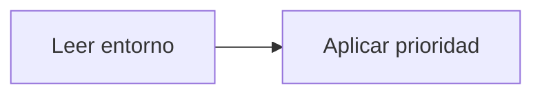

# Feature Specification: SF-12.2 — Sobrescritura por entorno

**Created**: 2026-10-19  
**Status**: draft  
**Flow**: [F-12 Carga y validación de la configuración](71-f-12-carga-y-validacion-de-la-configuracion.md) (subflujo)  
**Related Specs**: [F-12 Carga y validación de la configuración](71-f-12-carga-y-validacion-de-la-configuracion.md), [SF-12.1 Lectura de los valores por defecto](72-sf-12-1-lectura-de-los-valores-por-defecto.md), [SF-12.3 Validación](74-sf-12-3-validacion.md)  
**Origen (DEC/H)**: DEC-12, DEC-20  
**Pruebas (TC)**: TC-49  
**Contratos externos**: §2.4  

## Reglas de este documento

> Este spec es FUNCIONAL, no técnico: describe QUÉ hace el sistema, no CÓMO. Usa lenguaje de negocio; las siete herramientas externas se nombran por su función y se referencian por la sección de `sdd/reports/EXTERNAL_CONTRACTS.md`. Los casos borde se DOCUMENTAN; los valores de configuración se citan por el nombre del parámetro (NFR-012) con su valor por defecto entre paréntesis.

**Alcance**: Aplica las variables de entorno con prioridad; los secretos solo se leen del entorno.

## User Scenarios & Testing *(mandatory)*

### User Story 1 - El entorno manda (Priority: P1)

Como operador, quiero ajustar el comportamiento por variables de entorno sin recompilar.

**Why this priority**: Cada despliegue necesita sus propios valores y secretos.

**Independent Test**: Se prueba con una variable que cambia un umbral.

**Acceptance Scenarios**:

1. **Scenario**: Sobrescritura
   - **Given** una variable de entorno con el nombre del parámetro
   - **When** se arranca
   - **Then** su valor reemplaza al del archivo

2. **Scenario**: Secretos
   - **Given** el secreto está en el archivo y no en el entorno
   - **When** se arranca
   - **Then** no se usa: los secretos solo se leen del entorno

3. **Scenario**: Prioridad del entorno (TC-49)
   - **Given** el archivo con `OPERATION_STALE_SECONDS` de 120 y el entorno con 300, y un secreto escrito en el archivo
   - **When** se arranca
   - **Then** rige 300 y el secreto del archivo no se usa

4. **Scenario**: Sobrescritura de banderas y rutas (TC-49)
   - **Given** `DEV_ENDPOINTS_ENABLED` en verdadero y `DB_PATH` con otra ruta en el entorno y los valores por defecto en el archivo
   - **When** se arranca
   - **Then** rigen los valores del entorno y `CORS_ALLOWED_ORIGINS` conserva su valor por defecto

---

### Edge Cases

> Solo se documentan; los marcados MUST-IMPLEMENT se vuelven requisito FR-XXX y se implementan con TDD, los DEFERRED quedan para una iteración posterior.

#### Invalid Data
- [DEFERRED] Rotación de secretos con operaciones activas: solo con operaciones en estados finales (AR-14) (NFR-012)

#### Security & Permissions
- [MUST-IMPLEMENT] Cuando el valor es un secreto → nunca se imprime (NFR-003)

## Requirements *(mandatory)*

### Functional Requirements

- **FR-085**: La notificación al pasajero DEBE invocarse solo en modo sistema (FR-122) con una plantilla fija; en modo pasajero no se invoca porque el mensaje se ve en la pantalla. Se activa con `NOTIFY_ENABLED`.
- **FR-120**: La evaluación DEBE recibir un parámetro `caller` obligatorio (`user` o `system`): el pasajero exige su sesión (FR-001); otro sistema exige una credencial de servicio (`SERVICE_API_KEY`, apagada por defecto) y NUNCA recibe información personal ni la vista completa, solo el identificador de decisión, el estado de la decisión, el motivo del cambio, el estado de la notificación y si requiere revisión manual.

### Non-Functional and Documentation Requirements

- **NFR-012**: Configuración: todos los parámetros de los supuestos S-09 a S-19 DEBEN ser variables configurables (archivo de configuración con sobrescritura por entorno, validadas al arrancar y con valor por defecto documentado) y ninguno puede estar fijado en la lógica; entre ellos `RELEVANT_DELAY_MIN_MINUTES` (1), `MIN_CONNECTION_MINUTES` (0 por aeropuerto), `MCT_UNCERTAINTY_MINUTES` (45), `CLOCK_SKEW_SECONDS` (60), `EVENT_MAX_AGE_SECONDS` (sin límite), `OPERATION_STALE_SECONDS` (120), `REBOOK_MAX_RETRIES` (2), `AUDIT_RETENTION_DAYS` (30), `PARSER_MAX_CONDITION_CHARS` (200), `PARSER_MAX_DEPTH` (10), `REMEDY_RIGHTS`, `COMPENSATION_RIGHTS`, `NOTIFY_ENABLED`, `NOTIFY_COOLDOWN_SECONDS` (86400), `NOTIFY_MAX_RETRIES` (2), `OPERATION_INDETERMINATE_EXPIRY_SECONDS` (900), `EVALUATE_RATE_LIMIT_PER_MINUTE` (30), `CHANGE_RIGHTS`, `SUPPORTED_EVENT_TYPES`, `NOTIFY_ONLY_EVENT_TYPES`, `POLICY_SCENARIOS`, `REASON_PRIORITY`, la tabla de compatibilidad de afirmaciones y los secretos `SERVICE_API_KEY` e `IDEMPOTENCY_SECRET` (solo por entorno). Una prueba cambia cada parámetro y comprueba que cambia el comportamiento. También son configurables los parámetros operativos de `sdd/reports/EXTERNAL_CONTRACTS.md` §2.4 (tiempos de espera, reintentos de lectura, modo de reloj, origen permitido, ubicación del registro y banderas de desarrollo).
- **NFR-003**: Seguridad: el analizador de reglas DEBE operar sin ejecución dinámica, las entradas se validan estrictamente, el origen permitido se acota al front y no hay secretos en el repositorio.

### Key Entities *(include if feature involves data)*

- **Configuración**: Conjunto central de parámetros con valor por defecto, sobrescritura por entorno y validación al arrancar. Campos principales:
  - `name`: nombre del parámetro (p. ej. `RELEVANT_DELAY_MIN_MINUTES`)
  - `default`: valor por defecto documentado
  - `effective_value`: valor tras aplicar el entorno
  - `validation`: tipo, rango, lista no vacía o longitud mínima
  - `is_secret`: booleano (solo por entorno, nunca se muestra)
  - `effect`: comportamiento que cambia

## Architectural Attributes *(mandatory)*

| Attribute | Value |
|-----------|-------|
| **Interaction type** | batch |
| **Consistency** | strong |
| **Workflow** | single-step |
| **Read pattern** | simple |
| **Auditability** | full-history |
| **Domain complexity** | medium |
| **Modularity** | bounded-context |
| **Deployment** | monolith |

## Success Criteria *(mandatory)*

### Measurable Outcomes

- **SC-001**: Todo parámetro es sobrescribible por entorno excepto los secretos, que solo existen por entorno.

## Traceability *(mandatory after implementation)*

> Las columnas de archivo y línea se registran en la verificación de trazabilidad posterior a la implementación; hoy cada criterio queda enlazado a su origen y a las pruebas que lo verifican.

| Criterion | Origen | Prueba (TC) | Source File | Line(s) |
|-----------|--------|-------------|-------------|---------|
| FR-085 | DEC-20 | sin TC en el mapa §6 de REQUERIMIENTOS_V1 | se registra en la verificación posterior a la implementación | se registra en la verificación posterior a la implementación |
| FR-120 | Usuario (2026-10-19) | sin TC en el mapa §6 de REQUERIMIENTOS_V1 | se registra en la verificación posterior a la implementación | se registra en la verificación posterior a la implementación |
| NFR-012 | Usuario (2026-10-19) | TC-49 | se registra en la verificación posterior a la implementación | se registra en la verificación posterior a la implementación |
| NFR-003 | DEC-12 | sin TC en el mapa §6 de REQUERIMIENTOS_V1 | se registra en la verificación posterior a la implementación | se registra en la verificación posterior a la implementación |
| SC-001 | criterio medible de este spec | TC-49 | se registra en la verificación posterior a la implementación | se registra en la verificación posterior a la implementación |

## Business Process (BPM View)

```
Leer entorno → Aplicar prioridad
```



