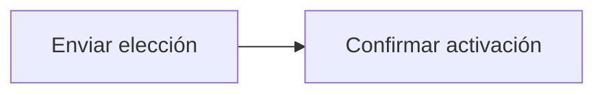

# Feature Specification: FE-01.2 — Activación del escenario

**Created**: 2026-10-19  
**Status**: draft  
**Flow**: [FE-01 Selector de escenario y reloj (solo desarrollo)](77-fe-01-selector-de-escenario-y-reloj-solo-desarrollo.md) (subflujo)  
**Related Specs**: [FE-01 Selector de escenario y reloj (solo desarrollo)](77-fe-01-selector-de-escenario-y-reloj-solo-desarrollo.md), [FE-01.1 Carga del catálogo](78-fe-01-1-carga-del-catalogo.md), [FE-01.3 Fijación de la sesión simulada](80-fe-01-3-fijacion-de-la-sesion-simulada.md)  
**Origen (DEC/H)**: DEC-04  
**Pruebas (TC)**: TC-01  
**Contratos externos**: §1.1 (fila 7)  

## Reglas de este documento

> Este spec es FUNCIONAL, no técnico: describe QUÉ hace el sistema, no CÓMO. Usa lenguaje de negocio; las siete herramientas externas se nombran por su función y se referencian por la sección de `sdd/reports/EXTERNAL_CONTRACTS.md`. Los casos borde se DOCUMENTAN; los valores de configuración se citan por el nombre del parámetro (NFR-012) con su valor por defecto entre paréntesis.

**Alcance**: Al elegir un escenario lo activa en el servicio de desarrollo y espera su confirmación.

## User Scenarios & Testing *(mandatory)*

### User Story 1 - El escenario elegido es el que se ve (Priority: P1)

Como evaluador, quiero que al elegir un escenario los datos cambien a esa situación.

**Why this priority**: Sin activación la vista no cambia.

**Independent Test**: Se prueba cambiando entre dos escenarios.

**Acceptance Scenarios**:

1. **Scenario**: Activación
   - **Given** el evaluador elige otro escenario
   - **When** se confirma la activación
   - **Then** se continúa con la sesión simulada

2. **Scenario**: Escenario no encontrado (TC-01)
   - **Given** BASE_TC01 activo y un escenario que ya no existe en el catálogo
   - **When** se elige ese escenario
   - **Then** se lee «El escenario ya no existe. Elige otro.» y se conserva BASE_TC01; mientras activa se lee «Activando escenario…» con la lista deshabilitada

3. **Scenario**: Cambio a SIN_MENOR_TC07 (TC-07)
   - **Given** BASE_TC01 activo
   - **When** se elige SIN_MENOR_TC07
   - **Then** se activa y la vista muestra dos pasajeros adultos

---

### Edge Cases

> Solo se documentan; los marcados MUST-IMPLEMENT se vuelven requisito FR-XXX y se implementan con TDD, los DEFERRED quedan para una iteración posterior.

#### System Errors
- [MUST-IMPLEMENT] Cuando la activación falla → aviso y se mantiene el escenario anterior (FR-111)

#### Invalid Data
- [MUST-IMPLEMENT] Cuando el escenario ya no existe → aviso de escenario no encontrado (FR-101)

## Requirements *(mandatory)*

### Functional Requirements

- **FR-VIS-001**: La interfaz DEBE aplicar estilos coherentes con la identidad visual definida: CSS propio alineado con `sdd/reports/DESIGN_CONTRACT.md` (tokens de color, tipografía, espaciado y radios), sin logos ni marcas de terceros.
- **FR-VIS-002**: Está PROHIBIDO entregar HTML sin estilos: cada pantalla y cada estado de este flujo DEBE renderizarse con los estilos de la identidad, nunca con el aspecto por defecto del navegador.
- **FR-VIS-003**: La interfaz DEBE ser consistente con `sdd/reports/DESIGN_CONTRACT.md`: usa solo los componentes de su inventario y solo sus tokens; toda diferencia respecto del contrato es un defecto de la implementación, no del contrato.
- **FR-101**: La fuente de verdad es el universo del enunciado: los escenarios de prueba reproducen los siete ejemplos (con datos personales claramente ficticios) y las variantes de prueba; los tipos de evento son retraso, cambio de puerta y estado; un test verifica que los datos ficticios no aparecen en registros ni en el historial.
- **FR-111**: El front de prueba DEBE tener el aspecto y la sensación del centro de ayuda de una aerolínea (sin logos ni marcas), verificable con la lista de componentes y la lista de verificación de tokens de `sdd/reports/DESIGN_CONTRACT.md`: selector de escenario, contexto, alerta, reglas cumplidas y no cumplidas, opción propuesta, vía de reembolso, avisos de estimación, hora límite y «sujeto a disponibilidad», y botones de acción.

### Key Entities *(include if feature involves data)*

- **Escenario de desarrollo**: Conjunto de datos simulados de las siete herramientas, activable solo en desarrollo. Campos principales:
  - `scenario_id`: texto
  - `booking_id`: texto
  - `title`: texto en español
  - `description`: texto
  - `ui`: booleano (visible en el selector)
  - `tests`: lista de TC-nn

## Architectural Attributes *(mandatory)*

| Attribute | Value |
|-----------|-------|
| **Interaction type** | sync-http |
| **Consistency** | strong |
| **Workflow** | single-step |
| **Read pattern** | simple |
| **Auditability** | none |
| **Domain complexity** | low |
| **Modularity** | feature-slice |
| **Deployment** | monolith |

## Success Criteria *(mandatory)*

### Measurable Outcomes

- **SC-001**: El 100 % de las activaciones fallidas conserva el escenario anterior.

## UI Constraints *(include for frontend/web projects)*

### Visual Requirements
- **Design system**: propio, definido en `sdd/reports/DESIGN_CONTRACT.md` (CSS propio con tokens de color, tipografía, espaciado y radios; sin librería de componentes ni logos de terceros).
- **Responsive**: sí; una columna con margen lateral de 16 px y ancho máximo de 720 px, sin desplazamiento horizontal desde 320 px; botones a ancho completo en móvil con área táctil mínima de 44 × 44 px.
- **Accessibility**: WCAG 2.1 nivel AA (NFR-011): roles semánticos, foco visible, navegación por teclado, contraste de al menos 4,5:1 en texto y 3:1 en contornos de controles; el color nunca es el único portador de significado.

### Interaction Patterns
- **Loading states**: el selector queda deshabilitado mientras se activa.
- **Error states**: aviso en el selector.
- **Empty states**: no aplica a este paso: siempre hay un escenario activo.

### Style Constraints
- **Color palette**: tokens de color del DESIGN_CONTRACT (marca índigo para acciones primarias y foco, rojo solo decorativo, tintes para banners y chips); el color nunca es el único portador de significado: siempre va acompañado de texto e ícono.
- **Typography**: tipografía del sistema con escala de 14, 16, 20 y 24 px, interlineado 1,5; códigos de reglas en monoespaciada.
- **Spacing**: escala de espaciado de 4 a 32 px del DESIGN_CONTRACT; radio único de 8 px.

### Visual Spec *(mandatory for web/mobile)*

| Screen | Image | Source | Description |
|--------|-------|--------|-------------|
| Pantalla 2: retraso con opción propuesta y caso humano | Wireframe ASCII de `sdd/reports/DESIGN_CONTRACT.md` (§Evidencia Visual); captura de imagen diferida hasta que exista el front | Wireframe de texto (alternativa autorizada cuando no hay imagen) | alertas, reglas plegadas, opción propuesta, vía de reembolso, acciones con cuenta regresiva y diálogo |

## Traceability *(mandatory after implementation)*

> Las columnas de archivo y línea se registran en la verificación de trazabilidad posterior a la implementación; hoy cada criterio queda enlazado a su origen y a las pruebas que lo verifican.

| Criterion | Origen | Prueba (TC) | Source File | Line(s) |
|-----------|--------|-------------|-------------|---------|
| FR-VIS-001 | Usuario (2026-10-19) | sin TC en el mapa §6 de REQUERIMIENTOS_V1 | se registra en la verificación posterior a la implementación | se registra en la verificación posterior a la implementación |
| FR-VIS-002 | Usuario (2026-10-19) | sin TC en el mapa §6 de REQUERIMIENTOS_V1 | se registra en la verificación posterior a la implementación | se registra en la verificación posterior a la implementación |
| FR-VIS-003 | Usuario (2026-10-19) | sin TC en el mapa §6 de REQUERIMIENTOS_V1 | se registra en la verificación posterior a la implementación | se registra en la verificación posterior a la implementación |
| FR-101 | DEC-04 | sin TC en el mapa §6 de REQUERIMIENTOS_V1 | se registra en la verificación posterior a la implementación | se registra en la verificación posterior a la implementación |
| FR-111 | DEC-04 | sin TC en el mapa §6 de REQUERIMIENTOS_V1 | se registra en la verificación posterior a la implementación | se registra en la verificación posterior a la implementación |
| SC-001 | criterio medible de este spec | TC-01 | se registra en la verificación posterior a la implementación | se registra en la verificación posterior a la implementación |

## Business Process (BPM View)

```
Enviar elección → Confirmar activación
```



