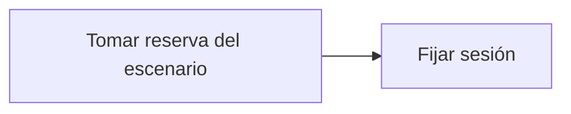

# Feature Specification: FE-01.3 — Fijación de la sesión simulada

**Created**: 2026-10-19  
**Status**: draft  
**Flow**: [FE-01 Selector de escenario y reloj (solo desarrollo)](77-fe-01-selector-de-escenario-y-reloj-solo-desarrollo.md) (subflujo)  
**Related Specs**: [FE-01 Selector de escenario y reloj (solo desarrollo)](77-fe-01-selector-de-escenario-y-reloj-solo-desarrollo.md), [FE-01.2 Activación del escenario](79-fe-01-2-activacion-del-escenario.md), [FE-01.4 Avance del reloj de escenario](81-fe-01-4-avance-del-reloj-de-escenario.md)  
**Origen (DEC/H)**: DEC-04, DEC-21  
**Pruebas (TC)**: TC-21  
**Contratos externos**: §1.1 (autenticación simulada)  

## Reglas de este documento

> Este spec es FUNCIONAL, no técnico: describe QUÉ hace el sistema, no CÓMO. Usa lenguaje de negocio; las siete herramientas externas se nombran por su función y se referencian por la sección de `sdd/reports/EXTERNAL_CONTRACTS.md`. Los casos borde se DOCUMENTAN; los valores de configuración se citan por el nombre del parámetro (NFR-012) con su valor por defecto entre paréntesis.

**Alcance**: Fija la sesión simulada con la reserva del escenario elegido para las siguientes llamadas.

## User Scenarios & Testing *(mandatory)*

### User Story 1 - La vista pertenece a la reserva elegida (Priority: P1)

Como evaluador, quiero que la vista pida la reserva del escenario elegido y no otra.

**Why this priority**: La pertenencia a la sesión es obligatoria.

**Independent Test**: Se prueba cambiando de escenario y mirando qué reserva se pide.

**Acceptance Scenarios**:

1. **Scenario**: Sesión
   - **Given** un escenario activado
   - **When** se fija la sesión
   - **Then** las llamadas siguientes usan su reserva

2. **Scenario**: Error de autenticación
   - **Given** `DEV_SESSION_HEADER_ENABLED` apagado en el servicio
   - **When** se fija la sesión de ABC123
   - **Then** se lee «No se pudo iniciar la sesión de prueba.» con «Reintentar» y rol de alerta

3. **Scenario**: Sesión de ABC123 (TC-21)
   - **Given** el escenario OTRA_RESERVA_TC21 con reserva XYZ789
   - **When** se elige
   - **Then** las llamadas siguientes usan XYZ789 y no ABC123

---

### Edge Cases

> Solo se documentan; los marcados MUST-IMPLEMENT se vuelven requisito FR-XXX y se implementan con TDD, los DEFERRED quedan para una iteración posterior.

#### Security & Permissions
- [MUST-IMPLEMENT] Cuando la sesión simulada no está habilitada en el servicio → la vista muestra un error de autenticación (FR-001)
- [MUST-IMPLEMENT] Cuando es versión de producción → no hay sesión simulada (FR-001)

## Requirements *(mandatory)*

### Functional Requirements

- **FR-VIS-001**: La interfaz DEBE aplicar estilos coherentes con la identidad visual definida: CSS propio alineado con `sdd/reports/DESIGN_CONTRACT.md` (tokens de color, tipografía, espaciado y radios), sin logos ni marcas de terceros.
- **FR-VIS-002**: Está PROHIBIDO entregar HTML sin estilos: cada pantalla y cada estado de este flujo DEBE renderizarse con los estilos de la identidad, nunca con el aspecto por defecto del navegador.
- **FR-VIS-003**: La interfaz DEBE ser consistente con `sdd/reports/DESIGN_CONTRACT.md`: usa solo los componentes de su inventario y solo sus tokens; toda diferencia respecto del contrato es un defecto de la implementación, no del contrato.
- **FR-001**: El sistema DEBE operar sobre la sesión autenticada del pasajero y comprobar que la reserva y la decisión solicitadas pertenezcan a esa sesión; una reserva ajena y una inexistente DEBEN producir exactamente la misma respuesta de «no encontrado», sin confirmar la existencia de ninguna. La sesión simulada solo existe con el parámetro `DEV_SESSION_HEADER_ENABLED` (apagado por defecto): en cualquier otro perfil toda petición del pasajero sin sesión DEBE rechazarse por falta de autenticación, y toda petición del sistema DEBE exigir la credencial de servicio (FR-120). Los errores NO DEBEN mostrar trazas ni repetir la entrada, nunca se pide ni se muestra documento de identidad, y el identificador de decisión DEBE ser aleatorio y no adivinable.
- **FR-111**: El front de prueba DEBE tener el aspecto y la sensación del centro de ayuda de una aerolínea (sin logos ni marcas), verificable con la lista de componentes y la lista de verificación de tokens de `sdd/reports/DESIGN_CONTRACT.md`: selector de escenario, contexto, alerta, reglas cumplidas y no cumplidas, opción propuesta, vía de reembolso, avisos de estimación, hora límite y «sujeto a disponibilidad», y botones de acción.

### Key Entities *(include if feature involves data)*

- **Sesión y credencial**: Identidad con la que se pide una evaluación: sesión del pasajero o credencial de servicio. Campos principales:
  - `caller`: user | system
  - `session_booking`: texto | ausente (solo modo user)
  - `service_key`: texto | ausente (solo modo system; comparación en tiempo constante)
  - `requests_last_minute`: entero (límite `EVALUATE_RATE_LIMIT_PER_MINUTE`)
  - `authorized`: booleano

## Architectural Attributes *(mandatory)*

| Attribute | Value |
|-----------|-------|
| **Interaction type** | sync-http |
| **Consistency** | strong |
| **Workflow** | single-step |
| **Read pattern** | simple |
| **Auditability** | none |
| **Domain complexity** | low |
| **Modularity** | feature-slice |
| **Deployment** | monolith |

## Success Criteria *(mandatory)*

### Measurable Outcomes

- **SC-001**: Cada escenario usa exclusivamente su propia reserva.

## UI Constraints *(include for frontend/web projects)*

### Visual Requirements
- **Design system**: propio, definido en `sdd/reports/DESIGN_CONTRACT.md` (CSS propio con tokens de color, tipografía, espaciado y radios; sin librería de componentes ni logos de terceros).
- **Responsive**: sí; una columna con margen lateral de 16 px y ancho máximo de 720 px, sin desplazamiento horizontal desde 320 px; botones a ancho completo en móvil con área táctil mínima de 44 × 44 px.
- **Accessibility**: WCAG 2.1 nivel AA (NFR-011): roles semánticos, foco visible, navegación por teclado, contraste de al menos 4,5:1 en texto y 3:1 en contornos de controles; el color nunca es el único portador de significado.

### Interaction Patterns
- **Loading states**: sin pantalla propia; la vista muestra su esqueleto.
- **Error states**: pantalla de error de carga con reintento.
- **Empty states**: no aplica a este paso.

### Style Constraints
- **Color palette**: tokens de color del DESIGN_CONTRACT (marca índigo para acciones primarias y foco, rojo solo decorativo, tintes para banners y chips); el color nunca es el único portador de significado: siempre va acompañado de texto e ícono.
- **Typography**: tipografía del sistema con escala de 14, 16, 20 y 24 px, interlineado 1,5; códigos de reglas en monoespaciada.
- **Spacing**: escala de espaciado de 4 a 32 px del DESIGN_CONTRACT; radio único de 8 px.

### Visual Spec *(mandatory for web/mobile)*

| Screen | Image | Source | Description |
|--------|-------|--------|-------------|
| Pantalla 6: error de carga | Wireframe ASCII de `sdd/reports/DESIGN_CONTRACT.md` (§Evidencia Visual); captura de imagen diferida hasta que exista el front | Wireframe de texto (alternativa autorizada cuando no hay imagen) | «no pudimos cargar tu viaje» con reintento y sin soporte |

## Traceability *(mandatory after implementation)*

> Las columnas de archivo y línea se registran en la verificación de trazabilidad posterior a la implementación; hoy cada criterio queda enlazado a su origen y a las pruebas que lo verifican.

| Criterion | Origen | Prueba (TC) | Source File | Line(s) |
|-----------|--------|-------------|-------------|---------|
| FR-VIS-001 | Usuario (2026-10-19) | sin TC en el mapa §6 de REQUERIMIENTOS_V1 | se registra en la verificación posterior a la implementación | se registra en la verificación posterior a la implementación |
| FR-VIS-002 | Usuario (2026-10-19) | sin TC en el mapa §6 de REQUERIMIENTOS_V1 | se registra en la verificación posterior a la implementación | se registra en la verificación posterior a la implementación |
| FR-VIS-003 | Usuario (2026-10-19) | sin TC en el mapa §6 de REQUERIMIENTOS_V1 | se registra en la verificación posterior a la implementación | se registra en la verificación posterior a la implementación |
| FR-001 | DEC-21 | TC-21 | se registra en la verificación posterior a la implementación | se registra en la verificación posterior a la implementación |
| FR-111 | DEC-04 | sin TC en el mapa §6 de REQUERIMIENTOS_V1 | se registra en la verificación posterior a la implementación | se registra en la verificación posterior a la implementación |
| SC-001 | criterio medible de este spec | TC-21 | se registra en la verificación posterior a la implementación | se registra en la verificación posterior a la implementación |

## Business Process (BPM View)

```
Tomar reserva del escenario → Fijar sesión
```



