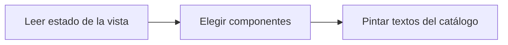

# Feature Specification: FE-02.2 — Pintado por estado

**Created**: 2026-10-19  
**Status**: draft  
**Flow**: [FE-02 Vista de viaje](82-fe-02-vista-de-viaje.md) (subflujo)  
**Related Specs**: [FE-02 Vista de viaje](82-fe-02-vista-de-viaje.md), [FE-02.1 Carga y mensaje de lentitud](83-fe-02-1-carga-y-mensaje-de-lentitud.md), [FE-02.3 Hora límite en UTC y cuenta regresiva](85-fe-02-3-hora-limite-en-utc-y-cuenta-regresiva.md)  
**Origen (DEC/H)**: DEC-02, DEC-04, DEC-05, DEC-07, DEC-09, DEC-12, DEC-15, DEC-16, DEC-17, DEC-18, DEC-19, DEC-21, DEC-27, DEC-28, DEC-31, H-08, H-13  
**Pruebas (TC)**: TC-02, TC-03, TC-06, TC-09, TC-12, TC-30, TC-45, TC-54, TC-60  
**Contratos externos**: §1.1 (fila 2: TripView), DESIGN_CONTRACT (dónde se usa cada componente por estado)  

## Reglas de este documento

> Este spec es FUNCIONAL, no técnico: describe QUÉ hace el sistema, no CÓMO. Usa lenguaje de negocio; las siete herramientas externas se nombran por su función y se referencian por la sección de `sdd/reports/EXTERNAL_CONTRACTS.md`. Los casos borde se DOCUMENTAN; los valores de configuración se citan por el nombre del parámetro (NFR-012) con su valor por defecto entre paréntesis.

**Alcance**: Elige qué componentes pintar según el estado de la vista: sin anomalía, informativa, retraso con opción, conflicto, sin opción viable, solicitud registrada y lectura fallida.

## User Scenarios & Testing *(mandatory)*

### User Story 1 - Cada situación tiene su pantalla (Priority: P1)

Como pasajero, quiero que lo que veo corresponda exactamente a mi situación.

**Why this priority**: Mostrar de más o de menos confunde.

**Independent Test**: Se prueba con los diez estados del DESIGN_CONTRACT.

**Acceptance Scenarios**:

1. **Scenario**: Segmento sin eventos
   - **Given** un segmento sin eventos
   - **When** se pinta
   - **Then** muestra «Horario programado» sin ícono de estado; «Sin información verificada» solo aparece con evidencia degradada

2. **Scenario**: Conflicto
   - **Given** conflicto de fuentes
   - **When** se pinta
   - **Then** aviso crítico, sin reglas y con botón de caso humano de un clic

3. **Scenario**: Estimación
   - **Given** conexión estimada
   - **When** se pinta
   - **Then** aviso «Tu conexión podría perderse (Estimación)» con «Es una estimación del sistema, sujeta al tiempo mínimo de conexión, que no tenemos. No es un hecho confirmado.», rotulado «Estimación» y nunca en color de éxito

4. **Scenario**: Conexión desconocida
   - **Given** la conexión perdida es desconocida con política rota
   - **When** se pinta
   - **Then** sin opciones, con el estado de decisión bloqueada explicado con lenguaje neutro y el botón «Hablar con una persona» de un clic

5. **Scenario**: Conexión falsa (TC-06)
   - **Given** CONEXION_FALSA_TC06B con retraso de 10 min y margen de 60 min
   - **When** se pinta
   - **Then** aviso informativo «Estimación de tu conexión»: «No detectamos que pierdas la conexión. Es una estimación, sujeta al tiempo mínimo de conexión; no es una garantía.» y nunca «tu conexión está segura»

6. **Scenario**: Vía de reembolso (TC-11)
   - **Given** BASE_TC01 con O3 sin respaldo recuperado
   - **When** se pinta
   - **Then** el bloque tiene un título de sección «Si prefieres no viajar» y el texto «Si prefieres no viajar, una persona puede revisar contigo las alternativas.», sin monto ni plazo ni afirmación de derecho

7. **Scenario**: Pantalla 4: sin opción viable (TC-09)
   - **Given** SIN_OPCION_TC09 con 2 pasajeros adultos y solo O2 con 1 asiento
   - **When** se pinta
   - **Then** mensaje de grupo no cubierto, sin opciones no viables y con el botón «Hablar con una persona» de un clic

8. **Scenario**: Segmento sin eventos y en conflicto (TC-54, TC-03)
   - **Given** S2 LA2410 sin eventos y S1 LA500 en conflicto de fuentes
   - **When** se pinta
   - **Then** S2 muestra «Horario programado» sin ícono y S1 «En revisión» con aviso crítico y caso humano de un clic

9. **Scenario**: Caso base con derivación numérica (TC-01)
   - **Given** el caso base ABC123: LA500 llega a las 17:55, LA2410 sale a las 19:05 y el retraso es de 160 min
   - **When** se pinta
   - **Then** la fila de LA500 muestra «Retrasado 160 min», «Nueva salida 17:10» y «Nueva llegada (Estimación): 20:35»; la alerta de conexión dice «Estimamos que no alcanzarías tu vuelo LA2410 (LIM → MEX)» (margen 19:05 − 20:35 = −90 min); se cumplen 2 de 5 reglas (R3 y R5) y la acción es «Aceptar y enviar a una persona» por PENDIENTE_APROBACION

---

### Edge Cases

> Solo se documentan; los marcados MUST-IMPLEMENT se vuelven requisito FR-XXX y se implementan con TDD, los DEFERRED quedan para una iteración posterior.

#### Invalid Data
- [MUST-IMPLEMENT] Cuando hay un evento de tipo desconocido → aviso neutro y botón de caso humano (FR-007)
- [MUST-IMPLEMENT] Cuando no hay opción viable → mensaje de grupo no cubierto con caso humano (FR-047)
- [MUST-IMPLEMENT] Cuando se excluyó una opción por dejar al menor solo → el mensaje lo dice (FR-043)
- [MUST-IMPLEMENT] Cuando la conexión es solo una estimación → ninguna pantalla afirma «tu conexión está segura» (FR-083)
- [MUST-IMPLEMENT] Cuando la conexión perdida es desconocida → sin opciones, decisión bloqueada y soporte de un clic (FR-041)
- [MUST-IMPLEMENT] Cuando hay varias alertas → el orden es críticas, retraso, puerta, conexión en riesgo y pernocte; sin retraso la puerta va primero (FR-006)

## Requirements *(mandatory)*

### Functional Requirements

- **FR-VIS-001**: La interfaz DEBE aplicar estilos coherentes con la identidad visual definida: CSS propio alineado con `sdd/reports/DESIGN_CONTRACT.md` (tokens de color, tipografía, espaciado y radios), sin logos ni marcas de terceros.
- **FR-VIS-002**: Está PROHIBIDO entregar HTML sin estilos: cada pantalla y cada estado de este flujo DEBE renderizarse con los estilos de la identidad, nunca con el aspecto por defecto del navegador.
- **FR-VIS-003**: La interfaz DEBE ser consistente con `sdd/reports/DESIGN_CONTRACT.md`: usa solo los componentes de su inventario y solo sus tokens; toda diferencia respecto del contrato es un defecto de la implementación, no del contrato.
- **FR-003**: El sistema DEBE mostrar siempre el contexto del viaje: segmentos (origen, destino, fecha, hora programada y estado), número de pasajeros y nombre de pila del titular (el primer pasajero adulto de la reserva; sin adulto se omite el saludo). Es la única excepción de información personal autorizada en pantalla.
- **FR-004**: Si no hay anomalía (ningún retraso relevante ni cambio de puerta validado y ninguna evidencia anómala), el sistema DEBE mostrar solo el contexto: sin alertas, reglas, opciones ni botones de acción (puede haber un botón «Actualizar» que solo vuelve a consultar y no es una acción externa), y el pasajero ve que todo está en orden. Con un cambio de puerta validado y sin retraso la decisión es INFORMATIVA con la puerta destacada. La evidencia degradada no genera alerta pero aplica FR-014. El soporte humano solo se ofrece cuando hay una acción posible.
- **FR-007**: Ante un evento de tipo desconocido o no soportado (por ejemplo una cancelación), el sistema NO DEBE interpretarlo: muestra un aviso neutro («una persona debe revisar tu vuelo») y ofrece el caso humano con el motivo `UNSUPPORTED_EVENT_TYPE`.
- **FR-008**: Con un retraso relevante validado el sistema DEBE consultar la política de retrasos y evaluar todas sus reglas, mostrando las que se cumplen y las que no con los valores usados. Una política vacía, o una regla cumplida cuyo indicador de aprobación humana falta o no es verdadero/falso, deja la decisión BLOQUEADA y con caso humano ofrecido; un fallo de lectura del contexto o de los eventos no produce decisión; un fallo de lectura de la política o de las opciones deja la decisión BLOQUEADA con soporte ofrecido.
- **FR-014**: Un segmento con solo evidencia degradada DEBE mostrarse como «sin información verificada» (nunca «a tiempo»), sin alerta ni botón. Un segmento sin ningún evento, o solo con eventos que no informan la salida, DEBE mostrar su horario programado sin afirmar estado ni alertar.
- **FR-023**: El tiempo mínimo de conexión es un dato requerido (`MIN_CONNECTION_MINUTES` por aeropuerto, 0 por defecto, rotulado «supuesto, no provisto»). Con tiempo no provisto un «falso» nunca se afirma en el rango incierto, la regla de conexión queda indeterminada y se ofrece el caso humano; un «falso» con tiempo no provisto se rotula «estimada, sujeta al tiempo mínimo de conexión» y la interfaz nunca dice «tu conexión está segura». Se registran los supuestos A1 (el retraso se propaga íntegro), A2 (tiempo mínimo no provisto) y A3 (el segmento siguiente no se retiene), y el dato queda en la lista de datos a solicitar.
- **FR-039**: Hay política rota si al menos una regla cumplida concede un derecho de remedio (`REMEDY_RIGHTS`; por defecto cambio sin costo, vale de comida y compensación en dinero). Un retraso sin política rota deja la decisión INFORMATIVA: se informa el retraso y se muestran las reglas evaluadas, sin consultar opciones, sin rebooking, compensación, soporte ni notificación de política, hasta que exista política rota. Los derechos que no son de remedio (trato prioritario) modifican el trato pero no rompen la política por sí solos.
- **FR-041**: Una opción es viable si (a) los asientos disponibles cubren a todo el grupo junto; (b) existe un derecho concedido que la respalda (`CHANGE_RIGHTS`, por defecto cambio sin costo, y costo cero); (c) su referencia de política coincide con una versión vigente y no superada; (d) su tipo está soportado; (e) no está vencida; (f) es coherente con el itinerario: con conexión perdida parte del origen del segmento siguiente, llega al destino final y sale después de la nueva llegada más el tiempo mínimo de conexión; sin conexión perdida reemplaza al segmento afectado (mismo origen y destino) y sale después de la lectura; con la conexión perdida desconocida no se puede verificar (f): ninguna opción es viable por itinerario incierto, la decisión es BLOQUEADA y se ofrece soporte.
- **FR-043**: Si se excluyó una opción por no cubrir al grupo o dejar al menor solo, el mensaje DEBE decirlo explícitamente y remitir a soporte.
- **FR-046**: La vía de reembolso DEBE mencionarse con redacción no afirmativa («si prefieres no viajar, una persona puede revisar contigo las alternativas»): no afirma un derecho y por eso queda exenta de referencia de política; la condición de tarifa «no reembolsable» no se usa para negar.
- **FR-047**: Sin opción viable el sistema DEBE mostrar un mensaje claro y ofrecer el caso humano con el motivo `NO_OPTION_COVERS_GROUP` si la causa son los asientos o separar al grupo, o `NO_VIABLE_OPTION` en otro caso.
- **FR-056**: Una solicitud creada DEBE mostrarse como «solicitud registrada, pendiente de confirmación, sujeta a disponibilidad» con su vencimiento; la confirmación queda fuera de la versión 1.
- **FR-058**: Ante pernocte el mensaje DEBE decir «podrías tener derecho a asistencia; un agente lo confirmará», sin cifras.
- **FR-066**: El sistema DEBE verificar la integridad de las lecturas: instante de lectura presente y en UTC, al menos un segmento y un pasajero, segmentos ordenados y encadenados, horas y fechas con formato válido, menor con edad y menor acompañado de adulto; en un retraso, minutos enteros mayores o iguales a 1 y nueva salida presente (un retraso menor o igual a cero es retraso incoherente). Una lectura inválida es lectura fallida (sin decisión, aviso y reintento, sin soporte); cadena rota o menor sin adulto dejan la conexión desconocida y la decisión BLOQUEADA con `BLOCKING_PARTIAL_DATA`; segmentos desordenados se reordenan sin bloqueo.

### Key Entities *(include if feature involves data)*

- **Pantalla del front de prueba**: Estado visible del front según la vista recibida. Campos principales:
  - `screen_state`: carga | sin anomalía | informativa | solo puerta | retraso con opción | conflicto | sin opción viable | solicitud registrada | lectura fallida | error de carga
  - `components`: lista de componentes del inventario del DESIGN_CONTRACT presentes
  - `texts`: claves del catálogo de textos usadas
  - `focus_target`: elemento que recibe el foco tras una acción
  - `aria_busy`: booleano (verdadero durante la carga)
- **Vista del viaje**: Respuesta completa para el pasajero; solo contiene campos de la lista blanca. Campos principales:
  - `decision_id`: identificador
  - `generated_at`: marca de tiempo UTC
  - `anomaly_detected`: booleano
  - `decision_state`: INFORMATIVA | AUTOMATICA | PENDIENTE_APROBACION | BLOQUEADA | nulo
  - `holder_first_name`: texto | nulo
  - `passenger_count`: entero
  - `load_status`: {trip_context: OK | INVALID, events: OK | FAILED, policy: OK | FAILED | NOT_REQUESTED, options: OK | FAILED | NOT_REQUESTED}
  - `data_as_of`: {trip_context, events, policy, options: marca de tiempo UTC | nulo}
  - `segments`: lista de estados resueltos con puerta y hora de la puerta
  - `alerts`: lista de {code: texto, severity: INFO | WARNING | CRITICAL, message_id: texto}
  - `derived_variables`: lista de variables derivadas
  - `policy`: política y reglas | nulo
  - `options`: lista de opciones viables
  - `proposed_option_id`: texto | nulo
  - `refund_notice`: mensaje validado | nulo
  - `offer_deadline`: marca de tiempo UTC | nulo
  - `actions`: lista de {action_id: texto, kind: ACCEPT_OPTION | OPEN_HUMAN_CASE, efecto: crear solicitud de cambio | crear caso humano con la opción elegida | crear caso humano, enabled: booleano, offered_reasons: lista de texto}
  - `messages`: lista de mensajes validados
  - `operations`: lista de operaciones activas de la reserva
  - `human_cases`: lista de intentos de caso humano de la situación

## Architectural Attributes *(mandatory)*

| Attribute | Value |
|-----------|-------|
| **Interaction type** | sync-http |
| **Consistency** | strong |
| **Workflow** | single-step |
| **Read pattern** | simple |
| **Auditability** | none |
| **Domain complexity** | low |
| **Modularity** | feature-slice |
| **Deployment** | monolith |

## Success Criteria *(mandatory)*

### Measurable Outcomes

- **SC-001**: Cada uno de los diez estados del DESIGN_CONTRACT produce los componentes indicados en su tabla.
- **SC-002**: Cero apariciones de «tu conexión está segura» o «llegarás a tiempo».

## UI Constraints *(include for frontend/web projects)*

### Visual Requirements
- **Design system**: propio, definido en `sdd/reports/DESIGN_CONTRACT.md` (CSS propio con tokens de color, tipografía, espaciado y radios; sin librería de componentes ni logos de terceros).
- **Responsive**: sí; una columna con margen lateral de 16 px y ancho máximo de 720 px, sin desplazamiento horizontal desde 320 px; botones a ancho completo en móvil con área táctil mínima de 44 × 44 px.
- **Accessibility**: WCAG 2.1 nivel AA (NFR-011): roles semánticos, foco visible, navegación por teclado, contraste de al menos 4,5:1 en texto y 3:1 en contornos de controles; el color nunca es el único portador de significado.

### Interaction Patterns
- **Loading states**: ver FE-02.1.
- **Error states**: ver FE-02.4.
- **Empty states**: viaje sin anomalía: solo contexto; sin segmentos: «No hay tramos para mostrar.».

### Style Constraints
- **Color palette**: tokens de color del DESIGN_CONTRACT (marca índigo para acciones primarias y foco, rojo solo decorativo, tintes para banners y chips); el color nunca es el único portador de significado: siempre va acompañado de texto e ícono.
- **Typography**: tipografía del sistema con escala de 14, 16, 20 y 24 px, interlineado 1,5; códigos de reglas en monoespaciada.
- **Spacing**: escala de espaciado de 4 a 32 px del DESIGN_CONTRACT; radio único de 8 px.

### Visual Spec *(mandatory for web/mobile)*

| Screen | Image | Source | Description |
|--------|-------|--------|-------------|
| Pantalla 1: vista sin anomalía | Wireframe ASCII de `sdd/reports/DESIGN_CONTRACT.md` (§Evidencia Visual); captura de imagen diferida hasta que exista el front | Wireframe de texto (alternativa autorizada cuando no hay imagen) | solo el contexto del viaje, sin botones; botón «Actualizar» |
| Pantalla 2: retraso con opción propuesta y caso humano | Wireframe ASCII de `sdd/reports/DESIGN_CONTRACT.md` (§Evidencia Visual); captura de imagen diferida hasta que exista el front | Wireframe de texto (alternativa autorizada cuando no hay imagen) | alertas, reglas plegadas, opción propuesta, vía de reembolso, acciones con cuenta regresiva y diálogo |
| Pantalla 3: conflicto de fuentes | Wireframe ASCII de `sdd/reports/DESIGN_CONTRACT.md` (§Evidencia Visual); captura de imagen diferida hasta que exista el front | Wireframe de texto (alternativa autorizada cuando no hay imagen) | aviso neutro, sin reglas, caso humano de un clic |
| Pantalla 4: sin opción viable | Wireframe ASCII de `sdd/reports/DESIGN_CONTRACT.md` (§Evidencia Visual); captura de imagen diferida hasta que exista el front | Wireframe de texto (alternativa autorizada cuando no hay imagen) | mensaje de grupo no cubierto y caso humano de un clic |
| Pantalla 5: solicitud registrada | Wireframe ASCII de `sdd/reports/DESIGN_CONTRACT.md` (§Evidencia Visual); captura de imagen diferida hasta que exista el front | Wireframe de texto (alternativa autorizada cuando no hay imagen) | «pendiente de confirmación, sujeta a disponibilidad» con vencimiento, tono informativo |
| Pantalla 8: segmentos vacíos | Wireframe ASCII de `sdd/reports/DESIGN_CONTRACT.md` (§Evidencia Visual); captura de imagen diferida hasta que exista el front | Wireframe de texto (alternativa autorizada cuando no hay imagen) | lectura inválida con aviso y reintento, sin soporte |
| Pantalla 9: informativa | Wireframe ASCII de `sdd/reports/DESIGN_CONTRACT.md` (§Evidencia Visual); captura de imagen diferida hasta que exista el front | Wireframe de texto (alternativa autorizada cuando no hay imagen) | retraso sin política rota con reglas plegadas y sin botones de acción |
| Pantalla 10: solo cambio de puerta | Wireframe ASCII de `sdd/reports/DESIGN_CONTRACT.md` (§Evidencia Visual); captura de imagen diferida hasta que exista el front | Wireframe de texto (alternativa autorizada cuando no hay imagen) | puerta destacada, horario programado sin ícono de estado, sin política |

## Traceability *(mandatory after implementation)*

> Las columnas de archivo y línea se registran en la verificación de trazabilidad posterior a la implementación; hoy cada criterio queda enlazado a su origen y a las pruebas que lo verifican.

| Criterion | Origen | Prueba (TC) | Source File | Line(s) |
|-----------|--------|-------------|-------------|---------|
| FR-VIS-001 | Usuario (2026-10-19) | sin TC en el mapa §6 de REQUERIMIENTOS_V1 | se registra en la verificación posterior a la implementación | se registra en la verificación posterior a la implementación |
| FR-VIS-002 | Usuario (2026-10-19) | sin TC en el mapa §6 de REQUERIMIENTOS_V1 | se registra en la verificación posterior a la implementación | se registra en la verificación posterior a la implementación |
| FR-VIS-003 | Usuario (2026-10-19) | sin TC en el mapa §6 de REQUERIMIENTOS_V1 | se registra en la verificación posterior a la implementación | se registra en la verificación posterior a la implementación |
| FR-003 | DEC-04, DEC-21 | sin TC en el mapa §6 de REQUERIMIENTOS_V1 | se registra en la verificación posterior a la implementación | se registra en la verificación posterior a la implementación |
| FR-004 | DEC-02 | TC-45, TC-54 | se registra en la verificación posterior a la implementación | se registra en la verificación posterior a la implementación |
| FR-007 | DEC-15, DEC-31 | sin TC en el mapa §6 de REQUERIMIENTOS_V1 | se registra en la verificación posterior a la implementación | se registra en la verificación posterior a la implementación |
| FR-008 | DEC-02, DEC-12 | sin TC en el mapa §6 de REQUERIMIENTOS_V1 | se registra en la verificación posterior a la implementación | se registra en la verificación posterior a la implementación |
| FR-014 | DEC-09 | TC-02, TC-54 | se registra en la verificación posterior a la implementación | se registra en la verificación posterior a la implementación |
| FR-023 | DEC-07, H-08, H-13 | TC-06 | se registra en la verificación posterior a la implementación | se registra en la verificación posterior a la implementación |
| FR-039 | DEC-02, DEC-05 | TC-45 | se registra en la verificación posterior a la implementación | se registra en la verificación posterior a la implementación |
| FR-041 | DEC-16, DEC-17 | TC-09, TC-60 | se registra en la verificación posterior a la implementación | se registra en la verificación posterior a la implementación |
| FR-043 | DEC-16 | sin TC en el mapa §6 de REQUERIMIENTOS_V1 | se registra en la verificación posterior a la implementación | se registra en la verificación posterior a la implementación |
| FR-046 | DEC-17, DEC-28 | sin TC en el mapa §6 de REQUERIMIENTOS_V1 | se registra en la verificación posterior a la implementación | se registra en la verificación posterior a la implementación |
| FR-047 | DEC-15 | TC-09 | se registra en la verificación posterior a la implementación | se registra en la verificación posterior a la implementación |
| FR-056 | DEC-18, DEC-19 | TC-30 | se registra en la verificación posterior a la implementación | se registra en la verificación posterior a la implementación |
| FR-058 | DEC-27 | sin TC en el mapa §6 de REQUERIMIENTOS_V1 | se registra en la verificación posterior a la implementación | se registra en la verificación posterior a la implementación |
| FR-066 | DEC-12, DEC-31 | sin TC en el mapa §6 de REQUERIMIENTOS_V1 | se registra en la verificación posterior a la implementación | se registra en la verificación posterior a la implementación |
| SC-001 | criterio medible de este spec | TC-02, TC-03, TC-06, TC-09, TC-12, TC-30, TC-45, TC-54, TC-60 | se registra en la verificación posterior a la implementación | se registra en la verificación posterior a la implementación |
| SC-002 | criterio medible de este spec | TC-02, TC-03, TC-06, TC-09, TC-12, TC-30, TC-45, TC-54, TC-60 | se registra en la verificación posterior a la implementación | se registra en la verificación posterior a la implementación |

## Business Process (BPM View)

```
Leer estado de la vista → Elegir componentes → Pintar textos del catálogo
```



