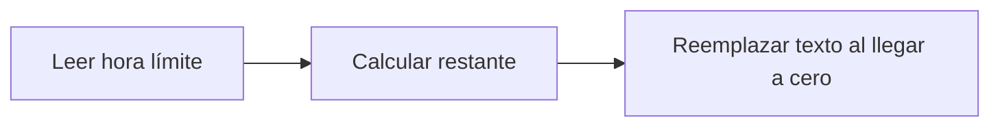

# Feature Specification: FE-02.3 — Hora límite en UTC y cuenta regresiva

**Created**: 2026-10-19  
**Status**: draft  
**Flow**: [FE-02 Vista de viaje](82-fe-02-vista-de-viaje.md) (subflujo)  
**Related Specs**: [FE-02 Vista de viaje](82-fe-02-vista-de-viaje.md), [FE-02.2 Pintado por estado](84-fe-02-2-pintado-por-estado.md), [FE-02.4 Error de carga con reintento](86-fe-02-4-error-de-carga-con-reintento.md)  
**Origen (DEC/H)**: DEC-04, DEC-19  
**Pruebas (TC)**: TC-08, TC-27  
**Contratos externos**: §1.1 (campo `offer_deadline`)  
**Deuda conocida de A1 (no se resuelve aquí)**: DEBT-A1-02  

## Reglas de este documento

> Este spec es FUNCIONAL, no técnico: describe QUÉ hace el sistema, no CÓMO. Usa lenguaje de negocio; las siete herramientas externas se nombran por su función y se referencian por la sección de `sdd/reports/EXTERNAL_CONTRACTS.md`. Los casos borde se DOCUMENTAN; los valores de configuración se citan por el nombre del parámetro (NFR-012) con su valor por defecto entre paréntesis.

**Alcance**: Dentro de la barra de acciones muestra «Quedan mm:ss (hasta HH:MM UTC)» calculada contra la hora de generación; al llegar a cero reemplaza el texto y el botón sigue activo.

## User Scenarios & Testing *(mandatory)*

### User Story 1 - El pasajero sabe cuánto tiempo tiene (Priority: P1)

Como pasajero, quiero ver cuánto queda para decidir y qué pasa después.

**Why this priority**: Las opciones vencen en minutos.

**Independent Test**: Se prueba con el escenario base y avanzando el reloj.

**Acceptance Scenarios**:

1. **Scenario**: Cuenta regresiva
   - **Given** la oferta vence a las 11:04:35Z (11:02:35Z más 120 s) y la vista se generó a las 11:02:47Z
   - **When** se pinta
   - **Then** junto al botón primario se lee «Quedan 01:48 (hasta 11:04 UTC)» (hora truncada al minuto hacia abajo) y debajo «Pasada esa hora, la opción queda sujeta a disponibilidad.»

2. **Scenario**: Vencida
   - **Given** el contador llega a cero
   - **When** se pinta
   - **Then** el contador se reemplaza por completo por «La hora límite pasó: la opción está sujeta a disponibilidad.» (sin «Quedan 00:00») y el botón sigue activo

3. **Scenario**: Cuenta regresiva de 01:48 (TC-08, TC-27)
   - **Given** oferta hasta 11:04:35Z (11:02:35Z más una vigencia de 120 s) y generación a las 11:02:47Z; la vigencia vence a los 120 s
   - **When** se pinta
   - **Then** muestra «Quedan 01:48 (hasta 11:04 UTC)» con la hora truncada al minuto

---

### Edge Cases

> Solo se documentan; los marcados MUST-IMPLEMENT se vuelven requisito FR-XXX y se implementan con TDD, los DEFERRED quedan para una iteración posterior.

#### System Errors
- [DEFERRED] El valor «Quedan 01:48» del wireframe no sale de un cálculo (DEBT-A1-02) (FR-071)

#### Invalid Data
- [MUST-IMPLEMENT] Cuando el contador llega a cero → el texto se reemplaza por completo, sin «Quedan 00:00» (FR-071)
- [MUST-IMPLEMENT] Cuando se anuncia a lectores de pantalla → no se anuncia segundo a segundo, solo al llegar a cero (NFR-011)

## Requirements *(mandatory)*

### Functional Requirements

- **FR-VIS-001**: La interfaz DEBE aplicar estilos coherentes con la identidad visual definida: CSS propio alineado con `sdd/reports/DESIGN_CONTRACT.md` (tokens de color, tipografía, espaciado y radios), sin logos ni marcas de terceros.
- **FR-VIS-002**: Está PROHIBIDO entregar HTML sin estilos: cada pantalla y cada estado de este flujo DEBE renderizarse con los estilos de la identidad, nunca con el aspecto por defecto del navegador.
- **FR-VIS-003**: La interfaz DEBE ser consistente con `sdd/reports/DESIGN_CONTRACT.md`: usa solo los componentes de su inventario y solo sus tokens; toda diferencia respecto del contrato es un defecto de la implementación, no del contrato.
- **FR-071**: La vista DEBE mostrar la hora límite (el mínimo de los vencimientos de las opciones mostradas) en UTC y como cuenta regresiva; pasada esa hora, «sujeto a disponibilidad».

### Non-Functional and Documentation Requirements

- **NFR-011**: Accesibilidad básica: la interfaz DEBE ofrecer roles semánticos, foco visible, navegación por teclado y contraste AA (relación de al menos 4,5:1 verificada sobre los tokens por una prueba que la calcula).

### Key Entities *(include if feature involves data)*

- **Pantalla del front de prueba**: Estado visible del front según la vista recibida. Campos principales:
  - `screen_state`: carga | sin anomalía | informativa | solo puerta | retraso con opción | conflicto | sin opción viable | solicitud registrada | lectura fallida | error de carga
  - `components`: lista de componentes del inventario del DESIGN_CONTRACT presentes
  - `texts`: claves del catálogo de textos usadas
  - `focus_target`: elemento que recibe el foco tras una acción
  - `aria_busy`: booleano (verdadero durante la carga)

## Architectural Attributes *(mandatory)*

| Attribute | Value |
|-----------|-------|
| **Interaction type** | sync-http |
| **Consistency** | strong |
| **Workflow** | single-step |
| **Read pattern** | simple |
| **Auditability** | none |
| **Domain complexity** | low |
| **Modularity** | feature-slice |
| **Deployment** | monolith |

## Success Criteria *(mandatory)*

### Measurable Outcomes

- **SC-001**: La cuenta regresiva coincide con la hora límite menos la hora de generación en el 100 % de los casos.

## UI Constraints *(include for frontend/web projects)*

### Visual Requirements
- **Design system**: propio, definido en `sdd/reports/DESIGN_CONTRACT.md` (CSS propio con tokens de color, tipografía, espaciado y radios; sin librería de componentes ni logos de terceros).
- **Responsive**: sí; una columna con margen lateral de 16 px y ancho máximo de 720 px, sin desplazamiento horizontal desde 320 px; botones a ancho completo en móvil con área táctil mínima de 44 × 44 px.
- **Accessibility**: WCAG 2.1 nivel AA (NFR-011): roles semánticos, foco visible, navegación por teclado, contraste de al menos 4,5:1 en texto y 3:1 en contornos de controles; el color nunca es el único portador de significado.

### Interaction Patterns
- **Loading states**: no aplica: la cuenta aparece con la vista.
- **Error states**: no aplica: no hay hora límite sin opciones.
- **Empty states**: sin opciones no hay cuenta regresiva.

### Style Constraints
- **Color palette**: tokens de color del DESIGN_CONTRACT (marca índigo para acciones primarias y foco, rojo solo decorativo, tintes para banners y chips); el color nunca es el único portador de significado: siempre va acompañado de texto e ícono.
- **Typography**: tipografía del sistema con escala de 14, 16, 20 y 24 px, interlineado 1,5; códigos de reglas en monoespaciada.
- **Spacing**: escala de espaciado de 4 a 32 px del DESIGN_CONTRACT; radio único de 8 px.

### Visual Spec *(mandatory for web/mobile)*

| Screen | Image | Source | Description |
|--------|-------|--------|-------------|
| Pantalla 2: retraso con opción propuesta y caso humano | Wireframe ASCII de `sdd/reports/DESIGN_CONTRACT.md` (§Evidencia Visual); captura de imagen diferida hasta que exista el front | Wireframe de texto (alternativa autorizada cuando no hay imagen) | alertas, reglas plegadas, opción propuesta, vía de reembolso, acciones con cuenta regresiva y diálogo |

## Traceability *(mandatory after implementation)*

> Las columnas de archivo y línea se registran en la verificación de trazabilidad posterior a la implementación; hoy cada criterio queda enlazado a su origen y a las pruebas que lo verifican.

| Criterion | Origen | Prueba (TC) | Source File | Line(s) |
|-----------|--------|-------------|-------------|---------|
| FR-VIS-001 | Usuario (2026-10-19) | sin TC en el mapa §6 de REQUERIMIENTOS_V1 | se registra en la verificación posterior a la implementación | se registra en la verificación posterior a la implementación |
| FR-VIS-002 | Usuario (2026-10-19) | sin TC en el mapa §6 de REQUERIMIENTOS_V1 | se registra en la verificación posterior a la implementación | se registra en la verificación posterior a la implementación |
| FR-VIS-003 | Usuario (2026-10-19) | sin TC en el mapa §6 de REQUERIMIENTOS_V1 | se registra en la verificación posterior a la implementación | se registra en la verificación posterior a la implementación |
| FR-071 | DEC-19 | sin TC en el mapa §6 de REQUERIMIENTOS_V1 | se registra en la verificación posterior a la implementación | se registra en la verificación posterior a la implementación |
| NFR-011 | DEC-04 | sin TC en el mapa §6 de REQUERIMIENTOS_V1 | se registra en la verificación posterior a la implementación | se registra en la verificación posterior a la implementación |
| SC-001 | criterio medible de este spec | TC-08, TC-27 | se registra en la verificación posterior a la implementación | se registra en la verificación posterior a la implementación |

## Business Process (BPM View)

```
Leer hora límite → Calcular restante → Reemplazar texto al llegar a cero
```



