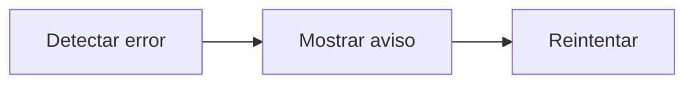

# Feature Specification: FE-02.4 — Error de carga con reintento

**Created**: 2026-10-19  
**Status**: draft  
**Flow**: [FE-02 Vista de viaje](82-fe-02-vista-de-viaje.md) (subflujo)  
**Related Specs**: [FE-02 Vista de viaje](82-fe-02-vista-de-viaje.md), [FE-02.3 Hora límite en UTC y cuenta regresiva](85-fe-02-3-hora-limite-en-utc-y-cuenta-regresiva.md), [FE-02.5 Catálogo de textos y lista blanca de campos](87-fe-02-5-catalogo-de-textos-y-lista-blanca-de-campos.md)  
**Origen (DEC/H)**: DEC-04, DEC-11, DEC-12, DEC-15, DEC-18, DEC-31  
**Pruebas (TC)**: TC-33, TC-39  
**Contratos externos**: §1.1 (fila 2: 502 de contexto no disponible)  

## Reglas de este documento

> Este spec es FUNCIONAL, no técnico: describe QUÉ hace el sistema, no CÓMO. Usa lenguaje de negocio; las siete herramientas externas se nombran por su función y se referencian por la sección de `sdd/reports/EXTERNAL_CONTRACTS.md`. Los casos borde se DOCUMENTAN; los valores de configuración se citan por el nombre del parámetro (NFR-012) con su valor por defecto entre paréntesis.

**Alcance**: Si no se puede cargar el viaje, muestra «No pudimos cargar tu viaje» con «Reintentar» y sin soporte.

## User Scenarios & Testing *(mandatory)*

### User Story 1 - Un fallo no deja al pasajero sin salida (Priority: P1)

Como pasajero, quiero poder reintentar cuando algo falla.

**Why this priority**: Una pantalla vacía sin salida genera abandono.

**Independent Test**: Se prueba simulando el fallo del contexto.

**Acceptance Scenarios**:

1. **Scenario**: Error de carga
   - **Given** el servicio responde contexto no disponible
   - **When** se pinta
   - **Then** «No pudimos cargar tu viaje» con «Ocurrió un problema al consultar tu reserva. Inténtalo de nuevo en unos segundos.» y «Reintentar», sin soporte y sin «Actualizar»

2. **Scenario**: Lectura inválida
   - **Given** la lectura es inválida
   - **When** se pinta
   - **Then** «Reserva ABC123», «No hay tramos para mostrar.», «No pudimos validar los datos de tu reserva.» «Inténtalo de nuevo en unos segundos.» y «Reintentar», sin saludo, sin pasajeros y sin soporte

3. **Scenario**: Contexto no disponible (TC-33)
   - **Given** el contexto de ABC123 falla dos veces
   - **When** se pinta
   - **Then** muestra el error con «Reintentar» y sin soporte

---

### Edge Cases

> Solo se documentan; los marcados MUST-IMPLEMENT se vuelven requisito FR-XXX y se implementan con TDD, los DEFERRED quedan para una iteración posterior.

#### System Errors
- [MUST-IMPLEMENT] Cuando el reintento también falla → se mantiene la pantalla de error (FR-105)
- [MUST-IMPLEMENT] Cuando solo faltan los eventos → se muestra el contexto con aviso (FR-105)

## Requirements *(mandatory)*

### Functional Requirements

- **FR-VIS-001**: La interfaz DEBE aplicar estilos coherentes con la identidad visual definida: CSS propio alineado con `sdd/reports/DESIGN_CONTRACT.md` (tokens de color, tipografía, espaciado y radios), sin logos ni marcas de terceros.
- **FR-VIS-002**: Está PROHIBIDO entregar HTML sin estilos: cada pantalla y cada estado de este flujo DEBE renderizarse con los estilos de la identidad, nunca con el aspecto por defecto del navegador.
- **FR-VIS-003**: La interfaz DEBE ser consistente con `sdd/reports/DESIGN_CONTRACT.md`: usa solo los componentes de su inventario y solo sus tokens; toda diferencia respecto del contrato es un defecto de la implementación, no del contrato.
- **FR-066**: El sistema DEBE verificar la integridad de las lecturas: instante de lectura presente y en UTC, al menos un segmento y un pasajero, segmentos ordenados y encadenados, horas y fechas con formato válido, menor con edad y menor acompañado de adulto; en un retraso, minutos enteros mayores o iguales a 1 y nueva salida presente (un retraso menor o igual a cero es retraso incoherente). Una lectura inválida es lectura fallida (sin decisión, aviso y reintento, sin soporte); cadena rota o menor sin adulto dejan la conexión desconocida y la decisión BLOQUEADA con `BLOCKING_PARTIAL_DATA`; segmentos desordenados se reordenan sin bloqueo.
- **FR-086**: La indicación de datos parciales de una lectura es información de contexto y solo bloquea si falta un campo necesario para decidir. Una lectura fallida o inválida da aviso y reintento sin soporte; el caso humano de datos parciales solo se ofrece si la decisión queda BLOQUEADA por una anomalía que exige validación manual.
- **FR-105**: Matriz de errores por herramienta: las lecturas con fallo se reconsultan una vez sin bucles; sin contexto del viaje hay pantalla de «no pudimos cargar tu viaje» con reintento; solo sin eventos se muestra el contexto sin estado ni alerta y con aviso; sin política u opciones queda BLOQUEADA con caso humano ofrecido. Una solicitud de cambio con error no reintentable no se reintenta, muestra un fallo genérico y ofrece caso humano. En el caso humano, un error explícito dice «no pudimos registrar tu solicitud, puedes reintentar»; un tiempo agotado o respuesta perdida es indeterminado («no pudimos confirmar si tu solicitud quedó registrada; puede que ya lo esté»), no se reenvía automáticamente y el reintento exige un segundo clic explícito tras advertir del posible duplicado. Nunca se afirma éxito.
- **FR-111**: El front de prueba DEBE tener el aspecto y la sensación del centro de ayuda de una aerolínea (sin logos ni marcas), verificable con la lista de componentes y la lista de verificación de tokens de `sdd/reports/DESIGN_CONTRACT.md`: selector de escenario, contexto, alerta, reglas cumplidas y no cumplidas, opción propuesta, vía de reembolso, avisos de estimación, hora límite y «sujeto a disponibilidad», y botones de acción.

### Key Entities *(include if feature involves data)*

- **Pantalla del front de prueba**: Estado visible del front según la vista recibida. Campos principales:
  - `screen_state`: carga | sin anomalía | informativa | solo puerta | retraso con opción | conflicto | sin opción viable | solicitud registrada | lectura fallida | error de carga
  - `components`: lista de componentes del inventario del DESIGN_CONTRACT presentes
  - `texts`: claves del catálogo de textos usadas
  - `focus_target`: elemento que recibe el foco tras una acción
  - `aria_busy`: booleano (verdadero durante la carga)

## Architectural Attributes *(mandatory)*

| Attribute | Value |
|-----------|-------|
| **Interaction type** | sync-http |
| **Consistency** | strong |
| **Workflow** | single-step |
| **Read pattern** | simple |
| **Auditability** | none |
| **Domain complexity** | low |
| **Modularity** | feature-slice |
| **Deployment** | monolith |

## Success Criteria *(mandatory)*

### Measurable Outcomes

- **SC-001**: En el 100 % de los errores de carga existe «Reintentar» y ninguno ofrece soporte.

## UI Constraints *(include for frontend/web projects)*

### Visual Requirements
- **Design system**: propio, definido en `sdd/reports/DESIGN_CONTRACT.md` (CSS propio con tokens de color, tipografía, espaciado y radios; sin librería de componentes ni logos de terceros).
- **Responsive**: sí; una columna con margen lateral de 16 px y ancho máximo de 720 px, sin desplazamiento horizontal desde 320 px; botones a ancho completo en móvil con área táctil mínima de 44 × 44 px.
- **Accessibility**: WCAG 2.1 nivel AA (NFR-011): roles semánticos, foco visible, navegación por teclado, contraste de al menos 4,5:1 en texto y 3:1 en contornos de controles; el color nunca es el único portador de significado.

### Interaction Patterns
- **Loading states**: ver FE-02.1.
- **Error states**: tono de error con rol de alerta y botón «Reintentar».
- **Empty states**: no aplica.

### Style Constraints
- **Color palette**: tokens de color del DESIGN_CONTRACT (marca índigo para acciones primarias y foco, rojo solo decorativo, tintes para banners y chips); el color nunca es el único portador de significado: siempre va acompañado de texto e ícono.
- **Typography**: tipografía del sistema con escala de 14, 16, 20 y 24 px, interlineado 1,5; códigos de reglas en monoespaciada.
- **Spacing**: escala de espaciado de 4 a 32 px del DESIGN_CONTRACT; radio único de 8 px.

### Visual Spec *(mandatory for web/mobile)*

| Screen | Image | Source | Description |
|--------|-------|--------|-------------|
| Pantalla 6: error de carga | Wireframe ASCII de `sdd/reports/DESIGN_CONTRACT.md` (§Evidencia Visual); captura de imagen diferida hasta que exista el front | Wireframe de texto (alternativa autorizada cuando no hay imagen) | «no pudimos cargar tu viaje» con reintento y sin soporte |
| Pantalla 8: segmentos vacíos | Wireframe ASCII de `sdd/reports/DESIGN_CONTRACT.md` (§Evidencia Visual); captura de imagen diferida hasta que exista el front | Wireframe de texto (alternativa autorizada cuando no hay imagen) | lectura inválida con aviso y reintento, sin soporte |

## Traceability *(mandatory after implementation)*

> Las columnas de archivo y línea se registran en la verificación de trazabilidad posterior a la implementación; hoy cada criterio queda enlazado a su origen y a las pruebas que lo verifican.

| Criterion | Origen | Prueba (TC) | Source File | Line(s) |
|-----------|--------|-------------|-------------|---------|
| FR-VIS-001 | Usuario (2026-10-19) | sin TC en el mapa §6 de REQUERIMIENTOS_V1 | se registra en la verificación posterior a la implementación | se registra en la verificación posterior a la implementación |
| FR-VIS-002 | Usuario (2026-10-19) | sin TC en el mapa §6 de REQUERIMIENTOS_V1 | se registra en la verificación posterior a la implementación | se registra en la verificación posterior a la implementación |
| FR-VIS-003 | Usuario (2026-10-19) | sin TC en el mapa §6 de REQUERIMIENTOS_V1 | se registra en la verificación posterior a la implementación | se registra en la verificación posterior a la implementación |
| FR-066 | DEC-12, DEC-31 | TC-39 | se registra en la verificación posterior a la implementación | se registra en la verificación posterior a la implementación |
| FR-086 | DEC-11 | sin TC en el mapa §6 de REQUERIMIENTOS_V1 | se registra en la verificación posterior a la implementación | se registra en la verificación posterior a la implementación |
| FR-105 | DEC-15, DEC-18 | TC-33 | se registra en la verificación posterior a la implementación | se registra en la verificación posterior a la implementación |
| FR-111 | DEC-04 | sin TC en el mapa §6 de REQUERIMIENTOS_V1 | se registra en la verificación posterior a la implementación | se registra en la verificación posterior a la implementación |
| SC-001 | criterio medible de este spec | TC-33, TC-39 | se registra en la verificación posterior a la implementación | se registra en la verificación posterior a la implementación |

## Business Process (BPM View)

```
Detectar error → Mostrar aviso → Reintentar
```



