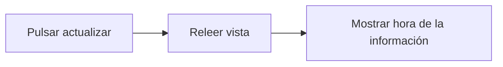

# Feature Specification: FE-02.6 — Botón «Actualizar»

**Created**: 2026-10-19  
**Status**: draft  
**Flow**: [FE-02 Vista de viaje](82-fe-02-vista-de-viaje.md) (subflujo)  
**Related Specs**: [FE-02 Vista de viaje](82-fe-02-vista-de-viaje.md), [FE-02.5 Catálogo de textos y lista blanca de campos](87-fe-02-5-catalogo-de-textos-y-lista-blanca-de-campos.md), [FE-02.7 Destino del foco](89-fe-02-7-destino-del-foco.md)  
**Origen (DEC/H)**: DEC-04, DEC-10, DEC-14, DEC-19  
**Pruebas (TC)**: TC-45, TC-51  
**Contratos externos**: §1.1 (fila 2)  

## Reglas de este documento

> Este spec es FUNCIONAL, no técnico: describe QUÉ hace el sistema, no CÓMO. Usa lenguaje de negocio; las siete herramientas externas se nombran por su función y se referencian por la sección de `sdd/reports/EXTERNAL_CONTRACTS.md`. Los casos borde se DOCUMENTAN; los valores de configuración se citan por el nombre del parámetro (NFR-012) con su valor por defecto entre paréntesis.

**Alcance**: En las vistas sin acción primaria ofrece «Actualizar», con «Información de las HH:MM UTC», que relee la vista y no es una acción externa.

## User Scenarios & Testing *(mandatory)*

### User Story 1 - El pasajero puede volver a mirar sin riesgo (Priority: P1)

Como pasajero, quiero refrescar la información con un botón, sabiendo que no cambia nada.

**Why this priority**: Un retraso informativo puede evolucionar.

**Independent Test**: Se prueba en las vistas sin anomalía, informativa y solo puerta.

**Acceptance Scenarios**:

1. **Scenario**: Actualizar (TC-45)
   - **Given** INFORMATIVA_TC45 con retraso de 5 min a las 11:02 UTC, una de las tres pantallas de la lista cerrada (sin anomalía, informativa o solo puerta)
   - **When** el pasajero pulsa «Actualizar»
   - **Then** se muestra el botón secundario «Actualizar» con «Información de las 11:02 UTC» y sin botones de acción; al pulsarlo se vuelve a pedir la evaluación y se actualiza la hora de la información, sin consentimiento ni escritura externa

2. **Scenario**: Sin «Actualizar» fuera de la lista (TC-30, TC-33, TC-12)
   - **Given** las pantallas de solicitud registrada, de error de carga y de lectura inválida PARCIAL_BLOQUEANTE_TC12
   - **When** se pintan
   - **Then** no hay botón «Actualizar»: la pantalla de solicitud registrada solo tiene sus acciones y las otras dos tienen «Reintentar»

---

### Edge Cases

> Solo se documentan; los marcados MUST-IMPLEMENT se vuelven requisito FR-XXX y se implementan con TDD, los DEFERRED quedan para una iteración posterior.

#### System Errors
- [MUST-IMPLEMENT] Cuando la relectura falla → se mantiene la vista anterior con un aviso (FR-105)

#### Invalid Data
- [MUST-IMPLEMENT] Cuando hay acción primaria → el botón «Actualizar» no se muestra (FR-050)
- [MUST-IMPLEMENT] Cuando la vista es de solicitud registrada, error de carga o lectura inválida → no hay botón «Actualizar» (contrato 22: solo sin anomalía, informativa y solo puerta) (FR-004)

## Requirements *(mandatory)*

### Functional Requirements

- **FR-VIS-001**: La interfaz DEBE aplicar estilos coherentes con la identidad visual definida: CSS propio alineado con `sdd/reports/DESIGN_CONTRACT.md` (tokens de color, tipografía, espaciado y radios), sin logos ni marcas de terceros.
- **FR-VIS-002**: Está PROHIBIDO entregar HTML sin estilos: cada pantalla y cada estado de este flujo DEBE renderizarse con los estilos de la identidad, nunca con el aspecto por defecto del navegador.
- **FR-VIS-003**: La interfaz DEBE ser consistente con `sdd/reports/DESIGN_CONTRACT.md`: usa solo los componentes de su inventario y solo sus tokens; toda diferencia respecto del contrato es un defecto de la implementación, no del contrato.
- **FR-002**: En cada entrada del pasajero a la vista, el sistema DEBE consultar de nuevo el contexto del viaje y los eventos operacionales; no existe memoria intermedia de lecturas en la versión 1.
- **FR-050**: Toda acción externa (solicitud de cambio, caso humano, notificación) DEBE requerir un clic explícito del pasajero; el sistema solo propone y ofrece. La persistencia interna no es una acción externa. Excepción: en modo sistema se puede enviar la notificación de FR-122 sin clic, con plantilla fija; ninguna otra acción externa se ejecuta en modo sistema. Un clic autoriza exactamente una acción y los textos de los botones lo declaran, incluida la derivación posterior a una falla persistente.
- **FR-111**: El front de prueba DEBE tener el aspecto y la sensación del centro de ayuda de una aerolínea (sin logos ni marcas), verificable con la lista de componentes y la lista de verificación de tokens de `sdd/reports/DESIGN_CONTRACT.md`: selector de escenario, contexto, alerta, reglas cumplidas y no cumplidas, opción propuesta, vía de reembolso, avisos de estimación, hora límite y «sujeto a disponibilidad», y botones de acción.

### Key Entities *(include if feature involves data)*

- **Pantalla del front de prueba**: Estado visible del front según la vista recibida. Campos principales:
  - `screen_state`: carga | sin anomalía | informativa | solo puerta | retraso con opción | conflicto | sin opción viable | solicitud registrada | lectura fallida | error de carga
  - `components`: lista de componentes del inventario del DESIGN_CONTRACT presentes
  - `texts`: claves del catálogo de textos usadas
  - `focus_target`: elemento que recibe el foco tras una acción
  - `aria_busy`: booleano (verdadero durante la carga)

## Architectural Attributes *(mandatory)*

| Attribute | Value |
|-----------|-------|
| **Interaction type** | sync-http |
| **Consistency** | strong |
| **Workflow** | single-step |
| **Read pattern** | simple |
| **Auditability** | none |
| **Domain complexity** | low |
| **Modularity** | feature-slice |
| **Deployment** | monolith |

## Success Criteria *(mandatory)*

### Measurable Outcomes

- **SC-001**: Pulsar «Actualizar» nunca provoca una escritura externa.

## UI Constraints *(include for frontend/web projects)*

### Visual Requirements
- **Design system**: propio, definido en `sdd/reports/DESIGN_CONTRACT.md` (CSS propio con tokens de color, tipografía, espaciado y radios; sin librería de componentes ni logos de terceros).
- **Responsive**: sí; una columna con margen lateral de 16 px y ancho máximo de 720 px, sin desplazamiento horizontal desde 320 px; botones a ancho completo en móvil con área táctil mínima de 44 × 44 px.
- **Accessibility**: WCAG 2.1 nivel AA (NFR-011): roles semánticos, foco visible, navegación por teclado, contraste de al menos 4,5:1 en texto y 3:1 en contornos de controles; el color nunca es el único portador de significado.

### Interaction Patterns
- **Loading states**: el botón se deshabilita mientras relee.
- **Error states**: aviso con rol de estado.
- **Empty states**: no aplica.

### Style Constraints
- **Color palette**: tokens de color del DESIGN_CONTRACT (marca índigo para acciones primarias y foco, rojo solo decorativo, tintes para banners y chips); el color nunca es el único portador de significado: siempre va acompañado de texto e ícono.
- **Typography**: tipografía del sistema con escala de 14, 16, 20 y 24 px, interlineado 1,5; códigos de reglas en monoespaciada.
- **Spacing**: escala de espaciado de 4 a 32 px del DESIGN_CONTRACT; radio único de 8 px.

### Visual Spec *(mandatory for web/mobile)*

| Screen | Image | Source | Description |
|--------|-------|--------|-------------|
| Pantalla 1: vista sin anomalía | Wireframe ASCII de `sdd/reports/DESIGN_CONTRACT.md` (§Evidencia Visual); captura de imagen diferida hasta que exista el front | Wireframe de texto (alternativa autorizada cuando no hay imagen) | solo el contexto del viaje, sin botones; botón «Actualizar» |
| Pantalla 9: informativa | Wireframe ASCII de `sdd/reports/DESIGN_CONTRACT.md` (§Evidencia Visual); captura de imagen diferida hasta que exista el front | Wireframe de texto (alternativa autorizada cuando no hay imagen) | retraso sin política rota con reglas plegadas y sin botones de acción |
| Pantalla 10: solo cambio de puerta | Wireframe ASCII de `sdd/reports/DESIGN_CONTRACT.md` (§Evidencia Visual); captura de imagen diferida hasta que exista el front | Wireframe de texto (alternativa autorizada cuando no hay imagen) | puerta destacada, horario programado sin ícono de estado, sin política |

## Traceability *(mandatory after implementation)*

> Las columnas de archivo y línea se registran en la verificación de trazabilidad posterior a la implementación; hoy cada criterio queda enlazado a su origen y a las pruebas que lo verifican.

| Criterion | Origen | Prueba (TC) | Source File | Line(s) |
|-----------|--------|-------------|-------------|---------|
| FR-VIS-001 | Usuario (2026-10-19) | sin TC en el mapa §6 de REQUERIMIENTOS_V1 | se registra en la verificación posterior a la implementación | se registra en la verificación posterior a la implementación |
| FR-VIS-002 | Usuario (2026-10-19) | sin TC en el mapa §6 de REQUERIMIENTOS_V1 | se registra en la verificación posterior a la implementación | se registra en la verificación posterior a la implementación |
| FR-VIS-003 | Usuario (2026-10-19) | sin TC en el mapa §6 de REQUERIMIENTOS_V1 | se registra en la verificación posterior a la implementación | se registra en la verificación posterior a la implementación |
| FR-002 | DEC-10, DEC-19 | sin TC en el mapa §6 de REQUERIMIENTOS_V1 | se registra en la verificación posterior a la implementación | se registra en la verificación posterior a la implementación |
| FR-050 | DEC-14 | sin TC en el mapa §6 de REQUERIMIENTOS_V1 | se registra en la verificación posterior a la implementación | se registra en la verificación posterior a la implementación |
| FR-111 | DEC-04 | sin TC en el mapa §6 de REQUERIMIENTOS_V1 | se registra en la verificación posterior a la implementación | se registra en la verificación posterior a la implementación |
| SC-001 | criterio medible de este spec | TC-45, TC-51 | se registra en la verificación posterior a la implementación | se registra en la verificación posterior a la implementación |

## Business Process (BPM View)

```
Pulsar actualizar → Releer vista → Mostrar hora de la información
```



