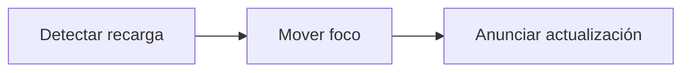

# Feature Specification: FE-02.7 — Destino del foco

**Created**: 2026-10-19  
**Status**: draft  
**Flow**: [FE-02 Vista de viaje](82-fe-02-vista-de-viaje.md) (subflujo)  
**Related Specs**: [FE-02 Vista de viaje](82-fe-02-vista-de-viaje.md), [FE-02.6 Botón «Actualizar»](88-fe-02-6-boton-actualizar.md), [FE-02.8 Cambio de puerta destacado](90-fe-02-8-cambio-de-puerta-destacado.md)  
**Origen (DEC/H)**: DEC-04  
**Pruebas (TC)**: TC-01  
**Contratos externos**: DESIGN_CONTRACT (contrato 19: accesibilidad estructural)  

## Reglas de este documento

> Este spec es FUNCIONAL, no técnico: describe QUÉ hace el sistema, no CÓMO. Usa lenguaje de negocio; las siete herramientas externas se nombran por su función y se referencian por la sección de `sdd/reports/EXTERNAL_CONTRACTS.md`. Los casos borde se DOCUMENTAN; los valores de configuración se citan por el nombre del parámetro (NFR-012) con su valor por defecto entre paréntesis.

**Alcance**: Tras «Reintentar», «Actualizar» y un cambio de estado, el foco va a un destino definido y se anuncia la actualización.

## User Scenarios & Testing *(mandatory)*

### User Story 1 - Quien usa teclado o lector de pantalla no se pierde (Priority: P1)

Como pasajero con lector de pantalla, quiero que el foco me lleve a lo nuevo.

**Why this priority**: Accesibilidad básica (NFR-011).

**Independent Test**: Se prueba con teclado.

**Acceptance Scenarios**:

1. **Scenario**: Tras reintentar
   - **Given** el pasajero reintenta
   - **When** se recarga
   - **Then** el foco pasa al título «Tu viaje» y una región anuncia «Información actualizada a las HH:MM UTC»

2. **Scenario**: Tras cambio de estado
   - **Given** la situación cambió al aceptar
   - **When** se recarga
   - **Then** el foco pasa a un aviso informativo al inicio

3. **Scenario**: Saltar al contenido y foco blanco en el encabezado (TC-01)
   - **Given** la vista del caso base con el selector de escenario en el encabezado índigo
   - **When** se navega con el teclado desde el inicio
   - **Then** el primer foco es el enlace «Saltar al contenido» y el anillo de foco dentro del encabezado es blanco, en el resto es índigo de 3 px

4. **Scenario**: Panel de reglas con teclado (TC-01)
   - **Given** BASE_TC01 con el panel de reglas plegado con «Ver reglas» y «Se cumplen 2 de 5 reglas»
   - **When** se activa con Intro o Espacio
   - **Then** el botón expone `aria-expanded` verdadero, cambia a «Ocultar reglas» y el panel se despliega

5. **Scenario**: Reintentar que vuelve a fallar (TC-33)
   - **Given** el contexto falla otra vez tras pulsar «Reintentar»
   - **When** termina la recarga
   - **Then** el foco pasa al aviso de error, que se anuncia con rol de alerta, y «Reintentar» sigue disponible

6. **Scenario**: Actualizar con éxito (TC-45)
   - **Given** INFORMATIVA_TC45 y la relectura funciona a las 11:02 UTC
   - **When** se pulsa «Actualizar»
   - **Then** el foco pasa al título «Tu viaje» y se anuncia «Información actualizada a las 11:02 UTC»

7. **Scenario**: Foco tras Reintentar (TC-33)
   - **Given** el contexto falló y la recarga funciona
   - **When** se pulsa «Reintentar»
   - **Then** el foco pasa a «Tu viaje» y se anuncia «Información actualizada a las 11:02 UTC»

---

### Edge Cases

> Solo se documentan; los marcados MUST-IMPLEMENT se vuelven requisito FR-XXX y se implementan con TDD, los DEFERRED quedan para una iteración posterior.

#### Invalid Data
- [MUST-IMPLEMENT] Cuando el diálogo se cierra con un resultado → el foco pasa al aviso de resultado (NFR-011)
- [MUST-IMPLEMENT] Cuando se abre el diálogo → el foco queda atrapado y vuelve al botón que lo abrió (NFR-011)

## Requirements *(mandatory)*

### Functional Requirements

- **FR-VIS-001**: La interfaz DEBE aplicar estilos coherentes con la identidad visual definida: CSS propio alineado con `sdd/reports/DESIGN_CONTRACT.md` (tokens de color, tipografía, espaciado y radios), sin logos ni marcas de terceros.
- **FR-VIS-002**: Está PROHIBIDO entregar HTML sin estilos: cada pantalla y cada estado de este flujo DEBE renderizarse con los estilos de la identidad, nunca con el aspecto por defecto del navegador.
- **FR-VIS-003**: La interfaz DEBE ser consistente con `sdd/reports/DESIGN_CONTRACT.md`: usa solo los componentes de su inventario y solo sus tokens; toda diferencia respecto del contrato es un defecto de la implementación, no del contrato.
- **FR-111**: El front de prueba DEBE tener el aspecto y la sensación del centro de ayuda de una aerolínea (sin logos ni marcas), verificable con la lista de componentes y la lista de verificación de tokens de `sdd/reports/DESIGN_CONTRACT.md`: selector de escenario, contexto, alerta, reglas cumplidas y no cumplidas, opción propuesta, vía de reembolso, avisos de estimación, hora límite y «sujeto a disponibilidad», y botones de acción.

### Non-Functional and Documentation Requirements

- **NFR-011**: Accesibilidad básica: la interfaz DEBE ofrecer roles semánticos, foco visible, navegación por teclado y contraste AA (relación de al menos 4,5:1 verificada sobre los tokens por una prueba que la calcula).

### Key Entities *(include if feature involves data)*

- **Pantalla del front de prueba**: Estado visible del front según la vista recibida. Campos principales:
  - `screen_state`: carga | sin anomalía | informativa | solo puerta | retraso con opción | conflicto | sin opción viable | solicitud registrada | lectura fallida | error de carga
  - `components`: lista de componentes del inventario del DESIGN_CONTRACT presentes
  - `texts`: claves del catálogo de textos usadas
  - `focus_target`: elemento que recibe el foco tras una acción
  - `aria_busy`: booleano (verdadero durante la carga)

## Architectural Attributes *(mandatory)*

| Attribute | Value |
|-----------|-------|
| **Interaction type** | sync-http |
| **Consistency** | strong |
| **Workflow** | single-step |
| **Read pattern** | simple |
| **Auditability** | none |
| **Domain complexity** | low |
| **Modularity** | feature-slice |
| **Deployment** | monolith |

## Success Criteria *(mandatory)*

### Measurable Outcomes

- **SC-001**: El 100 % de los recorridos con teclado alcanza todas las acciones.

## UI Constraints *(include for frontend/web projects)*

### Visual Requirements
- **Design system**: propio, definido en `sdd/reports/DESIGN_CONTRACT.md` (CSS propio con tokens de color, tipografía, espaciado y radios; sin librería de componentes ni logos de terceros).
- **Responsive**: sí; una columna con margen lateral de 16 px y ancho máximo de 720 px, sin desplazamiento horizontal desde 320 px; botones a ancho completo en móvil con área táctil mínima de 44 × 44 px.
- **Accessibility**: WCAG 2.1 nivel AA (NFR-011): roles semánticos, foco visible, navegación por teclado, contraste de al menos 4,5:1 en texto y 3:1 en contornos de controles; el color nunca es el único portador de significado.

### Interaction Patterns
- **Loading states**: el foco no se mueve durante la carga.
- **Error states**: tras el error el foco va al aviso.
- **Empty states**: no aplica.

### Style Constraints
- **Color palette**: tokens de color del DESIGN_CONTRACT (marca índigo para acciones primarias y foco, rojo solo decorativo, tintes para banners y chips); el color nunca es el único portador de significado: siempre va acompañado de texto e ícono.
- **Typography**: tipografía del sistema con escala de 14, 16, 20 y 24 px, interlineado 1,5; códigos de reglas en monoespaciada.
- **Spacing**: escala de espaciado de 4 a 32 px del DESIGN_CONTRACT; radio único de 8 px.

### Visual Spec *(mandatory for web/mobile)*

| Screen | Image | Source | Description |
|--------|-------|--------|-------------|
| Pantalla 1: vista sin anomalía | Wireframe ASCII de `sdd/reports/DESIGN_CONTRACT.md` (§Evidencia Visual); captura de imagen diferida hasta que exista el front | Wireframe de texto (alternativa autorizada cuando no hay imagen) | solo el contexto del viaje, sin botones; botón «Actualizar» |
| Pantalla 6: error de carga | Wireframe ASCII de `sdd/reports/DESIGN_CONTRACT.md` (§Evidencia Visual); captura de imagen diferida hasta que exista el front | Wireframe de texto (alternativa autorizada cuando no hay imagen) | «no pudimos cargar tu viaje» con reintento y sin soporte |

## Traceability *(mandatory after implementation)*

> Las columnas de archivo y línea se registran en la verificación de trazabilidad posterior a la implementación; hoy cada criterio queda enlazado a su origen y a las pruebas que lo verifican.

| Criterion | Origen | Prueba (TC) | Source File | Line(s) |
|-----------|--------|-------------|-------------|---------|
| FR-VIS-001 | Usuario (2026-10-19) | sin TC en el mapa §6 de REQUERIMIENTOS_V1 | se registra en la verificación posterior a la implementación | se registra en la verificación posterior a la implementación |
| FR-VIS-002 | Usuario (2026-10-19) | sin TC en el mapa §6 de REQUERIMIENTOS_V1 | se registra en la verificación posterior a la implementación | se registra en la verificación posterior a la implementación |
| FR-VIS-003 | Usuario (2026-10-19) | sin TC en el mapa §6 de REQUERIMIENTOS_V1 | se registra en la verificación posterior a la implementación | se registra en la verificación posterior a la implementación |
| FR-111 | DEC-04 | sin TC en el mapa §6 de REQUERIMIENTOS_V1 | se registra en la verificación posterior a la implementación | se registra en la verificación posterior a la implementación |
| NFR-011 | DEC-04 | sin TC en el mapa §6 de REQUERIMIENTOS_V1 | se registra en la verificación posterior a la implementación | se registra en la verificación posterior a la implementación |
| SC-001 | criterio medible de este spec | TC-01 | se registra en la verificación posterior a la implementación | se registra en la verificación posterior a la implementación |

## Business Process (BPM View)

```
Detectar recarga → Mover foco → Anunciar actualización
```



