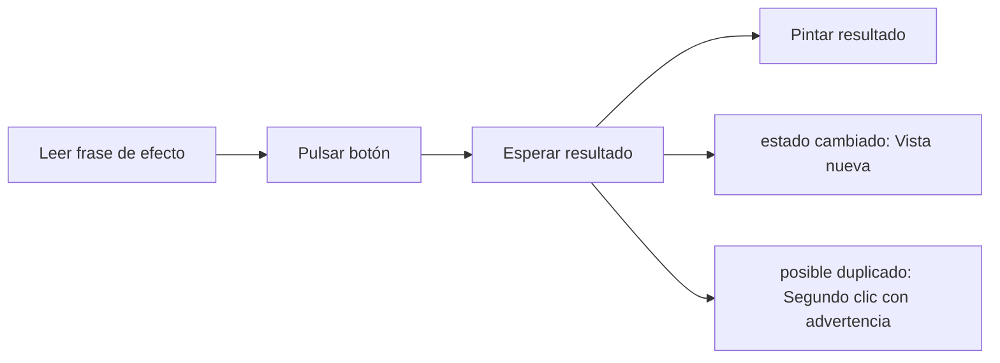

# Feature Specification: FE-03 — Aceptar opción (front)

**Created**: 2026-10-19  
**Status**: draft  
**Flow**: FE-03 Aceptar opción (front)  
**Related Specs**: [FE-03.1 Frase de efecto y texto del botón por efecto](92-fe-03-1-frase-de-efecto-y-texto-del-boton-por-efecto.md), [FE-03.2 Envío y bloqueo](93-fe-03-2-envio-y-bloqueo.md), [FE-03.3 Manejo de los siete resultados](94-fe-03-3-manejo-de-los-siete-resultados.md), [FE-03.4 Refresco tras estado cambiado](95-fe-03-4-refresco-tras-estado-cambiado.md), [FE-03.5 Segundo clic tras necesidad de confirmación](96-fe-03-5-segundo-clic-tras-necesidad-de-confirmacion.md), [F-02 Aceptar opción](16-f-02-aceptar-opcion.md), [FE-02 Vista de viaje](82-fe-02-vista-de-viaje.md), [FE-04 Hablar con una persona (front)](97-fe-04-hablar-con-una-persona-front.md)  
**Origen (DEC/H)**: DEC-04, DEC-13, DEC-14, DEC-15, DEC-16, DEC-18, DEC-19  
**Pruebas (TC)**: TC-07, TC-14, TC-15, TC-22, TC-30, TC-31  
**Contratos externos**: §1.1 (fila 3), DESIGN_CONTRACT (contratos 7 y 9)  
**Deuda conocida de A1 (no se resuelve aquí)**: DEBT-A1-01  

## Reglas de este documento

> Este spec es FUNCIONAL, no técnico: describe QUÉ hace el sistema, no CÓMO. Usa lenguaje de negocio; las siete herramientas externas se nombran por su función y se referencian por la sección de `sdd/reports/EXTERNAL_CONTRACTS.md`. Los casos borde se DOCUMENTAN; los valores de configuración se citan por el nombre del parámetro (NFR-012) con su valor por defecto entre paréntesis.

**Alcance**: El clic en el botón primario de la opción: se deshabilita mientras hay solicitud en curso, envía la decisión, la clave de itinerario y la huella (nunca el contenido de la opción) y pinta cada uno de los siete resultados.

## User Scenarios & Testing *(mandatory)*

### User Story 1 - El pasajero acepta con un clic sabiendo qué ocurrirá (Priority: P1)

Como pasajero, quiero que el texto que precede al botón me diga qué va a pasar y que tras el clic vea claramente el resultado.

**Why this priority**: Es la acción de mayor impacto de la interfaz.

**Independent Test**: Se prueba pulsando el botón en el escenario sin menor y en el caso base.

**Acceptance Scenarios**:

1. **Scenario**: Solicitud registrada
   - **Given** decisión automática
   - **When** el pasajero pulsa «Aceptar esta opción»
   - **Then** el botón queda deshabilitado con «Procesando tu solicitud…» y luego se ve «Solicitud registrada, pendiente de confirmación, sujeta a disponibilidad» con el vencimiento y «Tu vuelo todavía no se cambia.»

2. **Scenario**: Caso humano con la opción
   - **Given** decisión que exige aprobación
   - **When** pulsa «Aceptar y enviar a una persona»
   - **Then** se ve el caso creado y que la reserva no cambió

3. **Scenario**: Situación cambió
   - **Given** el servidor responde estado cambiado
   - **When** se recibe
   - **Then** se muestra la vista nueva y el foco va al aviso informativo

4. **Scenario**: Aceptar O1 sin menor (TC-07, TC-30)
   - **Given** SIN_MENOR_TC07 con O1 LA2412 de 4 asientos
   - **When** se pulsa «Aceptar esta opción»
   - **Then** el botón queda en «Procesando tu solicitud…» y luego se ve la solicitud RBK-88231 que vence a las 11:12 UTC

---

### Edge Cases

> Solo se documentan; los marcados MUST-IMPLEMENT se vuelven requisito FR-XXX y se implementan con TDD, los DEFERRED quedan para una iteración posterior.

#### System Errors
- [MUST-IMPLEMENT] Cuando hay una solicitud en curso → el botón sigue visible, `aria-disabled` y texto visible; la explicación va fuera del botón (FR-062)
- [MUST-IMPLEMENT] Cuando el resultado es fallo → mensaje genérico y caso humano ofrecido (FR-105)

#### Invalid Data
- [MUST-IMPLEMENT] Cuando existe una solicitud existente → «ya existe una solicitud en curso para esta opción» (FR-055)

#### Race Conditions
- [DEFERRED] Dos pestañas con opciones distintas (DEBT-A1-01) (FR-053)

## Requirements *(mandatory)*

### Functional Requirements

- **FR-VIS-001**: La interfaz DEBE aplicar estilos coherentes con la identidad visual definida: CSS propio alineado con `sdd/reports/DESIGN_CONTRACT.md` (tokens de color, tipografía, espaciado y radios), sin logos ni marcas de terceros.
- **FR-VIS-002**: Está PROHIBIDO entregar HTML sin estilos: cada pantalla y cada estado de este flujo DEBE renderizarse con los estilos de la identidad, nunca con el aspecto por defecto del navegador.
- **FR-VIS-003**: La interfaz DEBE ser consistente con `sdd/reports/DESIGN_CONTRACT.md`: usa solo los componentes de su inventario y solo sus tokens; toda diferencia respecto del contrato es un defecto de la implementación, no del contrato.
- **FR-050**: Toda acción externa (solicitud de cambio, caso humano, notificación) DEBE requerir un clic explícito del pasajero; el sistema solo propone y ofrece. La persistencia interna no es una acción externa. Excepción: en modo sistema se puede enviar la notificación de FR-122 sin clic, con plantilla fija; ninguna otra acción externa se ejecuta en modo sistema. Un clic autoriza exactamente una acción y los textos de los botones lo declaran, incluida la derivación posterior a una falla persistente.
- **FR-051**: Al aceptar una opción cuando la decisión no exige aprobación, el sistema DEBE revalidar (FR-070), obtener la llave de idempotencia y crear la solicitud de cambio.
- **FR-052**: Al aceptar una opción cuando la decisión exige aprobación, es BLOQUEADA o tiene reglas no evaluables, el sistema NO DEBE crear la solicitud de cambio: crea un caso humano con la opción elegida como evidencia.
- **FR-054**: Un resultado indeterminado (falla temporal del proveedor, tiempo agotado o respuesta perdida) DEBE reintentarse hasta `REBOOK_MAX_RETRIES` (2) veces con la misma llave; luego se deriva a caso humano (cubierto por el clic de FR-050). Nunca se informa éxito ni fracaso.
- **FR-055**: Un rechazo por duplicado DEBE tratarse como solicitud existente y la vista muestra «ya existe una solicitud en curso para esta opción», sin bucles.
- **FR-056**: Una solicitud creada DEBE mostrarse como «solicitud registrada, pendiente de confirmación, sujeta a disponibilidad» con su vencimiento; la confirmación queda fuera de la versión 1.
- **FR-062**: Dos aceptaciones simultáneas, o una aceptación mientras la operación está en curso, indeterminada o creada, DEBEN resultar en una sola escritura; la segunda devuelve el estado de la primera y el botón se deshabilita mientras hay una solicitud en curso.
- **FR-070**: Antes de crear un cambio el sistema DEBE reconsultar contexto, eventos, opciones y política y recalcular la decisión y su huella (estado de cada segmento, reglas cumplidas, derechos, aprobación, versión de política, composición del grupo y, de la opción elegida, itinerario, suficiencia de asientos, diferencia de tarifa y referencia de política). Si la huella difiere de la mostrada, no se escribe y se muestra el nuevo estado; marcas de tiempo, ids de eventos descartados, identificador de opción y confianza no cuentan. La vigencia no entra en la huella: es una condición de ejecución independiente. Los casos humanos no se revalidan.
- **FR-105**: Matriz de errores por herramienta: las lecturas con fallo se reconsultan una vez sin bucles; sin contexto del viaje hay pantalla de «no pudimos cargar tu viaje» con reintento; solo sin eventos se muestra el contexto sin estado ni alerta y con aviso; sin política u opciones queda BLOQUEADA con caso humano ofrecido. Una solicitud de cambio con error no reintentable no se reintenta, muestra un fallo genérico y ofrece caso humano. En el caso humano, un error explícito dice «no pudimos registrar tu solicitud, puedes reintentar»; un tiempo agotado o respuesta perdida es indeterminado («no pudimos confirmar si tu solicitud quedó registrada; puede que ya lo esté»), no se reenvía automáticamente y el reintento exige un segundo clic explícito tras advertir del posible duplicado. Nunca se afirma éxito.

### Non-Functional and Documentation Requirements

- **NFR-011**: Accesibilidad básica: la interfaz DEBE ofrecer roles semánticos, foco visible, navegación por teclado y contraste AA (relación de al menos 4,5:1 verificada sobre los tokens por una prueba que la calcula).

### Key Entities *(include if feature involves data)*

- **Pantalla del front de prueba**: Estado visible del front según la vista recibida. Campos principales:
  - `screen_state`: carga | sin anomalía | informativa | solo puerta | retraso con opción | conflicto | sin opción viable | solicitud registrada | lectura fallida | error de carga
  - `components`: lista de componentes del inventario del DESIGN_CONTRACT presentes
  - `texts`: claves del catálogo de textos usadas
  - `focus_target`: elemento que recibe el foco tras una acción
  - `aria_busy`: booleano (verdadero durante la carga)
- **Resultado de aceptación**: Respuesta a un clic de «Aceptar esta opción». Campos principales:
  - `outcome`: REBOOKING_CREATED | EXISTING_REQUEST | HUMAN_CASE_CREATED | EXISTING_CASE | NEEDS_CONFIRMATION | STATE_CHANGED | FAILED
  - `message`: mensaje validado
  - `operation`: operación | nulo
  - `human_case`: caso humano | nulo
  - `retries`: entero entre 0 y `REBOOK_MAX_RETRIES`
  - `view`: vista del viaje | nulo (solo con STATE_CHANGED)

## Architectural Attributes *(mandatory)*

| Attribute | Value |
|-----------|-------|
| **Interaction type** | sync-http |
| **Consistency** | strong |
| **Workflow** | multi-step |
| **Read pattern** | simple |
| **Auditability** | basic |
| **Domain complexity** | medium |
| **Modularity** | feature-slice |
| **Deployment** | monolith |

## Success Criteria *(mandatory)*

### Measurable Outcomes

- **SC-001**: El 100 % de los clics muestra antes la frase de efecto asociada al botón.
- **SC-002**: El botón permanece deshabilitado durante toda la operación.
- **SC-003**: Los siete resultados se pintan con una redacción aprobada.

## UI Constraints *(include for frontend/web projects)*

### Visual Requirements
- **Design system**: propio, definido en `sdd/reports/DESIGN_CONTRACT.md` (CSS propio con tokens de color, tipografía, espaciado y radios; sin librería de componentes ni logos de terceros).
- **Responsive**: sí; una columna con margen lateral de 16 px y ancho máximo de 720 px, sin desplazamiento horizontal desde 320 px; botones a ancho completo en móvil con área táctil mínima de 44 × 44 px.
- **Accessibility**: WCAG 2.1 nivel AA (NFR-011): roles semánticos, foco visible, navegación por teclado, contraste de al menos 4,5:1 en texto y 3:1 en contornos de controles; el color nunca es el único portador de significado.

### Interaction Patterns
- **Loading states**: botón deshabilitado con «Procesando tu solicitud…».
- **Error states**: estado de error con mensaje genérico y caso humano ofrecido.
- **Empty states**: sin opción no hay botón primario.

### Style Constraints
- **Color palette**: tokens de color del DESIGN_CONTRACT (marca índigo para acciones primarias y foco, rojo solo decorativo, tintes para banners y chips); el color nunca es el único portador de significado: siempre va acompañado de texto e ícono.
- **Typography**: tipografía del sistema con escala de 14, 16, 20 y 24 px, interlineado 1,5; códigos de reglas en monoespaciada.
- **Spacing**: escala de espaciado de 4 a 32 px del DESIGN_CONTRACT; radio único de 8 px.

### Visual Spec *(mandatory for web/mobile)*

| Screen | Image | Source | Description |
|--------|-------|--------|-------------|
| Pantalla 2: retraso con opción propuesta y caso humano | Wireframe ASCII de `sdd/reports/DESIGN_CONTRACT.md` (§Evidencia Visual); captura de imagen diferida hasta que exista el front | Wireframe de texto (alternativa autorizada cuando no hay imagen) | alertas, reglas plegadas, opción propuesta, vía de reembolso, acciones con cuenta regresiva y diálogo |
| Pantalla 5: solicitud registrada | Wireframe ASCII de `sdd/reports/DESIGN_CONTRACT.md` (§Evidencia Visual); captura de imagen diferida hasta que exista el front | Wireframe de texto (alternativa autorizada cuando no hay imagen) | «pendiente de confirmación, sujeta a disponibilidad» con vencimiento, tono informativo |
| Pantalla 4: sin opción viable | Wireframe ASCII de `sdd/reports/DESIGN_CONTRACT.md` (§Evidencia Visual); captura de imagen diferida hasta que exista el front | Wireframe de texto (alternativa autorizada cuando no hay imagen) | mensaje de grupo no cubierto y caso humano de un clic |

## Traceability *(mandatory after implementation)*

> Las columnas de archivo y línea se registran en la verificación de trazabilidad posterior a la implementación; hoy cada criterio queda enlazado a su origen y a las pruebas que lo verifican.

| Criterion | Origen | Prueba (TC) | Source File | Line(s) |
|-----------|--------|-------------|-------------|---------|
| FR-VIS-001 | Usuario (2026-10-19) | sin TC en el mapa §6 de REQUERIMIENTOS_V1 | se registra en la verificación posterior a la implementación | se registra en la verificación posterior a la implementación |
| FR-VIS-002 | Usuario (2026-10-19) | sin TC en el mapa §6 de REQUERIMIENTOS_V1 | se registra en la verificación posterior a la implementación | se registra en la verificación posterior a la implementación |
| FR-VIS-003 | Usuario (2026-10-19) | sin TC en el mapa §6 de REQUERIMIENTOS_V1 | se registra en la verificación posterior a la implementación | se registra en la verificación posterior a la implementación |
| FR-050 | DEC-14 | sin TC en el mapa §6 de REQUERIMIENTOS_V1 | se registra en la verificación posterior a la implementación | se registra en la verificación posterior a la implementación |
| FR-051 | DEC-14, DEC-19 | TC-07 | se registra en la verificación posterior a la implementación | se registra en la verificación posterior a la implementación |
| FR-052 | DEC-13, DEC-16 | sin TC en el mapa §6 de REQUERIMIENTOS_V1 | se registra en la verificación posterior a la implementación | se registra en la verificación posterior a la implementación |
| FR-054 | DEC-18 | TC-14 | se registra en la verificación posterior a la implementación | se registra en la verificación posterior a la implementación |
| FR-055 | DEC-18 | TC-15 | se registra en la verificación posterior a la implementación | se registra en la verificación posterior a la implementación |
| FR-056 | DEC-18, DEC-19 | TC-30 | se registra en la verificación posterior a la implementación | se registra en la verificación posterior a la implementación |
| FR-062 | DEC-18 | TC-22 | se registra en la verificación posterior a la implementación | se registra en la verificación posterior a la implementación |
| FR-070 | DEC-19 | TC-31 | se registra en la verificación posterior a la implementación | se registra en la verificación posterior a la implementación |
| FR-105 | DEC-15, DEC-18 | sin TC en el mapa §6 de REQUERIMIENTOS_V1 | se registra en la verificación posterior a la implementación | se registra en la verificación posterior a la implementación |
| NFR-011 | DEC-04 | sin TC en el mapa §6 de REQUERIMIENTOS_V1 | se registra en la verificación posterior a la implementación | se registra en la verificación posterior a la implementación |
| SC-001 | criterio medible de este spec | TC-07, TC-14, TC-15, TC-22, TC-30, TC-31 | se registra en la verificación posterior a la implementación | se registra en la verificación posterior a la implementación |
| SC-002 | criterio medible de este spec | TC-07, TC-14, TC-15, TC-22, TC-30, TC-31 | se registra en la verificación posterior a la implementación | se registra en la verificación posterior a la implementación |
| SC-003 | criterio medible de este spec | TC-07, TC-14, TC-15, TC-22, TC-30, TC-31 | se registra en la verificación posterior a la implementación | se registra en la verificación posterior a la implementación |

## Business Process (BPM View)

```
Leer frase de efecto → Pulsar botón → Esperar resultado → Pintar resultado
```



### Subprocesses (if applicable)

```
FE-03.1: Frase de efecto y texto del botón por efecto
FE-03.2: Envío y bloqueo
FE-03.3: Manejo de los siete resultados
FE-03.4: Refresco tras estado cambiado
FE-03.5: Segundo clic tras necesidad de confirmación
```
