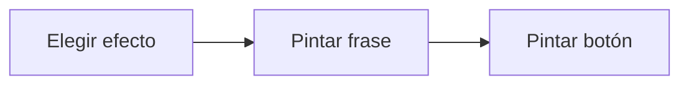

# Feature Specification: FE-03.1 — Frase de efecto y texto del botón por efecto

**Created**: 2026-10-19  
**Status**: draft  
**Flow**: [FE-03 Aceptar opción (front)](91-fe-03-aceptar-opcion-front.md) (subflujo)  
**Related Specs**: [FE-03 Aceptar opción (front)](91-fe-03-aceptar-opcion-front.md), [FE-03.2 Envío y bloqueo](93-fe-03-2-envio-y-bloqueo.md)  
**Origen (DEC/H)**: DEC-04, DEC-13, DEC-14, DEC-16  
**Pruebas (TC)**: TC-01, TC-07  
**Contratos externos**: DESIGN_CONTRACT (contrato 9)  

## Reglas de este documento

> Este spec es FUNCIONAL, no técnico: describe QUÉ hace el sistema, no CÓMO. Usa lenguaje de negocio; las siete herramientas externas se nombran por su función y se referencian por la sección de `sdd/reports/EXTERNAL_CONTRACTS.md`. Los casos borde se DOCUMENTAN; los valores de configuración se citan por el nombre del parámetro (NFR-012) con su valor por defecto entre paréntesis.

**Alcance**: Cada efecto (crear cambio, caso con opción, caso con motivo conocido) tiene su botón y su frase de efecto antes del botón.

## User Scenarios & Testing *(mandatory)*

### User Story 1 - El botón dice lo que hace (Priority: P1)

Como pasajero, quiero leer qué pasará antes de pulsar.

**Why this priority**: Un clic autoriza exactamente una acción.

**Independent Test**: Se prueba con los tres efectos.

**Acceptance Scenarios**:

1. **Scenario**: Cambio
   - **Given** efecto de crear cambio
   - **When** se pinta
   - **Then** el botón primario «Aceptar esta opción» va precedido, y asociado a él para los lectores de pantalla, por la frase «Se creará una solicitud de cambio, pendiente de confirmación. Tu vuelo todavía no se cambia. Si no podemos confirmar el resultado, derivaremos tu caso a una persona.»

2. **Scenario**: Caso
   - **Given** efecto de caso humano con opción
   - **When** se pinta
   - **Then** el botón «Aceptar y enviar a una persona» va precedido de «Una persona revisará esta opción. Esto no cambia tu reserva.» y, pegado al botón, el aviso «Tu grupo incluye a un menor: esta decisión necesita la aprobación de una persona.» sin edad ni nombre del menor

3. **Scenario**: Motivo conocido y botón secundario (TC-03)
   - **Given** CONFLICTO_TC03 con motivo conocido, y BASE_TC01 con el botón secundario
   - **When** se pinta cada botón
   - **Then** «Hablar con una persona» de un clic va precedido de «Una persona revisará tu caso. Esto no cambia tu reserva.»; el secundario del caso base va precedido de «Se abrirá una solicitud para que una persona te ayude. Esto no cambia tu reserva.»

4. **Scenario**: Efecto de crear cambio (TC-07)
   - **Given** SIN_MENOR_TC07 con dos pasajeros adultos y O1 LA2412
   - **When** se pinta
   - **Then** el botón «Aceptar esta opción» va precedido de su frase de efecto completa

---

### Edge Cases

> Solo se documentan; los marcados MUST-IMPLEMENT se vuelven requisito FR-XXX y se implementan con TDD, los DEFERRED quedan para una iteración posterior.

#### Invalid Data
- [MUST-IMPLEMENT] Cuando existe la frase → se asocia al botón para lectores de pantalla (NFR-011)
- [MUST-IMPLEMENT] Cuando existe el aviso de menor → va pegado al botón y sin edad (FR-112)

## Requirements *(mandatory)*

### Functional Requirements

- **FR-VIS-001**: La interfaz DEBE aplicar estilos coherentes con la identidad visual definida: CSS propio alineado con `sdd/reports/DESIGN_CONTRACT.md` (tokens de color, tipografía, espaciado y radios), sin logos ni marcas de terceros.
- **FR-VIS-002**: Está PROHIBIDO entregar HTML sin estilos: cada pantalla y cada estado de este flujo DEBE renderizarse con los estilos de la identidad, nunca con el aspecto por defecto del navegador.
- **FR-VIS-003**: La interfaz DEBE ser consistente con `sdd/reports/DESIGN_CONTRACT.md`: usa solo los componentes de su inventario y solo sus tokens; toda diferencia respecto del contrato es un defecto de la implementación, no del contrato.
- **FR-050**: Toda acción externa (solicitud de cambio, caso humano, notificación) DEBE requerir un clic explícito del pasajero; el sistema solo propone y ofrece. La persistencia interna no es una acción externa. Excepción: en modo sistema se puede enviar la notificación de FR-122 sin clic, con plantilla fija; ninguna otra acción externa se ejecuta en modo sistema. Un clic autoriza exactamente una acción y los textos de los botones lo declaran, incluida la derivación posterior a una falla persistente.
- **FR-052**: Al aceptar una opción cuando la decisión exige aprobación, es BLOQUEADA o tiene reglas no evaluables, el sistema NO DEBE crear la solicitud de cambio: crea un caso humano con la opción elegida como evidencia.

### Non-Functional and Documentation Requirements

- **NFR-011**: Accesibilidad básica: la interfaz DEBE ofrecer roles semánticos, foco visible, navegación por teclado y contraste AA (relación de al menos 4,5:1 verificada sobre los tokens por una prueba que la calcula).

### Key Entities *(include if feature involves data)*

- **Pantalla del front de prueba**: Estado visible del front según la vista recibida. Campos principales:
  - `screen_state`: carga | sin anomalía | informativa | solo puerta | retraso con opción | conflicto | sin opción viable | solicitud registrada | lectura fallida | error de carga
  - `components`: lista de componentes del inventario del DESIGN_CONTRACT presentes
  - `texts`: claves del catálogo de textos usadas
  - `focus_target`: elemento que recibe el foco tras una acción
  - `aria_busy`: booleano (verdadero durante la carga)

## Architectural Attributes *(mandatory)*

| Attribute | Value |
|-----------|-------|
| **Interaction type** | sync-http |
| **Consistency** | strong |
| **Workflow** | single-step |
| **Read pattern** | simple |
| **Auditability** | none |
| **Domain complexity** | low |
| **Modularity** | feature-slice |
| **Deployment** | monolith |

## Success Criteria *(mandatory)*

### Measurable Outcomes

- **SC-001**: El 100 % de los botones primarios tiene su frase de efecto asociada.

## UI Constraints *(include for frontend/web projects)*

### Visual Requirements
- **Design system**: propio, definido en `sdd/reports/DESIGN_CONTRACT.md` (CSS propio con tokens de color, tipografía, espaciado y radios; sin librería de componentes ni logos de terceros).
- **Responsive**: sí; una columna con margen lateral de 16 px y ancho máximo de 720 px, sin desplazamiento horizontal desde 320 px; botones a ancho completo en móvil con área táctil mínima de 44 × 44 px.
- **Accessibility**: WCAG 2.1 nivel AA (NFR-011): roles semánticos, foco visible, navegación por teclado, contraste de al menos 4,5:1 en texto y 3:1 en contornos de controles; el color nunca es el único portador de significado.

### Interaction Patterns
- **Loading states**: no aplica.
- **Error states**: no aplica.
- **Empty states**: sin acción no hay botón.

### Style Constraints
- **Color palette**: tokens de color del DESIGN_CONTRACT (marca índigo para acciones primarias y foco, rojo solo decorativo, tintes para banners y chips); el color nunca es el único portador de significado: siempre va acompañado de texto e ícono.
- **Typography**: tipografía del sistema con escala de 14, 16, 20 y 24 px, interlineado 1,5; códigos de reglas en monoespaciada.
- **Spacing**: escala de espaciado de 4 a 32 px del DESIGN_CONTRACT; radio único de 8 px.

### Visual Spec *(mandatory for web/mobile)*

| Screen | Image | Source | Description |
|--------|-------|--------|-------------|
| Pantalla 2: retraso con opción propuesta y caso humano | Wireframe ASCII de `sdd/reports/DESIGN_CONTRACT.md` (§Evidencia Visual); captura de imagen diferida hasta que exista el front | Wireframe de texto (alternativa autorizada cuando no hay imagen) | alertas, reglas plegadas, opción propuesta, vía de reembolso, acciones con cuenta regresiva y diálogo |

## Traceability *(mandatory after implementation)*

> Las columnas de archivo y línea se registran en la verificación de trazabilidad posterior a la implementación; hoy cada criterio queda enlazado a su origen y a las pruebas que lo verifican.

| Criterion | Origen | Prueba (TC) | Source File | Line(s) |
|-----------|--------|-------------|-------------|---------|
| FR-VIS-001 | Usuario (2026-10-19) | sin TC en el mapa §6 de REQUERIMIENTOS_V1 | se registra en la verificación posterior a la implementación | se registra en la verificación posterior a la implementación |
| FR-VIS-002 | Usuario (2026-10-19) | sin TC en el mapa §6 de REQUERIMIENTOS_V1 | se registra en la verificación posterior a la implementación | se registra en la verificación posterior a la implementación |
| FR-VIS-003 | Usuario (2026-10-19) | sin TC en el mapa §6 de REQUERIMIENTOS_V1 | se registra en la verificación posterior a la implementación | se registra en la verificación posterior a la implementación |
| FR-050 | DEC-14 | TC-01 | se registra en la verificación posterior a la implementación | se registra en la verificación posterior a la implementación |
| FR-052 | DEC-13, DEC-16 | TC-01 | se registra en la verificación posterior a la implementación | se registra en la verificación posterior a la implementación |
| NFR-011 | DEC-04 | sin TC en el mapa §6 de REQUERIMIENTOS_V1 | se registra en la verificación posterior a la implementación | se registra en la verificación posterior a la implementación |
| SC-001 | criterio medible de este spec | TC-01, TC-07 | se registra en la verificación posterior a la implementación | se registra en la verificación posterior a la implementación |

## Business Process (BPM View)

```
Elegir efecto → Pintar frase → Pintar botón
```



