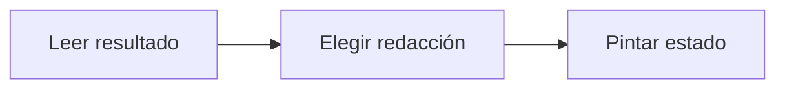

# Feature Specification: FE-03.3 — Manejo de los siete resultados

**Created**: 2026-10-19  
**Status**: draft  
**Flow**: [FE-03 Aceptar opción (front)](91-fe-03-aceptar-opcion-front.md) (subflujo)  
**Related Specs**: [FE-03 Aceptar opción (front)](91-fe-03-aceptar-opcion-front.md), [FE-03.2 Envío y bloqueo](93-fe-03-2-envio-y-bloqueo.md), [FE-03.4 Refresco tras estado cambiado](95-fe-03-4-refresco-tras-estado-cambiado.md)  
**Origen (DEC/H)**: DEC-13, DEC-14, DEC-15, DEC-16, DEC-18, DEC-19  
**Pruebas (TC)**: TC-01, TC-14, TC-15, TC-30, TC-31, TC-33  
**Contratos externos**: §1.1 (fila 3: AcceptResult)  

## Reglas de este documento

> Este spec es FUNCIONAL, no técnico: describe QUÉ hace el sistema, no CÓMO. Usa lenguaje de negocio; las siete herramientas externas se nombran por su función y se referencian por la sección de `sdd/reports/EXTERNAL_CONTRACTS.md`. Los casos borde se DOCUMENTAN; los valores de configuración se citan por el nombre del parámetro (NFR-012) con su valor por defecto entre paréntesis.

**Alcance**: Pinta cada resultado: solicitud registrada, solicitud existente, caso humano creado o existente, necesidad de confirmación, estado cambiado y fallo.

## User Scenarios & Testing *(mandatory)*

### User Story 1 - Cada resultado se explica con precisión (Priority: P1)

Como pasajero, quiero saber qué pasó exactamente tras mi clic.

**Why this priority**: Prometer más de lo ocurrido es un defecto grave.

**Independent Test**: Se prueba con cada resultado.

**Acceptance Scenarios**:

1. **Scenario**: REBOOKING_CREATED (TC-30)
   - **Given** SIN_MENOR_TC07: el proveedor responde la solicitud RBK-88231 pendiente de confirmación con vencimiento 11:12:00Z
   - **When** llega el resultado REBOOKING_CREATED
   - **Then** aviso informativo (no verde) que recibe el foco: «Solicitud registrada, pendiente de confirmación, sujeta a disponibilidad. Vence a las 11:12 UTC. Tu vuelo todavía no se cambia.» y «Código de seguimiento: RBK-88231»

2. **Scenario**: EXISTING_REQUEST (TC-15)
   - **Given** el proveedor responde duplicado con RBK-88231 o ya hay una operación en curso para O1 LA2412
   - **When** llega el resultado EXISTING_REQUEST
   - **Then** aviso informativo: «Ya existe una solicitud en curso para esta opción.» y el botón «Aceptar esta opción» sigue con su texto y deshabilitado, con la explicación en un párrafo fuera del botón

3. **Scenario**: HUMAN_CASE_CREATED (TC-01, TC-14)
   - **Given** BASE_TC01 con decisión PENDIENTE_APROBACION, o 3 llamadas indeterminadas del proveedor de cambios; el proveedor de casos responde HC-4471, cola DISRUPTION_L2, 45 minutos
   - **When** llega el resultado HUMAN_CASE_CREATED
   - **Then** aviso de éxito con rol de estado: «Registramos tu solicitud. Una persona te atenderá; el tiempo objetivo de atención es de 45 minutos. Código de seguimiento: HC-4471.» y la reserva no cambió

4. **Scenario**: EXISTING_CASE
   - **Given** ya existe el caso HC-4471 con la misma clave de deduplicación
   - **When** llega el resultado EXISTING_CASE
   - **Then** aviso informativo: «Ya registramos una solicitud tuya para esta situación. Código de seguimiento: HC-4471.» sin enviar nada nuevo

5. **Scenario**: NEEDS_CONFIRMATION (TC-33)
   - **Given** el intento anterior del caso HC-4471 quedó indeterminado
   - **When** llega el resultado NEEDS_CONFIRMATION
   - **Then** diálogo con aviso de advertencia (rol de alerta): «No pudimos confirmar si tu solicitud quedó registrada; puede que ya lo esté. Si la envías de nuevo, podría duplicarse.» y los botones «Cerrar» y «Enviar de nuevo igualmente»

6. **Scenario**: STATE_CHANGED (TC-31)
   - **Given** los asientos de O1 LA2412 pasaron de 4 a 0 entre la vista y el clic
   - **When** llega el resultado STATE_CHANGED con la vista nueva
   - **Then** se reemplaza la vista y el foco pasa a un aviso informativo al inicio: «La situación cambió: actualizamos tu viaje»

7. **Scenario**: FAILED (TC-33)
   - **Given** el proveedor de cambios rechaza con un error no reintentable, o el proveedor de casos responde un error explícito
   - **When** llega el resultado FAILED
   - **Then** aviso de error con rol de alerta: para la solicitud de cambio «No pudimos procesar tu solicitud de cambio. Puedes hablar con una persona para que te ayude.» y para el caso humano «No pudimos registrar tu solicitud, puedes reintentar.»; nunca se afirma éxito

---

### Edge Cases

> Solo se documentan; los marcados MUST-IMPLEMENT se vuelven requisito FR-XXX y se implementan con TDD, los DEFERRED quedan para una iteración posterior.

#### System Errors
- [MUST-IMPLEMENT] Cuando el fallo es indeterminado → nunca se dice éxito ni fracaso (FR-054)

#### Invalid Data
- [MUST-IMPLEMENT] Cuando la solicitud ya existe → «ya existe una solicitud en curso para esta opción» (FR-055)

## Requirements *(mandatory)*

### Functional Requirements

- **FR-VIS-001**: La interfaz DEBE aplicar estilos coherentes con la identidad visual definida: CSS propio alineado con `sdd/reports/DESIGN_CONTRACT.md` (tokens de color, tipografía, espaciado y radios), sin logos ni marcas de terceros.
- **FR-VIS-002**: Está PROHIBIDO entregar HTML sin estilos: cada pantalla y cada estado de este flujo DEBE renderizarse con los estilos de la identidad, nunca con el aspecto por defecto del navegador.
- **FR-VIS-003**: La interfaz DEBE ser consistente con `sdd/reports/DESIGN_CONTRACT.md`: usa solo los componentes de su inventario y solo sus tokens; toda diferencia respecto del contrato es un defecto de la implementación, no del contrato.
- **FR-051**: Al aceptar una opción cuando la decisión no exige aprobación, el sistema DEBE revalidar (FR-070), obtener la llave de idempotencia y crear la solicitud de cambio.
- **FR-052**: Al aceptar una opción cuando la decisión exige aprobación, es BLOQUEADA o tiene reglas no evaluables, el sistema NO DEBE crear la solicitud de cambio: crea un caso humano con la opción elegida como evidencia.
- **FR-054**: Un resultado indeterminado (falla temporal del proveedor, tiempo agotado o respuesta perdida) DEBE reintentarse hasta `REBOOK_MAX_RETRIES` (2) veces con la misma llave; luego se deriva a caso humano (cubierto por el clic de FR-050). Nunca se informa éxito ni fracaso.
- **FR-055**: Un rechazo por duplicado DEBE tratarse como solicitud existente y la vista muestra «ya existe una solicitud en curso para esta opción», sin bucles.
- **FR-056**: Una solicitud creada DEBE mostrarse como «solicitud registrada, pendiente de confirmación, sujeta a disponibilidad» con su vencimiento; la confirmación queda fuera de la versión 1.
- **FR-105**: Matriz de errores por herramienta: las lecturas con fallo se reconsultan una vez sin bucles; sin contexto del viaje hay pantalla de «no pudimos cargar tu viaje» con reintento; solo sin eventos se muestra el contexto sin estado ni alerta y con aviso; sin política u opciones queda BLOQUEADA con caso humano ofrecido. Una solicitud de cambio con error no reintentable no se reintenta, muestra un fallo genérico y ofrece caso humano. En el caso humano, un error explícito dice «no pudimos registrar tu solicitud, puedes reintentar»; un tiempo agotado o respuesta perdida es indeterminado («no pudimos confirmar si tu solicitud quedó registrada; puede que ya lo esté»), no se reenvía automáticamente y el reintento exige un segundo clic explícito tras advertir del posible duplicado. Nunca se afirma éxito.

### Key Entities *(include if feature involves data)*

- **Resultado de aceptación**: Respuesta a un clic de «Aceptar esta opción». Campos principales:
  - `outcome`: REBOOKING_CREATED | EXISTING_REQUEST | HUMAN_CASE_CREATED | EXISTING_CASE | NEEDS_CONFIRMATION | STATE_CHANGED | FAILED
  - `message`: mensaje validado
  - `operation`: operación | nulo
  - `human_case`: caso humano | nulo
  - `retries`: entero entre 0 y `REBOOK_MAX_RETRIES`
  - `view`: vista del viaje | nulo (solo con STATE_CHANGED)
- **Pantalla del front de prueba**: Estado visible del front según la vista recibida. Campos principales:
  - `screen_state`: carga | sin anomalía | informativa | solo puerta | retraso con opción | conflicto | sin opción viable | solicitud registrada | lectura fallida | error de carga
  - `components`: lista de componentes del inventario del DESIGN_CONTRACT presentes
  - `texts`: claves del catálogo de textos usadas
  - `focus_target`: elemento que recibe el foco tras una acción
  - `aria_busy`: booleano (verdadero durante la carga)

## Architectural Attributes *(mandatory)*

| Attribute | Value |
|-----------|-------|
| **Interaction type** | sync-http |
| **Consistency** | strong |
| **Workflow** | single-step |
| **Read pattern** | simple |
| **Auditability** | none |
| **Domain complexity** | low |
| **Modularity** | feature-slice |
| **Deployment** | monolith |

## Success Criteria *(mandatory)*

### Measurable Outcomes

- **SC-001**: Cada uno de los siete resultados tiene una redacción y estado visual propios.

## UI Constraints *(include for frontend/web projects)*

### Visual Requirements
- **Design system**: propio, definido en `sdd/reports/DESIGN_CONTRACT.md` (CSS propio con tokens de color, tipografía, espaciado y radios; sin librería de componentes ni logos de terceros).
- **Responsive**: sí; una columna con margen lateral de 16 px y ancho máximo de 720 px, sin desplazamiento horizontal desde 320 px; botones a ancho completo en móvil con área táctil mínima de 44 × 44 px.
- **Accessibility**: WCAG 2.1 nivel AA (NFR-011): roles semánticos, foco visible, navegación por teclado, contraste de al menos 4,5:1 en texto y 3:1 en contornos de controles; el color nunca es el único portador de significado.

### Interaction Patterns
- **Loading states**: ver FE-03.2.
- **Error states**: tono de error con rol de alerta.
- **Empty states**: no aplica.

### Style Constraints
- **Color palette**: tokens de color del DESIGN_CONTRACT (marca índigo para acciones primarias y foco, rojo solo decorativo, tintes para banners y chips); el color nunca es el único portador de significado: siempre va acompañado de texto e ícono.
- **Typography**: tipografía del sistema con escala de 14, 16, 20 y 24 px, interlineado 1,5; códigos de reglas en monoespaciada.
- **Spacing**: escala de espaciado de 4 a 32 px del DESIGN_CONTRACT; radio único de 8 px.

### Visual Spec *(mandatory for web/mobile)*

| Screen | Image | Source | Description |
|--------|-------|--------|-------------|
| Pantalla 5: solicitud registrada | Wireframe ASCII de `sdd/reports/DESIGN_CONTRACT.md` (§Evidencia Visual); captura de imagen diferida hasta que exista el front | Wireframe de texto (alternativa autorizada cuando no hay imagen) | resultado REBOOKING_CREATED y la tabla de los siete resultados del DESIGN_CONTRACT (v1.5) |
| Pantalla 2: retraso con opción propuesta y caso humano | Wireframe ASCII de `sdd/reports/DESIGN_CONTRACT.md` (§Evidencia Visual); captura de imagen diferida hasta que exista el front | Wireframe de texto (alternativa autorizada cuando no hay imagen) | diálogo del caso humano y sus variantes de error y de posible duplicado |

## Traceability *(mandatory after implementation)*

> Las columnas de archivo y línea se registran en la verificación de trazabilidad posterior a la implementación; hoy cada criterio queda enlazado a su origen y a las pruebas que lo verifican.

| Criterion | Origen | Prueba (TC) | Source File | Line(s) |
|-----------|--------|-------------|-------------|---------|
| FR-VIS-001 | Usuario (2026-10-19) | sin TC en el mapa §6 de REQUERIMIENTOS_V1 | se registra en la verificación posterior a la implementación | se registra en la verificación posterior a la implementación |
| FR-VIS-002 | Usuario (2026-10-19) | sin TC en el mapa §6 de REQUERIMIENTOS_V1 | se registra en la verificación posterior a la implementación | se registra en la verificación posterior a la implementación |
| FR-VIS-003 | Usuario (2026-10-19) | sin TC en el mapa §6 de REQUERIMIENTOS_V1 | se registra en la verificación posterior a la implementación | se registra en la verificación posterior a la implementación |
| FR-051 | DEC-14, DEC-19 | TC-01 | se registra en la verificación posterior a la implementación | se registra en la verificación posterior a la implementación |
| FR-052 | DEC-13, DEC-16 | TC-01 | se registra en la verificación posterior a la implementación | se registra en la verificación posterior a la implementación |
| FR-054 | DEC-18 | TC-01, TC-14, TC-33 | se registra en la verificación posterior a la implementación | se registra en la verificación posterior a la implementación |
| FR-055 | DEC-18 | TC-01, TC-15 | se registra en la verificación posterior a la implementación | se registra en la verificación posterior a la implementación |
| FR-056 | DEC-18, DEC-19 | TC-01, TC-30 | se registra en la verificación posterior a la implementación | se registra en la verificación posterior a la implementación |
| FR-105 | DEC-15, DEC-18 | TC-33 | se registra en la verificación posterior a la implementación | se registra en la verificación posterior a la implementación |
| SC-001 | criterio medible de este spec | TC-01, TC-14, TC-15, TC-30, TC-31, TC-33 | se registra en la verificación posterior a la implementación | se registra en la verificación posterior a la implementación |

## Business Process (BPM View)

```
Leer resultado → Elegir redacción → Pintar estado
```



