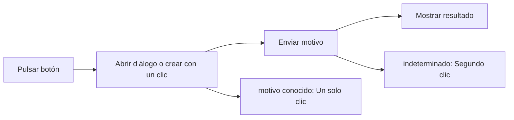

# Feature Specification: FE-04 — Hablar con una persona (front)

**Created**: 2026-10-19  
**Status**: draft  
**Flow**: FE-04 Hablar con una persona (front)  
**Related Specs**: [FE-04.1 Diálogo de motivo](98-fe-04-1-dialogo-de-motivo.md), [FE-04.2 Clic único con motivo conocido](99-fe-04-2-clic-unico-con-motivo-conocido.md), [FE-04.3 Envío con la decisión](100-fe-04-3-envio-con-la-decision.md), [FE-04.4 Resultado y errores](101-fe-04-4-resultado-y-errores.md), [FE-04.5 Advertencia de duplicado y segundo clic](102-fe-04-5-advertencia-de-duplicado-y-segundo-clic.md), [F-03 Caso humano manual («Hablar con una persona»)](27-f-03-caso-humano-manual-hablar-con-una-persona.md), [FE-02 Vista de viaje](82-fe-02-vista-de-viaje.md), [FE-03 Aceptar opción (front)](91-fe-03-aceptar-opcion-front.md)  
**Origen (DEC/H)**: DEC-02, DEC-04, DEC-13, DEC-14, DEC-15, DEC-18, DEC-22, DEC-23, DEC-27, DEC-29  
**Pruebas (TC)**: TC-17, TC-20, TC-33, TC-46  
**Contratos externos**: §1.1 (fila 4), DESIGN_CONTRACT (contratos 10 y 19)  

## Reglas de este documento

> Este spec es FUNCIONAL, no técnico: describe QUÉ hace el sistema, no CÓMO. Usa lenguaje de negocio; las siete herramientas externas se nombran por su función y se referencian por la sección de `sdd/reports/EXTERNAL_CONTRACTS.md`. Los casos borde se DOCUMENTAN; los valores de configuración se citan por el nombre del parámetro (NFR-012) con su valor por defecto entre paréntesis.

**Alcance**: El botón «Hablar con una persona» solo existe con una acción posible: con motivo conocido crea el caso con un solo clic; sin motivo conocido abre un diálogo con motivos neutros, sin preselección y sin texto libre, y muestra el resultado, incluyendo la advertencia de posible duplicado.

## User Scenarios & Testing *(mandatory)*

### User Story 1 - El pasajero pide ayuda humana sin confusión (Priority: P1)

Como pasajero, quiero pedir ayuda con un motivo claro y saber qué ocurre.

**Why this priority**: Es la salida segura cuando el sistema no puede decidir.

**Independent Test**: Se prueba con el diálogo con y sin compensación elegible y con motivo conocido.

**Acceptance Scenarios**:

1. **Scenario**: Diálogo
   - **Given** no hay motivo conocido
   - **When** el pasajero pulsa «Hablar con una persona»
   - **Then** se abre un diálogo con «Necesito ayuda con mi vuelo» y «Necesito ayuda con mis datos o documentos», ninguno preseleccionado y sin campo de texto

2. **Scenario**: Compensación elegible
   - **Given** hay compensación elegible
   - **When** se abre el diálogo
   - **Then** aparece también «Tengo una consulta sobre compensaciones»

3. **Scenario**: Un clic
   - **Given** el motivo ya es conocido (conflicto, sin opción)
   - **When** pulsa el botón
   - **Then** se crea el caso con un solo clic

4. **Scenario**: Posible duplicado
   - **Given** el intento previo fue indeterminado
   - **When** se pulsa de nuevo
   - **Then** se advierte y se exige un segundo clic

5. **Scenario**: Diálogo del caso base (TC-17, TC-46)
   - **Given** BASE_TC01 con compensación elegible (R4) y la variante SIN_COMPENSACION_TC46
   - **When** se abre «Hablar con una persona»
   - **Then** el caso base muestra 3 motivos y la variante 2, ninguno preseleccionado y sin campo de texto

---

### Edge Cases

> Solo se documentan; los marcados MUST-IMPLEMENT se vuelven requisito FR-XXX y se implementan con TDD, los DEFERRED quedan para una iteración posterior.

#### System Errors
- [MUST-IMPLEMENT] Cuando el caso falla con error explícito → el diálogo muestra «No pudimos registrar tu solicitud, puedes reintentar.» con «Cerrar» y «Reintentar» (FR-105)

#### Invalid Data
- [MUST-IMPLEMENT] Cuando el diálogo se cierra con Esc → el foco vuelve al botón que lo abrió (NFR-011)
- [DEFERRED] Validación con Producto del rótulo de compensación (mejora M3) (FR-060)

#### Security & Permissions
- [MUST-IMPLEMENT] Cuando el motivo es de datos personales → nunca se muestra información personal (FR-061)

## Requirements *(mandatory)*

### Functional Requirements

- **FR-VIS-001**: La interfaz DEBE aplicar estilos coherentes con la identidad visual definida: CSS propio alineado con `sdd/reports/DESIGN_CONTRACT.md` (tokens de color, tipografía, espaciado y radios), sin logos ni marcas de terceros.
- **FR-VIS-002**: Está PROHIBIDO entregar HTML sin estilos: cada pantalla y cada estado de este flujo DEBE renderizarse con los estilos de la identidad, nunca con el aspecto por defecto del navegador.
- **FR-VIS-003**: La interfaz DEBE ser consistente con `sdd/reports/DESIGN_CONTRACT.md`: usa solo los componentes de su inventario y solo sus tokens; toda diferencia respecto del contrato es un defecto de la implementación, no del contrato.
- **FR-050**: Toda acción externa (solicitud de cambio, caso humano, notificación) DEBE requerir un clic explícito del pasajero; el sistema solo propone y ofrece. La persistencia interna no es una acción externa. Excepción: en modo sistema se puede enviar la notificación de FR-122 sin clic, con plantilla fija; ninguna otra acción externa se ejecuta en modo sistema. Un clic autoriza exactamente una acción y los textos de los botones lo declaran, incluida la derivación posterior a una falla persistente.
- **FR-057**: Los motivos de caso humano son un conjunto cerrado de trece códigos (compensación solicitada, datos parciales bloqueantes, conflicto de fuentes, falla indeterminada del proveedor, evento no soportado, ninguna opción cubre al grupo, asistencia por pernocte, petición de datos personales, aprobación de política requerida, varios segmentos afectados, retraso incoherente, ninguna opción viable y otra ayuda). El sistema los ofrece; el caso se crea con el clic.
- **FR-059**: Al crear un caso humano el sistema DEBE enviar el motivo de mayor prioridad y conservar todos los motivos simultáneos, con evidencia solo de identificadores, enumeraciones y hechos validados (sin información personal), tomada de la decisión guardada si el pasajero indica la decisión que vio y, si no, de una evaluación fresca. La deduplicación local se calcula con reserva, motivos ordenados y huella de decisión, no bloquea el reintento explícito tras un intento fallido o indeterminado, y cada intento y su resultado (creado, fallido, indeterminado) queda registrado. No requiere revalidación.
- **FR-060**: El botón neutro «Hablar con una persona» DEBE mostrarse solo cuando hay una acción posible, con un motivo de enumeración cerrada (otra ayuda, datos personales y, solo si hay compensación elegible, compensación), con rótulos neutros sin resaltar ni preseleccionar y sin texto libre. La compensación nunca es proactiva ni lleva montos y, al elegirla, fija la solicitud de compensación y abre el caso con el clic.
- **FR-061**: El motivo de petición de datos personales NUNCA DEBE devolver información personal: abre un caso humano y la respuesta no contiene ningún campo prohibido.
- **FR-067**: El motivo de compensación del menú de soporte solo DEBE mostrarse si la política tiene una regla que concede un derecho de compensación (`COMPENSATION_RIGHTS`) que, evaluada con la solicitud de compensación verdadera y las demás variables, resulta verdadera, y la decisión no es INFORMATIVA.
- **FR-105**: Matriz de errores por herramienta: las lecturas con fallo se reconsultan una vez sin bucles; sin contexto del viaje hay pantalla de «no pudimos cargar tu viaje» con reintento; solo sin eventos se muestra el contexto sin estado ni alerta y con aviso; sin política u opciones queda BLOQUEADA con caso humano ofrecido. Una solicitud de cambio con error no reintentable no se reintenta, muestra un fallo genérico y ofrece caso humano. En el caso humano, un error explícito dice «no pudimos registrar tu solicitud, puedes reintentar»; un tiempo agotado o respuesta perdida es indeterminado («no pudimos confirmar si tu solicitud quedó registrada; puede que ya lo esté»), no se reenvía automáticamente y el reintento exige un segundo clic explícito tras advertir del posible duplicado. Nunca se afirma éxito.

### Non-Functional and Documentation Requirements

- **NFR-011**: Accesibilidad básica: la interfaz DEBE ofrecer roles semánticos, foco visible, navegación por teclado y contraste AA (relación de al menos 4,5:1 verificada sobre los tokens por una prueba que la calcula).

### Key Entities *(include if feature involves data)*

- **Pantalla del front de prueba**: Estado visible del front según la vista recibida. Campos principales:
  - `screen_state`: carga | sin anomalía | informativa | solo puerta | retraso con opción | conflicto | sin opción viable | solicitud registrada | lectura fallida | error de carga
  - `components`: lista de componentes del inventario del DESIGN_CONTRACT presentes
  - `texts`: claves del catálogo de textos usadas
  - `focus_target`: elemento que recibe el foco tras una acción
  - `aria_busy`: booleano (verdadero durante la carga)
- **Resultado de caso humano**: Respuesta a un clic de «Hablar con una persona». Campos principales:
  - `outcome`: HUMAN_CASE_CREATED | EXISTING_CASE | NEEDS_CONFIRMATION | INDETERMINATE | FAILED
  - `message`: mensaje validado
  - `human_case`: caso humano | nulo
  - `decision_id`: identificador de la decisión de la que salió la evidencia
- **Caso humano**: Escalamiento a una persona; cada intento queda registrado con su resultado. Campos principales:
  - `dedup_key`: texto
  - `attempt`: entero ≥ 1
  - `state`: EN_CURSO | CREADO | FALLIDO | INDETERMINADO
  - `reason`: uno de los 13 motivos cerrados
  - `reasons`: lista ordenada por prioridad
  - `case_id`: texto | nulo
  - `queue`: texto | nulo
  - `sla_minutes`: entero | nulo
  - `option`: {option_id: texto, itinerario y diferencia de tarifa} | nulo
  - `confirm_possible_duplicate`: booleano

## Architectural Attributes *(mandatory)*

| Attribute | Value |
|-----------|-------|
| **Interaction type** | sync-http |
| **Consistency** | strong |
| **Workflow** | multi-step |
| **Read pattern** | simple |
| **Auditability** | basic |
| **Domain complexity** | medium |
| **Modularity** | feature-slice |
| **Deployment** | monolith |

## Success Criteria *(mandatory)*

### Measurable Outcomes

- **SC-001**: El diálogo nunca contiene un campo de texto libre ni un motivo preseleccionado.
- **SC-002**: El motivo de compensación aparece solo con compensación elegible.
- **SC-003**: El botón no existe en pantallas sin acción posible.

## UI Constraints *(include for frontend/web projects)*

### Visual Requirements
- **Design system**: propio, definido en `sdd/reports/DESIGN_CONTRACT.md` (CSS propio con tokens de color, tipografía, espaciado y radios; sin librería de componentes ni logos de terceros).
- **Responsive**: sí; una columna con margen lateral de 16 px y ancho máximo de 720 px, sin desplazamiento horizontal desde 320 px; botones a ancho completo en móvil con área táctil mínima de 44 × 44 px.
- **Accessibility**: WCAG 2.1 nivel AA (NFR-011): roles semánticos, foco visible, navegación por teclado, contraste de al menos 4,5:1 en texto y 3:1 en contornos de controles; el color nunca es el único portador de significado.

### Interaction Patterns
- **Loading states**: el botón «Enviar solicitud» se deshabilita mientras se envía.
- **Error states**: estados de fallo e indeterminado con rol de alerta.
- **Empty states**: sin acción posible no existe el botón.

### Style Constraints
- **Color palette**: tokens de color del DESIGN_CONTRACT (marca índigo para acciones primarias y foco, rojo solo decorativo, tintes para banners y chips); el color nunca es el único portador de significado: siempre va acompañado de texto e ícono.
- **Typography**: tipografía del sistema con escala de 14, 16, 20 y 24 px, interlineado 1,5; códigos de reglas en monoespaciada.
- **Spacing**: escala de espaciado de 4 a 32 px del DESIGN_CONTRACT; radio único de 8 px.

### Visual Spec *(mandatory for web/mobile)*

| Screen | Image | Source | Description |
|--------|-------|--------|-------------|
| Pantalla 2: retraso con opción propuesta y caso humano | Wireframe ASCII de `sdd/reports/DESIGN_CONTRACT.md` (§Evidencia Visual); captura de imagen diferida hasta que exista el front | Wireframe de texto (alternativa autorizada cuando no hay imagen) | alertas, reglas plegadas, opción propuesta, vía de reembolso, acciones con cuenta regresiva y diálogo |
| Pantalla 3: conflicto de fuentes | Wireframe ASCII de `sdd/reports/DESIGN_CONTRACT.md` (§Evidencia Visual); captura de imagen diferida hasta que exista el front | Wireframe de texto (alternativa autorizada cuando no hay imagen) | aviso neutro, sin reglas, caso humano de un clic |
| Pantalla 4: sin opción viable | Wireframe ASCII de `sdd/reports/DESIGN_CONTRACT.md` (§Evidencia Visual); captura de imagen diferida hasta que exista el front | Wireframe de texto (alternativa autorizada cuando no hay imagen) | mensaje de grupo no cubierto y caso humano de un clic |

## Traceability *(mandatory after implementation)*

> Las columnas de archivo y línea se registran en la verificación de trazabilidad posterior a la implementación; hoy cada criterio queda enlazado a su origen y a las pruebas que lo verifican.

| Criterion | Origen | Prueba (TC) | Source File | Line(s) |
|-----------|--------|-------------|-------------|---------|
| FR-VIS-001 | Usuario (2026-10-19) | sin TC en el mapa §6 de REQUERIMIENTOS_V1 | se registra en la verificación posterior a la implementación | se registra en la verificación posterior a la implementación |
| FR-VIS-002 | Usuario (2026-10-19) | sin TC en el mapa §6 de REQUERIMIENTOS_V1 | se registra en la verificación posterior a la implementación | se registra en la verificación posterior a la implementación |
| FR-VIS-003 | Usuario (2026-10-19) | sin TC en el mapa §6 de REQUERIMIENTOS_V1 | se registra en la verificación posterior a la implementación | se registra en la verificación posterior a la implementación |
| FR-050 | DEC-14 | sin TC en el mapa §6 de REQUERIMIENTOS_V1 | se registra en la verificación posterior a la implementación | se registra en la verificación posterior a la implementación |
| FR-057 | DEC-13, DEC-15, DEC-27 | sin TC en el mapa §6 de REQUERIMIENTOS_V1 | se registra en la verificación posterior a la implementación | se registra en la verificación posterior a la implementación |
| FR-059 | DEC-15, DEC-23 | sin TC en el mapa §6 de REQUERIMIENTOS_V1 | se registra en la verificación posterior a la implementación | se registra en la verificación posterior a la implementación |
| FR-060 | DEC-02, DEC-29 | TC-17, TC-46 | se registra en la verificación posterior a la implementación | se registra en la verificación posterior a la implementación |
| FR-061 | DEC-15, DEC-22 | TC-20 | se registra en la verificación posterior a la implementación | se registra en la verificación posterior a la implementación |
| FR-067 | DEC-29 | TC-46 | se registra en la verificación posterior a la implementación | se registra en la verificación posterior a la implementación |
| FR-105 | DEC-15, DEC-18 | TC-33 | se registra en la verificación posterior a la implementación | se registra en la verificación posterior a la implementación |
| NFR-011 | DEC-04 | sin TC en el mapa §6 de REQUERIMIENTOS_V1 | se registra en la verificación posterior a la implementación | se registra en la verificación posterior a la implementación |
| SC-001 | criterio medible de este spec | TC-17, TC-20, TC-33, TC-46 | se registra en la verificación posterior a la implementación | se registra en la verificación posterior a la implementación |
| SC-002 | criterio medible de este spec | TC-17, TC-20, TC-33, TC-46 | se registra en la verificación posterior a la implementación | se registra en la verificación posterior a la implementación |
| SC-003 | criterio medible de este spec | TC-17, TC-20, TC-33, TC-46 | se registra en la verificación posterior a la implementación | se registra en la verificación posterior a la implementación |

## Business Process (BPM View)

```
Pulsar botón → Abrir diálogo o crear con un clic → Enviar motivo → Mostrar resultado
```



### Subprocesses (if applicable)

```
FE-04.1: Diálogo de motivo
FE-04.2: Clic único con motivo conocido
FE-04.3: Envío con la decisión
FE-04.4: Resultado y errores
FE-04.5: Advertencia de duplicado y segundo clic
```
